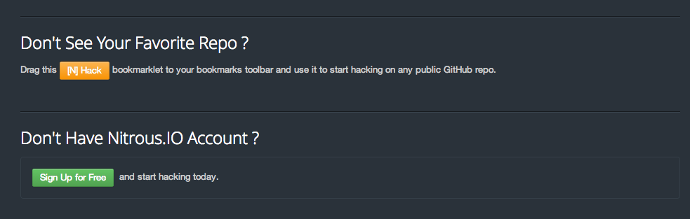
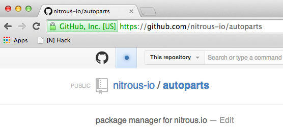

A few weeks ago, we launched the [Nitrous.IO Hack Button.](https://www.nitrous.io/hack?{{page.utm}})
The Hack Button allow developers to bring to life the code that is stuck in a Github repo by quickly
launching it into a clean cloud development environment.

Developers like you have used the hack button to launch thousands of repos from our launch partners in the last few weeks.
We've also seen new OSS projects and sample apps discover and [add the hack button to their repositories](https://www.nitrous.io/embed?{{page.utm}}) including the recently the popular
[Postman - A CLI Mailer utility](https://github.com/zachlatta/postman) written in [Go Lang](http://golang.org/) by
[Zach Latta at HackEDU](http://hackedu.us/?{{page.utm}})

### The Bookmarklet

Today, we're excited to launch [a companion bookmarklet](http://www.nitrous.io/hack?{{page.utm}}#bookmarklet) for Nitrous.IO users.

With the bookmarklet Nitrous.IO users can now clone any public Github repo even if the Repo
owner hasn't yet included a Hack Button. You can [get the bookmarklet here.](http://www.nitrous.io/hack?{{page.utm}}#bookmarklet)

<!--break-->

### Installation:

To install the bookmarklet simply drag the yellow button to your Browser's *Bookmarks Bar.*

### Using the Bookmarklet:

Browse to your favorite public Github Repository and then click on the *Bookmarklet* that you
created to launch that repository within a new Nitrous.IO Box.  

Follow the Prompts to login ([Sign up here for Free](https://www.nitrous.io/join/?{{page.utm}})) and
launch your repository in a Nitrous.IO box.

If you have any questions you [can reach out to us.](mailto:support@nitrous.io)
