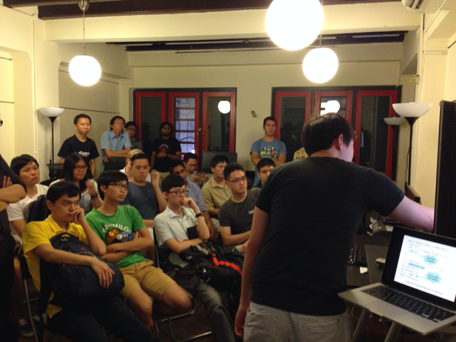

Singapore can now join the growing list of cities where a Go meetup has been
standing room only.  We at [Nitrous.IO](https://www.nitrous.io) recently got
our buckteeth on and organized a meetup for Singapore gophers on May 21.  We
were overwhelmed by the response!

Despite the event being announced a week in advance, there were at least 30
gophers/gophers-to-be squeezing into the Nitrous.IO Singapore office.  Many
local technology companies/offices were represented:
[Neo](http://www.neo.com/offices/singapore), [Pie](http://www.piethis.com/),
[Viki](http://viki.com), [Wego](http://wego.com), and more.

<!--break-->

## The Presentations

Since the meetup was organized very quickly, we were the only ones who had the
time to prepare talks. We hope to have other community members give talks at
future meetups, so please email us at
[hello+golang@nitrous.io](mailto:hello+golang@nitrous.io) with proposals or
ideas.

### An Introduction to Programming in Go

An inaugural meetup calls for an introduction to Go, a task Nitrous.IO CTO and
co-founder Peter Kim ([@raingrove](https://twitter.com/raingrove)) performed
with aplomb.  About half the attendees were new to Go, and his whirlwind tour
served them well.

The [slides for this
talk](https://speakerdeck.com/petejkim/an-introduction-to-programming-in-go)
are available on SpeakerDeck, or view them in the widget below.

### Static Analysis in Go

We wanted to cater for seasoned Go developers as well, so I prepared a session
on static analysis in Go, covering the `go/ast`, `go/parser`, etc standard
library packages and how they can be used for static analysis and even code
transformation in Go.

The source code and slides for this talk are also available at
[Bitbucket](https://bitbucket.org/keyist/static_analysis_in_go-slides).

## Recap

It was great to meet up with fellow Go fans of all levels.  From the Q&A
sessions after each talk it was clear that there are many topics to cover in
the future, particularly use cases for migrating existing services to Go.

## Where to go from here

For news on future Go meetups in Singapore, do join the [Singapore Gophers Facebook
group](https://www.facebook.com/groups/golang.sg/) .

If you want to try out Go without having to spend time installing it locally,
You can [sign up](https://www.nitrous.io?{{ page.utm }}) with Nitrous.IO for a
free development box in the cloud with Go pre-installed.
