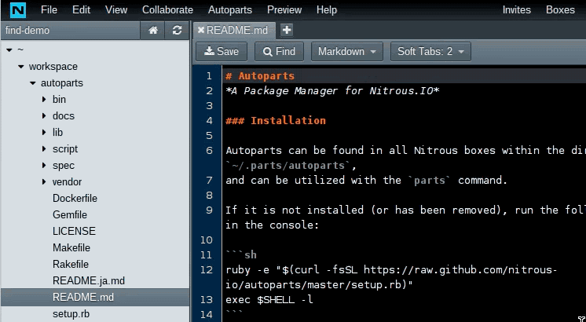
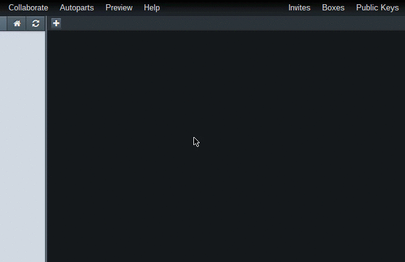
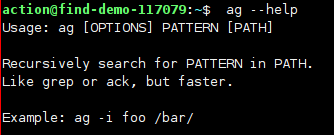

Once we started [leveling
up](http://blog.nitrous.io/2014/05/13/ide-improvements.html?{{ page.utm }}) our
Web IDE and received lots of positive feedback it was hard to stop.  Today we
would like to introduce our latest IDE improvement -- Find in Project.

You can now search across multiple directories in the IDE instead of just
within a file.  The results will be displayed in their own tab, where you can
navigate to the matching line immediately.

<!--break-->

### Finding your way around

Navigate in the IDE menu to `Edit > Find in Project`, or trigger it with
shortcut key `Cmd+Shift+F` (Mac) / `Ctrl+Shift+F` (Linux/Windows).

This will bring up a dialog.  Just type the term you would like to search for
and hit `Enter`.  The `Where` field is already populated for you with a
best-guess based on the file you currently have open.

If you want to search for a regular expression you have to explicitly enable
the `Regular Expression` option.  A slight inconvenience perhaps, but in return
you won't have to \e\s\c\a\p\e regex special characters!

Nitrous.IO has users worldwide, so unicode support is naturally a priority:

#### Whereby where is explained

Here's how the `Where` field is guessed: it will take the first subdirectory of
the 'top-level' directory, which is `workspace/` if the open file path is in
`workspace` or your home directory otherwise.

Some examples:

* if you are in `workspace/reponame/any/path/inside`, it will be `workspace/reponame`

* if you are in `$HOME/dotfiles/.vim/plugin`, it will be `dotfiles/`

* otherwise it will be your home directory, shown as "All files and folders".  This is also the default when you have no files open.

### Under the hood

`Grep`, or **G**lobally search **R**egular **E**xpressions and **P**rint is the
OG (Original Grep) command that sits atop the Unix search genealogy.  It's
spawned many offshoots, such as [ack](http://beyondgrep.com/) and [The Silver
Searcher](http://betterthanack.com/).  It is the latter that powers the Find in
Project feature.

> Aside: naturally a name like The Silver Searcher is asking to be trumped in the game of open source nominative one-upmanship, and unsurprisingly there is also a project named [The Platinum Searcher](https://github.com/monochromegane/the_platinum_searcher) which looks very promising.

We chose The Silver Searcher (command name `ag`) due to its speed and
flexibility.  Author [Geoff Greer](https://twitter.com/ggreer) has written many
detailed posts about how it's been optimized; my favorite is the one on
[adding
pthreads](http://geoff.greer.fm/2012/09/07/the-silver-searcher-adding-pthreads/).

For more advanced searching, you can try the `ag` command in your console.  It
is well-documented -- the `--help` flag provides more information than what is
shown below.

### More to come

This feature can help you search within the contents of files, but what if you
want to find a file by matching on its filename?  Our next IDE improvement will
do just that, and will be launching soon!
