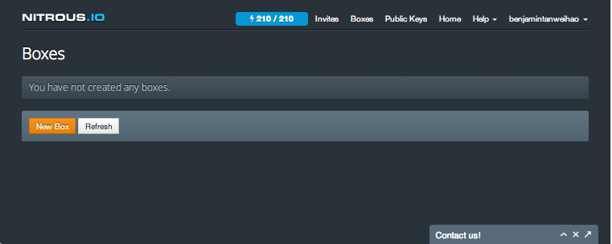
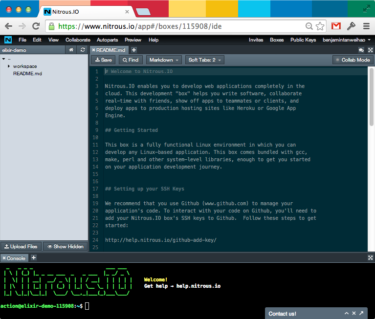
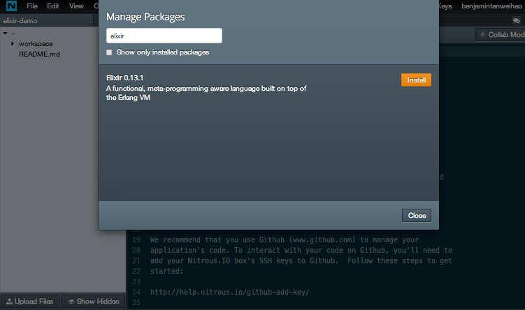
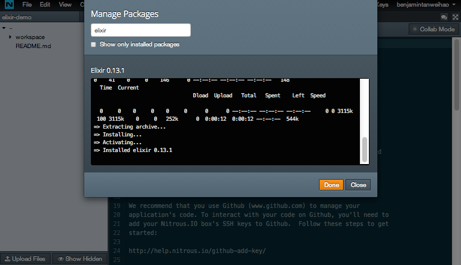
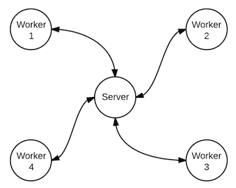
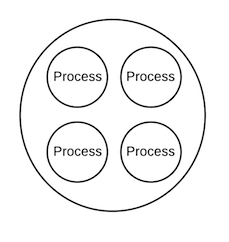
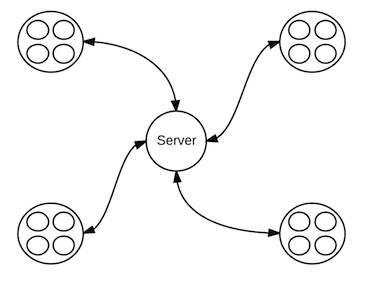
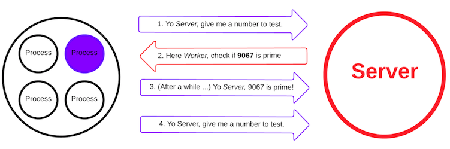

When you combine a magical potion with a compound that gives engines an additional boost, the result is going to be nothing short of awesome. In this article, I will introduce [Elixir](http://elixir-lang.org/). Instead of going through the basics (read: the boring stuff), we will learn how to implement a _distributed_ system that finds large primes.

## What is Elixir?

Here is how Elixir describes itself:


> Elixir is a functional, meta-programming aware language built on top of the Erlang VM. It is a dynamic language that focuses on tooling to leverage Erlang's abilities to build concurrent, distributed and fault-tolerant applications with hot code upgrades.

Elixir also comes with a [strong endorsement](http://joearms.github.io/2013/05/31/a-week-with-elixir.html) from none other than Joe Armstrong (creator of Erlang) himself:

> Elixir has a non-scary syntax and combines the good features of Ruby and Erlang. It’s not Erlang and it’s not Ruby and it has ideas of its own.

<!--break-->

## Getting Elixir installed

You can either spend a couple minutes setting up Elixir on
[Nitrous.IO](https://www.nitrous.io), or install Erlang and Elixir on your
local machine with [these
instructions](http://elixir-lang.org/getting_started/1.html).

If you choose the latter, [skip ahead](#just-enough-elixir) to the next section
when you're done.

## Elixir on Nitrous.IO

Once you're logged in to Nitrous.IO, create a new box:



Fill out a _name_ (i.e. `elixir-demo`), select your closest region and click "Create Box".


Notice that there isn't an Elixir template. In fact, you could pick _any_ template you want, because of a very nifty Nitrous.IO feature – [Autoparts](http://blog.nitrous.io/2013/09/18/introducing-autoparts-for-nitrous-io.html).

### Installing the Elixir Autopart

Once Nitrous.IO has completed provisioning your new box you will be greeted by a combination IDE and terminal interface:



To install the Elixir autopart, navigate to `Autoparts > Manage Packages` in the IDE menu. Next, search for "elixir" and hit install:



Installation took less than 5 minutes for me. Once the install is complete, you will see:



Click done to close the window. We can check if the install went smoothly by checking for the version of Elixir installed in the console:

```
action@elixir-demo-115908:~$ elixir -v
Elixir 0.13.1
```

Woot! Not too shabby for minimal time investment.

<a name="just-enough-elixir"></a>

## _Just Enough_ Elixir

Before we get to the fun bits, let's go through some important Elixir concepts to help you understand the code better later on.

### Processes and the Actor Concurrency Model

Erlang (and therefore Elixir) uses the Actor Concurrency Model. This means:

1. Each actor is a process.
2. Each process performs a specific task.
3. To tell a process to do something, you need to send it a message. The process can also reply by sending back another message.
4. The kinds of messages a process can act upon is specific to the process
itself. In other words, messages are pattern matched.
5. Other than that, processes do not share any information with other processes.

Let's illustrate this with code. In the IDE, right-click on `workspace` and select `New File`. Name the file `shouter.ex`, type or copy-paste the below, and `Save`.

```elixir
defmodule Shouter do

  def start do
    spawn(__MODULE__, :loop, [])
  end

  def send_message(to_pid, from_pid, msg) do
    send(to_pid, {from_pid, msg})
  end

  def loop do
    receive do
      {sender_pid, msg} ->
      IO.puts "#{inspect sender_pid} said: #{String.upcase msg}!!!"
    end
    loop
  end

end
```

Nitrous.IO currently doesn't come with syntax highlighting for Elixir, but I found Ruby to be a pretty close match. 

Now let's try to execute this program. Elixir comes with its own interactive console called `iex`. It is the equivalent of `irb`, `ipython`, etc.

In the console, navigate to the workspace directory and run the program:

```
action@elixir-demo-115908:~$ cd workspace/
action@elixir-demo-115908:~/workspace$ iex shouter.ex
Erlang/OTP 17 [erts-6.0] [source] [64-bit]
Interactive Elixir (0.13.1) - press Ctrl+C to exit (type h() ENTER for help)                                     
iex(1)>       
```

Let's see how this program works. Create a `Shouter` process:

```
iex(1)> w1 = Shouter.start
#PID<0.48.0>  
```

Congratulations! You have just created your first Elixir process. The return value is the process id, or _pid_ for short, and has been assigned to `w1`.

Note that you will most likely have a different pid compared to the examples. Pids serve as a _reference_ to processes. You can think of it like object references in object-oriented programming languages such as Ruby or Java.

Let's take a close look at the `start` function:

```elixir
defmodule Shouter do

  def start do
    spawn(__MODULE__, :loop, [])
  end
  
  # ...
end
```

In Elixir, processes are created using the `spawn` built-in function. It takes in a _module_, which is represented here by `__MODULE__`. This expands to `Shouter` in this example. The second argument is the `function`, followed by the list of arguments to pass to the function.  Since `loop` does not take in any arguments, we pass in an empty list. As noted previously, the return value of the `spawn` function is a pid.

Let's create another process.

```
iex(2)> w2 = Shouter.start
#PID<0.50.0>  
```

Recall that processes communicate with each other by sending messages. Let's do that now. We will send a message _from_ `w1` to `w2`:

```
iex(3)> Shouter.send_message(w1, w2, "Ohai, NitrousIO!")
#PID<0.50.0> said: Ohai, NitrousIO!
{#PID<0.50.0>, "OHAI, NITROUSIO!!!!"}  
```

You can even send a message to the same process:

```
iex(4)> Shouter.send_message(w1, w1, "I'm so lonely ...") 
#PID<0.48.0> said: I'm so lonely ...
{#PID<0.48.0>, "I'M SO LONELY ...!!!"}
```

#### Sending Messages

Now, we can take a close look at `send_message` and `loop`.

```elixir
def send_message(to_pid, from_pid, msg) do
  send(to_pid, {from_pid, msg})
end
```

The `send_message` function above is a thin wrapper for `send`, a built-in function. The first argument of `send` is the pid of the process you want to send the message to. The second argument is the process. The message can be a variety of things. It can be a string, a number, another pid, or in this case, a tuple. Tuples are data types which can contain things of potentially different types. Our message is the tuple `{pid, message}`.

So far, we've covered the sending part. Now, let's see how messages are _received_.

#### Receiving Messages

Recall how a process is started. We call the `start` function, which then calls the `spawn` function. The `spawn` function executes a function that runs in the newly created process. In this case, this function that runs in the newly created process is `loop`:

```elixir
def loop do
  receive do
    {sender_pid, msg} ->
      IO.puts "#{inspect sender_pid} said: #{String.upcase msg}!!!"
  end
  loop
end
```

Incoming messages are processed in a `receive` block. When a message is received, it is _pattern matched_. Pattern matching means that the "shape" of incoming message is compared with the pattern defined within the message block. In `loop`, for example, we only process messages that are 2-element tuples.

Notice that after the process is `receive`-ed, `loop` is recursively called. This is necessary. If the recursive call is omitted, then the process will exit since there is nothing left to do and subsequently be garbage collected.

Messages must include the pids within the message payload in order to facilitate back and forth communication between the sender and receiver,

We'll demonstrate this with an `Echo` module.  Create a new file called `echo.ex`:

```elixir
defmodule Echo do

  def start do
    spawn(__MODULE__, :loop, [])
  end

  def send_message(to_pid, from_pid, msg) do
    send(to_pid, {from_pid, msg})
  end

  def loop do
    receive do
      {sender_pid, msg} ->
        IO.puts "#{inspect sender_pid} said: #{msg}"
        send(sender_pid, {self, msg})
    end
    loop
  end

end
```

This is very similar to `Shouter`.  The difference: when a message is received, in addition to printing out a message, the receiver replies to the sender with another message, `{self, msg}`. `self` is the pid of the current process, i.e. the process which received the initial message.

Let's run `echo.ex`:

```
action@elixir-demo-115908:~/workspace$ iex echo.ex 
iex(1)> w1 = Echo.start 
#PID<0.48.0> 
iex(2)> w2 = Echo.start
#PID<0.50.0> 
```

Can you guess what happens if we send a message from `w1` to `w2`?

```
iex(3)> Echo.send_message(w1, {w2 "To infinity ... and beyond!"})
#PID<0.48.0> said: To infinity ... and beyond!
#PID<0.50.0> said: To infinity ... and beyond!
#PID<0.48.0> said: To infinity ... and beyond!
#PID<0.50.0> said: To infinity ... and beyond!
#PID<0.48.0> said: To infinity ... and beyond!
#PID<0.50.0> said: To infinity ... and beyond!
#PID<0.48.0> said: To infinity ... and beyond!
#PID<0.50.0> said: To infinity ... and beyond!
#PID<0.48.0> said: To infinity ... and beyond!
#PID<0.50.0> said: To infinity ... and beyond!
#PID<0.48.0> said: To infinity ... and beyond!
#PID<0.50.0> said: To infinity ... and beyond!
#PID<0.48.0> said: To infinity ... and beyond!
#PID<0.50.0> said: To infinity ... and beyond!
#PID<0.48.0> said: To infinity ... and beyond!
#PID<0.50.0> said: To infinity ... and beyond!
#PID<0.48.0> said: To infinity ... and beyond!
#PID<0.50.0> said: To infinity ... and beyond!
...
```

Oops. To exit, `Ctrl` and `C` twice again.

## Distributed Elixir

Now the _real_ fun begins. Elixir is great for building distributed systems. One of the reasons for this is _location transparency_ of pids. This means that it doesn't matter to the programmer if the message being sent to a process lives on a local or remote node.

### What We will be Building

We will build a _distributed_ system that check for prime numbers. In order to demonstrate this, we make use of Elixir's (the Erlang virtual machine, really) distribution capabilities. That is, the ability to easily connect nodes (different virtual machines) together to form a cluster.

Here is a conceptual diagram of how everything works:



The distributed system consists of 2 main parts, the _server_ and one or more _workers_. The server's main job is to hand out a number to be tested for primality (when requested by the worker), and to keep track of the highest prime number found. The worker's job is to test if the number is prime and report back to the server.

### A Worker Node

Each worker node can consist of _one or more_ processes.



A process created in the Erlang VM (and therefore Elixir) is _not_ the same as a process created by the operating system. Erlang VM processes are much more lightweight, and only take microseconds to [create](http://citeseerx.ist.psu.edu/viewdoc/download?doi=10.1.1.116.1969&rep=rep1&type=pdf). In fact, the Erlang VM can support up to 13.4 billion(!) processes.

So here's a revised diagram:



This shows a cluster of worker nodes connected to the server. More importantly, each of these worker nodes consist of multiple processes, each of which _independently_ requests for a number to test from the server, checks for primality, and replies the server.


### The Conversation Between the Worker and Server

We now take a closer look at the conversation that is going on between the worker and server.

Let's pick any process. This process begins by sending a message to the server. When the server receives a message from the worker, it will then reply with a number to test. Once the worker receives a reply, it can check the number for primality, and send the result to the server. Subsequently, the worker can request another number, and the cycle repeats.

It is important to realize that this conversation is asynchronous. At no point does the server have to wait for the worker's reply.



## Implementation

Create a new folder `primy`. Then, create 2 files, calling them `server.ex` and `worker.ex`.

### `server.ex`

Here's the server implementation:

```elixir
defmodule Server do

  def start do
    pid  = spawn(__MODULE__, :loop, [1, 1])
    :yes = :global.register_name("server", pid)
    pid
  end

  def loop(number, highest_prime) do
    receive do
      {:request, worker_pid} ->
        send(worker_pid, number)
        loop(number+1, highest_prime)

      {true, candidate_highest_prime} ->
        if candidate_highest_prime > highest_prime do
          IO.puts candidate_highest_prime
          loop(number, candidate_highest_prime)
        else
          loop(number, highest_prime)
        end

      {false, _} ->
        loop(number, highest_prime)
        
    end
  end

end
```

This is slightly more complicated than the previous examples. Let's start from the top.

```elixir
def start do
  pid  = spawn(__MODULE__, :loop, [1, 1])
  :yes = :global.register_name("server", pid)
  pid
end
```

As usual, we spawn a process. This time, we pass 2 arguments into the loop function: the number to begin with, and the highest prime calculated so far.

The second line globally associates `"server"` with the spawned server pid. This means that all connected nodes can use `server` to refer to the server instead of using its pid.

The server can receive 3 different kinds of messages from the worker:

#### 1. A Request for a Number

```elixir
receive do
  {:request, worker_pid} ->
    send(worker_pid, number)
    loop(number+1, highest_prime)
  # ...
end
```

A worker can request a number by sending a message of the form `{:request, worker_pid}`. The server handles this by sending a message back to the `worker_pid` with the number. After that, it increments `number`, and leaves `highest_prime` unchanged.

#### 2. A Prime Number has been found

```elixir
receive do
  # ...
  {true, candidate_highest_prime} ->
    if candidate_highest_prime > highest_prime do
      IO.puts candidate_highest_prime
      loop(number, candidate_highest_prime)
    else
      loop(number, highest_prime)
    end
  # ...
end
```

When a prime number has been found, a worker sends to the server the message that contains a tuple `{true, number}`. The server checks if this is the highest prime number found. If so, it loops, this time leaving `number` unchanged, but replacing `highest_prime` with `candidate_highest_prime`.

##### 3. A Prime Number has not been found

```elixir
receive do
  # ...
  {false, _} ->
    loop(number, highest_prime)
end
```

If the given number to the worker is not prime, then the tuple `{false, number}` is returned. In this case, it doesn't matter what the number is, so `_` is used to ignore the second value. `number` and `highest_prime` are left unchanged.

### `worker.ex`

Here's the full implementation of the worker:

```elixir
defmodule Worker do

  def start do
    pid = spawn(__MODULE__, :loop, [])
    send(server_pid, {:request, pid})
    pid
  end

  def server_pid do
    :global.whereis_name("server")
  end

  def loop do
    receive do
      number -> 
        if result = is_prime?(number, 5) do
          IO.puts number
        end
        send(server_pid, {result, number})
        send(server_pid, {:request, self})
        loop
    end
  end

  def is_prime?(_, 0) do
    true
  end

  def is_prime?(p, n) do
    if fermat(p) do
      is_prime?(p, n-1)
    else
      false
    end
  end

  def fermat(1), do: true

  def fermat(p) do
    r = :random.uniform(p-1)
    t = mpow(r, p-1, p)

    if t == 1 do
      true
    else
      false
    end
  end

  def mpow(n, 1, _) do
    n
  end

  def mpow(n, k, m) do
    mpow(rem(k, 2), n, k, m)
  end

  def mpow(0, m, k, m) do
    x = mpow(m, div(k, 2), m)
    rem(x*x, m)
  end

  def mpow(_, n, k, m) do
    x = mpow(n, k-1, m)
    rem(x*n, m)
  end

end
```

The bulk of `worker.ex` is functions that help calculate whether a number is prime. [Fermat's primality test](http://en.wikipedia.org/wiki/Fermat_primality_test) is used.

The important bits are the first 3 functions.

```elixir
def start do
  pid = spawn(__MODULE__, :loop, [])
  send(server_pid, {:request, pid})
  pid
end
```

The `start` function spawns a new worker process. It then sends a message to the server to request a number. Again, notice that the newly spawned `pid` is passed in as part of the message. The return value of the `start` function is the `pid` of the spawned worker.


```elixir
def server_pid do
  :global.whereis_name("server")
end
```

This is a convenience function to return the pid of the server, which as you might recall, is globally registered with the name `server`.

```elixir
def loop do
  receive do
    number -> 
      if result = is_prime?(number, 5) do
        IO.puts number
      end
      send(server_pid, {result, number})
      send(server_pid, {:request, self})
      loop
  end
end
```

Workers only receive one kind of message from the server – a number. When a number is received, the worker checks if the number is prime. If so, it prints it out to standard output. Then, it sends 2 messages to the server. First, is the result, either `{true, number}` or `{false, number}`. Once it reports the result to the server, it sends another message to the server to request for the next number to process. Finally, it loops itself again.

### Setting Up the Cluster

Quit any existing Elixir sessions you have, then open 3 consoles. Remember to navigate to the `workspace/primy` directory in each of them.

In console 1:

We start `server.ex` with the `--sname` (short name) flag and give it a name `server`. This name is needed to uniquely identify the node in the cluster.

```
action@elixir-demo-115908:~/workspace/primy$ iex --sname server server.ex
iex(server@elixir-demo-115908)1>
```

In console 2:

```
action@elixir-demo-115908:~/workspace/primy$ iex --sname w1 worker.ex
iex(w1@elixir-demo-115908)1>
```

In console 3:

```
action@elixir-demo-115908:~/workspace/primy$ iex --sname w2 worker.ex
iex(w2@elixir-demo-115908)1
```

Notice that now your `iex` prompt consists of the server name along with the host name. The next thing now is to link up the nodes together. I will do this in console 1, although you could try this in any console. First, note what are the node name and host names. Therefore, in order to connect to both the `w1` and `w2` worker nodes:

```
iex(server@elixir-demo-115908)1> Node.connect :'w1@elixir-demo-115908'
true
iex(server@elixir-demo-115908)2> Node.connect :'w2@elixir-demo-115908'
true
```

If you get `false`, most probably there's a typo. Now on _each_ of the consoles, try this:

```
iex> Node.list
```

In console 2 for example, you will see:

```
iex(w1@elixir-demo-115908)1> Node.list                                                                           
[:"server@elixir-demo-115908", :"w2@elixir-demo-115908"] 
```

On the other hand, in console 3, you will see:

```
iex(w2@elixir-demo-115908)1> Node.list
[:"server@elixir-demo-115908", :"w1@elixir-demo-115908"]
```

Just like that, we have a cluster!

### Running Primy

In console 1, start the server:

```
iex(server@elixir-demo-115908)3> Server.start
#PID<0.64.0>
```

At this point, the server is simply waiting in a loop for worker requests.

In console 2, let's start a worker:

```
iex(w1@elixir-demo-115908)> Worker.start
```

You will now see a stream of prime numbers. You can also see these numbers appearing in console 1.

Switch to console 3 and start a worker:

```
iex(w2@elixir-demo-115908)> Worker.start
```

You should also see a stream of prime numbers. Two things to note: each worker is processing a different prime number, and the numbers printed in console 1 need not come in increasing order.

Now, have a little fun and create more workers on each node. You can even repeat the above process and add more nodes.

## Thanks for Reading!

If you had made it this far, give yourself a pat on the back.

Hopefully you spent very little time setting up your Elixir development environment with Nitrous.IO and were able to focus on learning about distributed systems!  When I first used Nitrous.IO, I was extremely impressed with the time I was able to save.

Computing prime numbers may be trivial, but the goal here was to illustrate the _structure_ of a distributed system in Elixir.  Consider some of the problems you have solved in the past, and think about how they can be modelled with the Actor Concurrency Model and message passing.

## Want To Learn More?


I hope you had some fun learning about Elixir and diving straight into building a simple distributed system. If you want to learn more, __you should definitely check out my latest book__ (to be released around July 2014), [__The Little Elixir and OTP Guidebook__](http://www.exotpbook.com), where I show you how to build programs using Elixir and OTP. (__Hint__: _Launch Day Discounts!_)

OTP is a battle-tested framework (the source of Erlang’s greatness) that enables you to build fault-tolerant and scalable applications. 

Some of the example projects you will build: a parallel task distributor, a complete Tic-Tac-Toe Game and a distributed, fault-tolerant cache. If you have been meaning to do something useful with functional programming or simply itching for a fun weekend side-project, then this book might just be for you.

Come rediscover the joy of programming and what it feels like to be a beginner again!

## About the Author

Benjamin Tan is the Technical Director at Qisahn.com Pte Ltd, a video game retailer based in Singapore. Deathly afraid of being irrelevant, he is always trying to catch up on his ever-growing reading list. He [blogs](http://benjamintanweihao.github.io/), [codes](https://github.com/benjamintanweihao) and [tweets](https://twitter.com/bentanweihao).

### Credits

The inspiration for Primy comes from Johan Montelius' [course](http://web.it.kth.se/~johanmon/dse.html) on Distributed Systems in Erlang.
