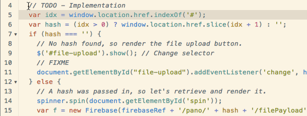
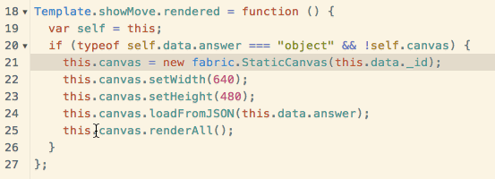
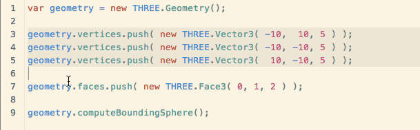

We are excited to announce the support for multiple cursors and selections in the Web IDE. We hope this will make Web IDE more useful and productive for your day to day usage.
For example, now you can quickly alter whitesapce/indentation or apply same edit to multiple places in a document.

If you are switching from a desktop editor like Sublime Text, you will find conventions are similar to what you're already used to.

## How do I make multiple selections?

There are two ways you can multiple selections.

* Hold down the <kbd>CMD</kbd> (OS X) or <kbd>CTRL</kbd> (Windows) and make selections.

To select an entire line simply click on the gutter.

* Hold down the <kbd>ALT</kbd> key and drag to make a rectangular(column) selection.

If you want to add a rectangular selection to an existing multiple selection, use <kbd>CMD + ALT</kbd> instead.

<!--break-->

## Can I just use the keyboard?

Yes, you can make multiple selections and edits only using the keyboard. Use <kbd>Shift</kbd> and arrows to make your selection.
Then press <kbd>CTRL + SHIFT + L</kbd> to split the selection into lines.

## How do I undo or remove selections?

To undo the last selection use <kbd>CMD + U</kbd>  (OS X) or <kbd>CTRL + U</kbd> (Windows). If you want to remove all previous selections leaving the last one intact, press <kbd>ESC</kbd>.

## Try and give us feedback

We've been shipping bunch of [Web IDE related updates](http://blog.nitrous.io/categories/announcements.html) in the last couple of weeks based on your feedback.
Give them a try and feel free to provide us any [feedback](https://twitter.com/n2osupport) you got.
