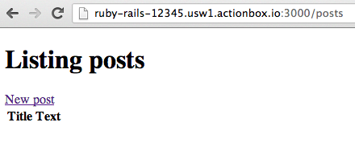
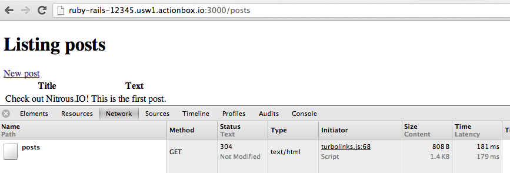

Rails 4.0 incorporates many new features, today of which we will take a look at Strong Parameters and Turbolinks. This guide closely follows the [rubyonrails.org guide](http://edgeguides.rubyonrails.org/getting_started.html), so please view this guide if you need a more in depth explanation on how everything runs. This guide focuses just on building an app on [Nitrous.IO](http://nitrous.io) with the new Rails 4.0 features.

### Prerequisites

* An external database. You can either setup an a SQLite database, or if you prefer to use Postgres then take a look at the [Postgres blog post](http://blog.nitrous.io/2013/02/11/postgres-action-io-3.html#database).
* An [Nitrous.IO account](https://nitrous.io)
* A [Box](http://help.action.io/customer/portal/articles/802603-create-a-box) on Nitrous.IO. Creating a new Ruby box will include ruby 2.0.

### Create an Application on your Nitrous.IO Box

In: [Nitrous.IO](https://nitrous.io)

You will first need to install the 'rails' RubyGem on your Nitrous.IO box:

    $ gem install rails

First we will create a blog application. If you are going to setup with Postgres, use this command instead to install the postgres gem along with the app creation. Else, exclude '-d postgresql' from the command:

    $ rails new blog -d postgresql
        
Switch to the blog folder to continue working on this app:

    $ cd blog

### Create a Development Database

We have previously released a [blog post](http://blog.nitrous.io/2013/02/11/postgres-action-io-3.html#Create a Development Database on Heroku Postgres) on how to create a Postgres database on Heroku. You can follow [this guide](http://blog.nitrous.io/2013/02/11/postgres-action-io-3.html#Create a Development Database on Heroku Postgres) if you choose to build a postgres database, else you will want to setup SQLite if that is your preferred method.

If you followed the Postgres guide in the [blog post](http://blog.nitrous.io/2013/02/11/postgres-action-io-3.html#Create a Development Database on Heroku Postgres), stop after you have configured your database.yml file and come back to this guide.

### Create Controllers and Routes

Assuming you have created a database and setup the development connection settings in the config/database.yml file, you can now test out the app to ensure it is running. Run the server with the following command:

    $ rails server
    
Once the app is running, you can view it by navigating to Preview > Port 3000 in your Nitrous.IO IDE. Ctrl + C will stop your server if pressed in the terminal.

Now we are ready to create a controller:

    $ rails generate controller welcome index

Next you will want to edit app/views/welcome/index.html.erb , and delete all of the code and replace it with the following:

    <h1>Hello, Rails!</h1>
    <%= link_to "My Blog", controller: "posts" %>

Let's setup the route to your homepage, and add the posts resource. Open the file config/routes.rb and replace the text with the following:

    Blog::Application.routes.draw do
      
      resources :posts
      
      root "welcome#index"
    end

At this point, test the index page by running 'rails start' in your console, and in your IDE menu bar navigating to Preview > Port 3000. The "My Blog" link isn't configured at this point, but we will set this up in the following steps.

Next, create a controller called PostsController with the following command:

    $ rails g controller posts

This builds a post controller, but we will need to include a template for our app. Create the file app/views/posts/new.html.erb and insert the following text:

    <%= form_for :post, url: posts_path do |f| %>
        

          <%= f.label :title %> 
          <%= f.text_field :title %>
        

 
        

          <%= f.label :text %> 
          <%= f.text_area :text %>
        

 
        

          <%= f.submit %>
          

    <% end %>
    <%= link_to 'Back', posts_path %>
        
### Creating the Post Model with Strong Parameters

To create a new post model, run this command in your terminal:

    $ rails generate model Post title:string text:text

This will setup a migration file which you can now run the rake command to initiate:

    $ rake db:migrate

We will now use the new feature [Strong Parameters](http://weblog.rubyonrails.org/2012/3/21/strong-parameters/) and will include private method in the posts controller. This will prevent an attacker from setting the model's attributes by manipulating the hash passed to the model.

Edit the file app/controllers/posts_controller.rb to contain the following code:

    class PostsController < ApplicationController
      def new
      end
      
      def show
        @post = Post.find(params[:id])
      end
      
      def index
        @posts = Post.all
      end
      
      def create
      @post = Post.new(post_params)
 
      @post.save
      redirect_to @post
    end
 
    private
      def post_params
        params.require(:post).permit(:title, :text)
      end
    end
    
Notice how the Strong Parameters feature now includes permit in the post_params method. This allows the app to accept both title and text when making a post.

Create the file app/views/posts/show.html.erb with the following code:

    

      <strong>Title:</strong>
      <%= @post.title %>
    

 
    

      <strong>Text:</strong>
      <%= @post.text %>
    

    <%= link_to 'Back', posts_path %>

You will also want to create a view for viewing all of the posts. Create the file app/views/posts/index.html.erb with the following text:

    <h1>Listing posts</h1>
 
    <%= link_to 'New post', new_post_path %>
    <table>
      <tr>
        <th>Title</th>
        <th>Text</th>
      </tr>
 
      <% @posts.each do |post| %>
        <tr>
          <td><%= post.title %></td>
          <td><%= post.text %></td>
        </tr>
      <% end %>
    </table>

Now your app should be able to create a new post. Run 'rails server' in your project folder again and preview your app again. Now when you click on the 'My Blog' link, you should be taken to a Listing posts page which looks like the following:

### Using Turbolinks to Your App

Turbolinks is a controversial feature in Rails 4 designed to make app navigation faster in the browser. This feauture should be enabled by default in Rails 4, and you can verify this by ensuring the following line is in your Gemfile:

    gem 'turbolinks'
    
You will also want to ensure /app/assets/javascripts/application.js contains the following line:

    //= require turbolinks
    
This feature only runs on the latest browsers, so if you are using an older browser than this feature will be automatically disabled. In this example we are going to be using the  [Chrome Developer Tools](https://developers.google.com/chrome-developer-tools/) to evaluate the network performance.

Run your app again with 'rails start', and then preview the app by navigating in your [Nitrous.IO](https://www.nitrous.io) IDE to Preview > Port 3000. From here you will want to click the link "My App" to navigate to the posts controller. Notice in the screenshot how the pages are handled by the initiator turbolinks.js.

This makes the pages appear to load faster, as the browser doesn't have to re-render the JavaScript and CSS each time the page loads.

Let us know how your app is working out! If you're having trouble, you can get in touch with us by visiting our [chatroom](https://nitrous.io/chat) or by [emailing us](mailto:help@nitrous.io).