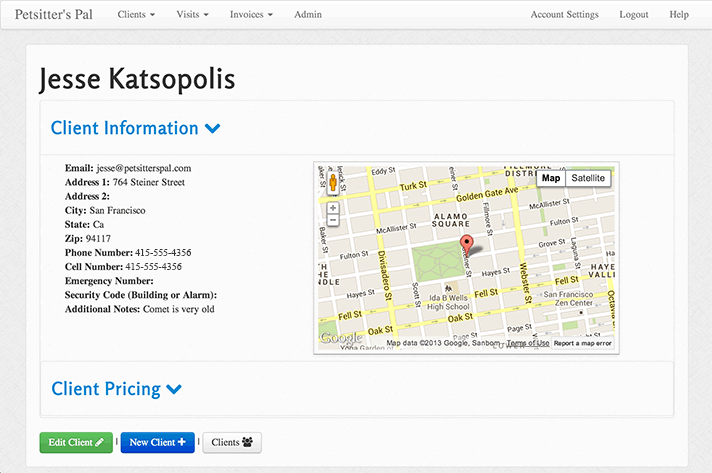

##### We interviewed Shaun McAvinney. He spent 1 year learning Ruby on Rails and developed [Pet Sitter's Pal](http://www.petsitterspal.com/) solely on Nitrous.IO.

### Tell me about how you came to develop Pet Sitter's Pal.

My sister is a pet sitter. She does a lot of business and has 5 people working for her as walkers. At a family gathering she was complaining about how much time scheduling, invoicing and managing clients takes her. She used some software that is outdated, overpriced, and too bloated for her needs. I had been looking for a project to work on, so I told her I'd give it a shot.

### What was your experience with coding before using Nitrous?

My career is in sales and client support. My experience with coding in the past was writing simple scripts to scrape sites or other basic stuff. I had written a few simple rails apps, although they barely deviated form the tutorials they were based on.
<!--break-->
### How did you utilize Nitrous.IO to learn Ruby on Rails, and what other resources did you use?

Using Nitrous closed the feedback loop for me. I was able to get started right away, without needing to set up a dev environment first. It had been a while since I had programmed anything, so I was initially prepared to go through the first chapter of every tutorial, installing rails, but it was already there. 

I relied heavily on [Railscasts](http://railscasts.com/) and [stackoverflow](http://stackoverflow.com/) for help throughout this project. If either of those resources didn't exist, [Pet Sitter's Pal](http://www.petsitterspal.com/) would have never launched. Sometimes I would search the comments on [Railscasts](http://railscasts.com/),  and get linked to [stackoverflow](http://stackoverflow.com/), or vice-versa. 

Another great resource was [Github](http://www.github.com). If I was trying to use a gem in a way not explicitly defined in the documentation, I would search [Github](http://www.github.com) repositories that were using the same gem, and see how those programmers wrote it. There are so many programmers that helped me without even knowing it.

### What do you code on Nitrous.IO?

The web app was built using Ruby on Rails, with SQLite in development and Postgres in production. I learned a lot of javascript while building this site; I had zero javascript experience previously, weird right?

Using Nitrous I also took part in a company hackathon, and won 3rd place! My company has a lot of experienced developers, so my hackathon partner, another non-dev, and I felt pretty great about our placing.

### What aspects of Nitrous do you love most?

I love that I can spin up a new box in seconds and start developing proof of concepts in minutes. 

Another sweet feature that I've used a lot is the ability to provide a public preview link of my app. With this I can show off the features currently in development to my partner. Videos and screenshots are great, but if your team is distributed, having the ability to spitball and play with design in real time is absolutely necessary.

I recommend using Nitrous to any new programmers, it removes all of the hiccups of installing the newest version of the programming language and framework, which can be tiresome depending on your OS, and the version of your OS. Nitrous gets all of that out of the way so you can just sit down and code.
