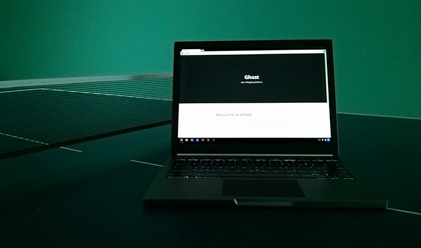
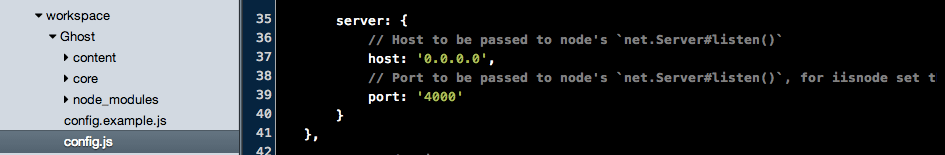
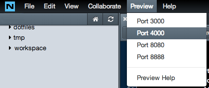
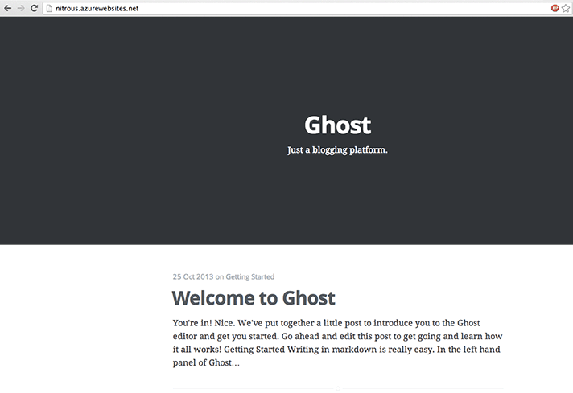

Ghost is a open source blogging platform which you can get up and running in minutes. The beauty of using it with Nitrous.IO is that you can add and edit a new post from any device, and you can easily add [collaborators](http://help.nitrous.io/collab/) to help you change the design and other content within the blog.

### Prerequisites

Before we get started, make sure you have the following:

* A [Nitrous.IO account](http://www.nitrous.io)
* A Node.JS box on Nitrous.IO
* A [Github account](http://www.github.com) which is [connected](http://help.nitrous.io/github-add-key/) to your Node box
* A [Windows Azure Subscription](http://www.windowsazure.com/en-us/pricing/free-trial/?ref=nitrous.io) (If you wish to host on a production server)
<!--break-->
### Installing Ghost

First you will need to navigate to your ~/workspace folder, and clone the [Ghost Github Repo](https://github.com/TryGhost/Ghost).

    $ cd ~/workspace
    $ git clone git@github.com:TryGhost/Ghost.git

Next, navigate into the project folder with `cd Ghost` and run the following commands:

    $ git submodule update --init
    $ npm install -g grunt-cli
    $ npm install

Your Nitrous box needs to have SASS and Bourbon installed which requires Ruby. Fortunately, Ruby is installed on the Node box for scenarios like this. Run the following commands to install these tools:

    $ gem install saas bourbon

Now you can run the following command to install Bourbon, compiles SASS and compile Handlebars templates within the project:

    $ grunt init

To be able to preview Ghost on your Nitrous box, you will need to change the development server to run on host: 0.0.0.0 and port 4000 (or any port between 1024-9999). In ~/workspace/Ghost/config.js , change the development settings to match the following:

Now it's time to start the server:

    $ npm start

To preview the blog, navigate in the Web IDE to Preview > Port 4000.

This will take you to a preview URL similar to `http://node-45072.usw1.actionbox.io:4000/`. If you are wanting to connect to the admin settings, add `ghost/` in the address bar to look similar to `http://node-45072.usw1.actionbox.io:4000/ghost/`.

>Ghost utilizes email for password resets, and it may prompt you to setup email. If you wish to do this then you will need to configure the `config.js` file to utilize [Mailgun](http://www.mailgun.com) or [Sendgrid](http://www.sendgrid.com) in the development settings.

### Editing and Creating Themes

Head over to Ghost's [theme documentation](http://docs.ghost.org/themes/) for information on how to do this. If you are looking for a developer to assist you with this, you can always add them as a [collaborator](http://help.nitrous.io/collab/) to your box, giving them the ability to make changes.

### Hosting Your Blog on Azure

Although you can keep your development session running with [tmux](http://help.nitrous.io/faq-disconnect/), we would recommend using a service such as [Windows Azure](http://www.windowsazure.com/).

If you haven't setup an account with Azure yet, do this now. [Sign up with Windows Azure](http://www.windowsazure.com/en-us/pricing/free-trial/?ref=nitrous.io).

#### Install Azure Command Line Interface (CLI)

Install the Azure CLI with the following command:

    $ npm -g install azure-cli 

#### Connect to your Azure subscription

Run the following command in the console to download your credentials from Azure: 
    
    $ azure account download

Open a new browser window and go to the link that is returned by the previous command. 
After you login, a `.publishsettings` credentials file will be downloaded to your machine. 

Upload this file to you Nitrous IDE using the [Upload Files button](http://help.nitrous.io/ide-file-uploads/) and run the following command replacing `pathto/mysubscription.pubishsettings` with the appropriate path to the credentials file:

    $ azure account import pathto/mysubscription.pubishsettings

#### Create a New Azure site

To create a new Azure Site cd to `~/workspace/Ghost` and run the following commands: 
    
    $ azure site create my_project_name --git
    $ azure site config add NODE_ENV=production

#### Configure Ghost for Azure

Ensure you are in `~/workspace/Ghost`. Prep your CSS and JS with the following command:

    $ grunt prod

Azure looks for `server.js` within the project folder instead of `index.js`. Let's make a copy by running the command below:

    $ cp index.js server.js

#### Deployment Settings in config.js

You will need to make the following changes in your `config.js` file to match the settings below:

		production: {
		    url: 'http://YOUR_SITE.azurewebsites.net/',
		    mail: {
		        transport: 'SMTP',
		        options: {
		            auth: {
		                user: 'AZURE_USERNAME',
		                pass: 'AZURE_PASSWORD'
		            }
		        }
		    },
		    database: {
		        client: 'sqlite3',
		        connection: {
		            filename: path.join(__dirname, '/content/data/ghost.db')
		        },
		        debug: false
		    },
		    server: {
		        host: '127.0.0.1',
		        port: process.env.PORT
		    }
		}

Also, comment out the following lines with # within your `.gitignore` file in the project folder:

		# /core/client/assets/css
		# /core/built
		# config.js

#### Deploying from Nitrous

To deploy simply push your committed code to Azure Sites with the following command:   

    $ git add .
    # git commit -m "Hello Ghost"
    $ git push azure master

You will now be prompted to enter in your Azure Account password.

Once the upload has finished you should see the message "Deployment Successful". 

You can view your Ghost site at `http://appname.azurewebsites.net`, and you can access your admin settings at `http://appname.azurewebsites.net/ghost/`.

That's it! How did it go for you? If you're having trouble, you can always get in touch with us by visiting our [chat room](https://www.nitrous.io/chat) or by [emailing us](mailto:support@nitrous.io).