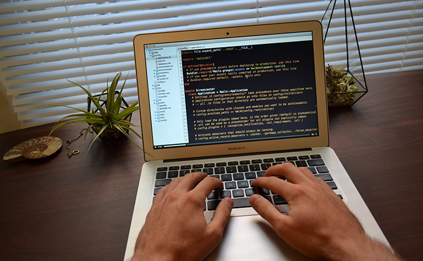
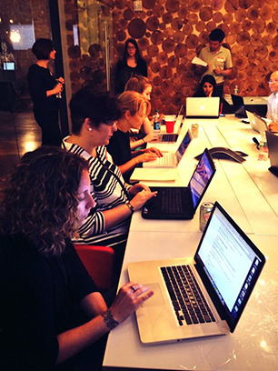
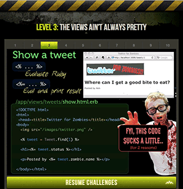

Have you been wanting to learn Ruby on Rails, but need to find the resources and time? Here is a good place to start. There are different strategies on getting started, and you can pick which ever method fits your lifestyle the best. Read more to get recommendations on the best resources for the following strategies:

* **Workshops**: Generally last for 1-2 days and they are scheduled by many different organizations. This is a great way to get down the basics as well as make connections with other like-minded developers.
* **Online Academies**: An online Academy can range from either a 2 - 12 week intensive course (for those serious about learning).
* **Free Online Tutorials**: Work at your own pace to learn as quickly as possible, or to learn whenever you have space time. These tutorials can be interactive or even include screen casts.
* **Read a Book**: What's wrong with picking up a book these days? There are many books which can be your best weapon in becoming a Ruby on Rails expert.

Keep this in mind while learning: If you are looking for a partner to collaborate with, [tweet](https://twitter.com/) with the hashtag `#pairwithme`. This can be used whether you are looking for a partner to code with, or if you are needing help on a project.

<!--break-->
### Attend an in Person Workshop

	

		

			We recently spoke with <a href="http://railsbridgenyc.org/?utm_source=nitrousio&utm_medium=blog&utm_campaign=learn-rails-article" target="_blank">RailsBridge NYC</a> whom used Nitrous.IO exclusively in their 2 day Workshop a couple weekends ago. RailsBridge is an organization which focus on increasing diversity in tech, and many of their workshops are to introduce Rails to women. The beginner workshops generally include students with little to no experience with computer programming topics, but there are also workshops where you will find programmers from a different backgrounds outside of Rails who are interested in broadening their knowledge base.
		

		

			Most workshops you attend will go over key points of the Ruby language, the MVC structure of Rails, and you will also build a sample app. There is an Installfest the day before in most occasions, but if Nitrous is utilized then you can start coding immediately :-)
		

		

		We recommend taking a look at the following workshops to see if any upcoming events are near you:
		

		<ul>
			<li>
		    <a href="http://www.bridgetroll.org/events?utm_source=nitrousio&utm_medium=blog&utm_campaign=learn-rails-article" target="_blank">RailsBridge</a>
		  </li>
		  <li>
		    <a href="http://railsgirls.com/events?utm_source=nitrousio&utm_medium=blog&utm_campaign=learn-rails-article" target="_blank">Rails Girls</a>
		  </li>
		  <li>
		    <a href="https://generalassemb.ly/education/introduction-to-ruby-on-rails-weekend-workshop?utm_source=nitrousio&utm_medium=blog&utm_campaign=learn-rails-article" target="_blank">General Assembly</a>
		  </li>
		</ul>
	

		

			
		

	To find other workshops in your area, take a look at what <a href="http://www.meetup.com/find/?keywords=Ruby+On+Rails&sort=recommended" target"_blank">meetup.com</a> has listed within their Ruby on Rails groups.

### Join an Academy (online or in person)

	If you are serious about becoming an expert Rails developer, you may want to dedicate some time (and money) into an academy. These academies range from hundreds of dollars for a course to thousands or dollars, and can last anywhere from 2 weeks to 12 weeks. Skill sets vary for each academy, but they generally start assuming you have little to no background with Ruby on Rails.

	We've spoken with the guys at <a href="http://academy.st/?utm_source=nitrousio&utm_medium=blog&utm_campaign=learn-rails-article" target="_blank">Startup Academy</a> who use Nitrous to help students get started quickly, and they gave us an insight on how their 8 week course works. Their goal is to help founders (or founders-to-be) learn a thing or two about building their own tech products. By equipping non-technical founders with some technical knowledge, their hope is to see more startups release their own minimum viable products and testing them in the market. Many of those who sign up are completely new to programming, but some have worked with other frameworks in the past. <a href="http://academy.st/?utm_source=nitrousio&utm_medium=blog&utm_campaign=learn-rails-article" target="_blank">Startup Academy</a> is an in person academy located in Singapore, and more information on their Rails course can be found on the <a href="http://academy.st/courses/rails" target="_blank">enrollment page</a>.

		

	
	Here are some online academies you may be interested in:

<ul>
  <li>
    <a href="https://learn.thoughtbot.com/workshops/20-intro-to-ruby-on-rails?utm_source=nitrousio&utm_medium=blog&utm_campaign=learn-rails-article" target="_blank">thoughtbot</a> (<a href="https://learn.thoughtbot.com/workshops/20-intro-to-ruby-on-rails?utm_source=nitrousio&utm_medium=blog&utm_campaign=learn-rails-article" target="_blank">beginner</a> or <a href="https://learn.thoughtbot.com/workshops/21-intermediate-ruby-on-rails?utm_source=nitrousio&utm_medium=blog&utm_campaign=learn-rails-article" target="_blank">intermediate</a>)
  </li>
  <li>
    <a href="http://www.gotealeaf.com/?utm_source=nitrousio&utm_medium=blog&utm_campaign=learn-rails-article" target="_blank">Tea Leaf Academy</a>
  </li>
  <li>
    <a href="https://rubyoffrails.com/?utm_source=nitrousio&utm_medium=blog&utm_campaign=learn-rails-article" target="_blank">Ruby Off Rails</a>
  </li>
</ul>

	For a directory of many more academies near you or online, give <a href="http://bootcamper.io/?utm_source=nitrousio&utm_medium=blog&utm_campaign=learn-rails-article" target="_blank">BootCamper</a> a visit. They do an amazing job at organizing all of the <a href="http://bootcamper.io/t/type/in-class">in class</a> and <a href="http://bootcamper.io/t/type/online?utm_source=nitrousio&utm_medium=blog&utm_campaign=learn-rails-article">online academies</a>, and it will take away the stress of finding which is right for you.

### Free (and Paid) Online Resources

	

		

			There are some great tools online that can help you Learn Ruby on Rails right away. We would recommend first picking up skills in Ruby, followed by understanding the Rails framework.
		

		

			Here are our favorite free online tutorial sites which we recommend:
		

		<ul>
			<li>
		    <a href="http://www.codecademy.com/?utm_source=nitrousio&utm_medium=blog&utm_campaign=learn-rails-article" target="_blank">Codecademy</a> (interactive Ruby tutorials)
		  </li>
		  <li>
		    <a href="http://railsforzombies.org/?utm_source=nitrousio&utm_medium=blog&utm_campaign=learn-rails-article" target="_blank">Rails for Zombies</a> (interactive Rails tutorials)
		  </li>
		  <li>
		    <a href="http://railscasts.com/?utm_source=nitrousio&utm_medium=blog&utm_campaign=learn-rails-article" target="_blank">Railscasts</a> (Ruby/Rails related screencasts)
		  </li>
		  <li>
		    <a href="https://peepcode.com/?utm_source=nitrousio&utm_medium=blog&utm_campaign=learn-rails-article" target="_blank">PeepCode</a> (Ruby/Rails related screencasts)
		  </li>
		</ul>

		

			Once you feel comfortable then you are ready to build your first app. Take a look at the <a href="http://blog.nitrous.io/2013/07/02/building-a-rails-4.0-app-on-nitrous-io.html?utm_source=nitrousio&utm_medium=blog&utm_campaign=learn-rails-article" target="_blank">Rails 4 guide</a> or <a href="http://www.sitepoint.com/nitrous-io-rails-development-cloud/?utm_source=nitrousio&utm_medium=blog&utm_campaign=learn-rails-article" target="_blank">Sitepoint's guide</a> to help build your first app on Nitrous.
		

	
		
	

			
	

### Read a Book!

	

		

			Books are still alive, and can still be a quicker reference than many online guides when it comes to understanding the fundamentals of languages and frameworks. These books are in my library and contain the essentials of learning Ruby on Rails:
		

		

			<ul>
				<li>
			    <a href="http://amzn.to/HrF7cn" target="_blank">The Ruby Programming Language</a> <a href="http://amzn.to/1hssivU" target="_blank">(Kindle)</a>
			  </li>
			  <li>
			    <a href="http://amzn.to/HrFpzS" target="_blank">Eloquent Ruby (intermediate)</a>  <a href="http://amzn.to/1gbnDz8" target="_blank">(Kindle)</a>
			  </li>
			  <li>
			    <a href="http://amzn.to/1aebFMX" target="_blank">Agile Web Development with Rails 4</a>
			  </li>
			</ul>
		

	

	

		
	

	Have any other suggestions? Let our <a href="mailto:support@nitrous.io">support team know</a>! We will keep this guide updated with the best resources on learning Ruby on Rails and would love to hear your suggestions.

