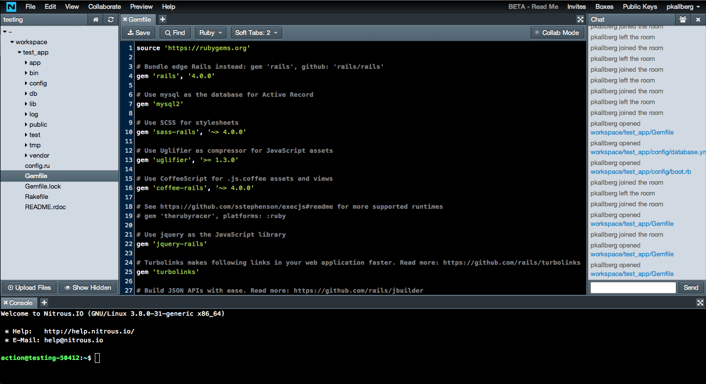
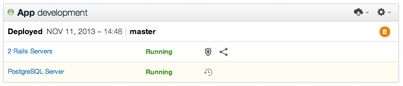

One of the challenges that we often hear from developers is the difficulty in managing the states of the various development and production environments they need to use on a regular basis. 

Nitrous.IO solves the problem with simple, repeatable configurations for development that can  transition easily into to the production environment. 

[Cloud 66](http://www.cloud66.com/?ref=nitrous.io) lets you take your Nitrous.IO environment and translate it into a production environment in over 60 datacenters globally. Here is a blog post that was orginally posted on the [Cloud 66 Blog](http://blog.cloud66.com/post/66768537459/development-in-the-cloud-with-nitrous-io?ref=nitrous.io) on how to set up Cloud 66 with [Nitrous.IO](http://nitrous.io/?utm_source=nitrous.io+utm_medium=blog).
<!--break-->

####Development in the Cloud with Nitrous.IO
We’re all developers here at Cloud 66 and we love learning about new tools that make our lives easier. One such tool is [Nitrous.IO](http://nitrous.io), which makes spending hours on end setting up local development environments a thing of the past. Working in the same environment as your team makes it a lot easier to replicate bugs and get to the root of a problem. 

The screenshot above shows the IDE - text editor, chat and console. Ultimately, a tool like Nitrous.IO cuts the cost and time sink associated with having a non-standard development environment. We believe that you can achieve further synergies by using our services in conjunction - Nitrous.IO takes care of your development environment and Cloud 66 helps you deploy and maintain your applications in the cloud. The screenshot below is an example of a stack on Cloud 66 with 2 app servers, a database server (with backups) and a load balancer.

####Cloud 66 + Nitrous.IO

We’ve made it really easy to deploy your code from a development environment like Nitrous.IO: 

1. Push your code to your git repository.
2. Create [a new stack on Cloud 66](http://help.cloud66.com/getting-started/your-first-stack.html?ref=nitrous.io).
3. Once your stack is created, you can use the [Cloud 66 toolbelt](http://help.cloud66.com/getting-started/toolbelt.html?ref=nitrous.io) to deploy straight from the command line. Simply add this code to your Gemfile and run `bundle install`:

        group :development do  
            gem ‘c66’
        end
4. Initiate the toolbelt by running `c66 init` and follow the authorization instructions.
5. Retrieve the list of your stacks: 
    `c66 list`
6. Deploy your stack with the latest code:
    `c66 deploy -s <stack_UID>`

There’s also so much more you can do with Cloud 66 - have a look at our [features page](https://www.cloud66.com/features/deploy?ref=nitrous.io) and [help pages](http://help.cloud66.com/?ref=nitrous.io) for more.