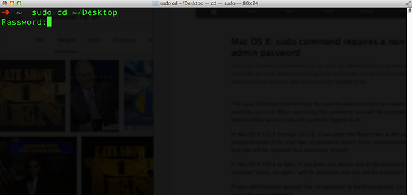
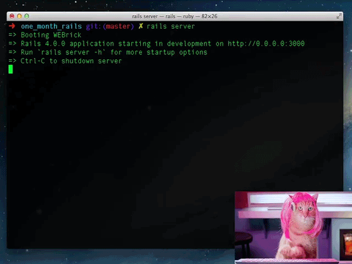
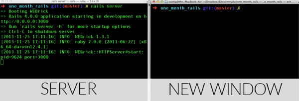
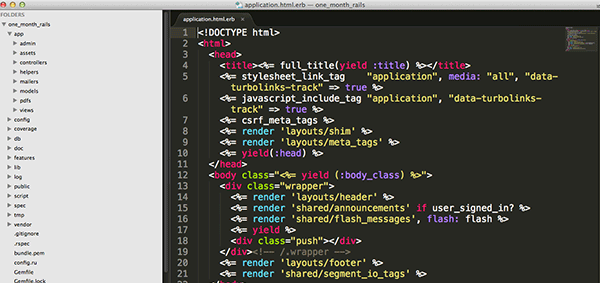
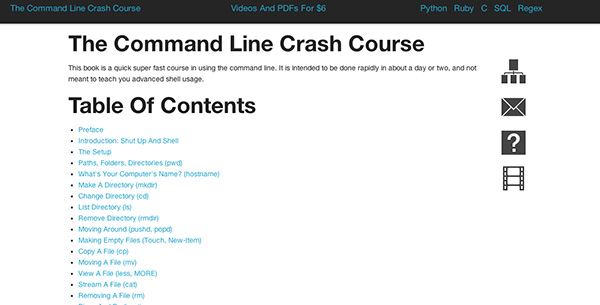
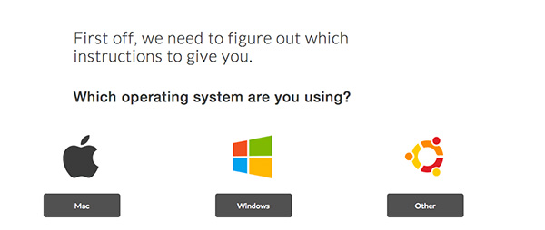
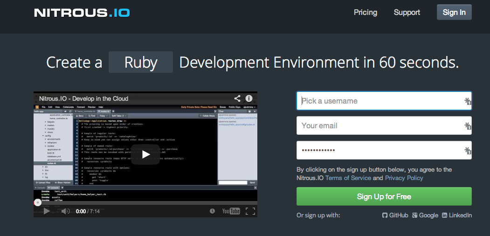

[Chris Castiglione](https://twitter.com/castig/{{page.utm}}) is a co-founder of One Month Rails. One Month Rails is focused on helping everyone
learn to code through step-by-step videos and detailed tutorials. He offers a perspective on the common mistakes
that people run into when installing Rails for the first time.

<!--break-->

Installing Rails on your own computer is tough! And even though there are <a href="http://installrails.com/{{page.utm}}" target="_blank">step-by-step guides</a>, and services where you can <a href="http://nitrous.io/{{page.utm}}" target="_blank">code right in the browser</a>... if it's your first time you'll likely run into these 5 problems:

###5) Thinking the invisible password field is broken

Occasionally the command line will prompt you for a password.

And when you begin typing, nothing happens! Not to worry! That's normal.
All you have to do is type in your password, and press enter.
Don't worry that you can't actually see your password.

###4) Attempting to Type Commands While the Server is Running

Each time you run "rails server" your command line is magically transformed into a server. Yes! How cool is that?

And maybe you're thinking, "Uh what does that mean?" Ok, it means that this window is running your application. And more importantly, it means you shouldn't type in this window anymore!!!! Bad kitty cat.

The correct thing to do is to open a new window. To open a new window press: `Command + T` (mac only) or select *New -&gt; Window*.
Whatever you do, don't close the server window: you'll need to have both of these windows open while you're developing.

##And now... the Third Mistake EVERYONE Makes When Installing Rails the first time:

###3) Thinking the text editor is the command line

This is the text editor. In the text editor you can write code in any language: HTML, CSS, Rails, CoffeeScript, etc.

But the one thing you can't write in the text editor? *Unix commands!*

One mistake students often make is typing commands into the text editor. No worries. Now you know to keep commands on the command line.

###2) Not Knowing Enough Unix Commands

Unix Commands can be scary if it's your first time... If you don't know any Unix commands I'd recommend <a href="http://cli.learncodethehardway.org/book/{{page.utm}}" target="_blank">Command Line Crash Course</a>.

Just complete the first 12 lessons of the crash course, that should be enough. And honestly, it won't take longer than an hour - so it's a great investment overall. 

##And.... the NUMBER ONE MISTAKE EVERYONE MAKES WHEN INSTALLING RAILS:

###1) Everything on your computer is out of date!
####Let me ask you a few questions:

* Do you have the latest version of Rails?
* Do you have the latest version of Ruby?
* Do you have the latest version of RVM?
* Do you have the latest version of Homebrew?
* Do you have the latest version of XCode?
* Do you have...

Installing a Rails environment can be a huge pain in the ass. The main reason is that everyone has a different operating system, and different versions of Rails, Ruby, RVM etc.

####Use <a href="http://www.InstallRails.com/{{page.utm}}" target="_blank">InstallRails.com</a> to install Ruby on Rails locally:

####Or skip the setup altogether and use <a href="http://nitrous.io/{{page.utm}}" target="_blank">Nitrous.IO to code in your browser.

</a>