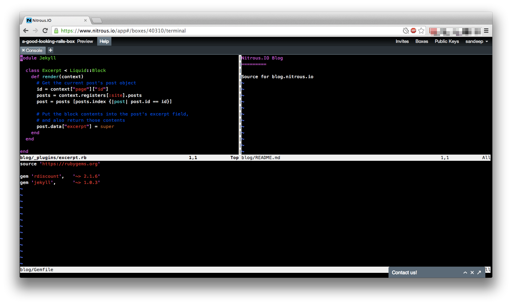
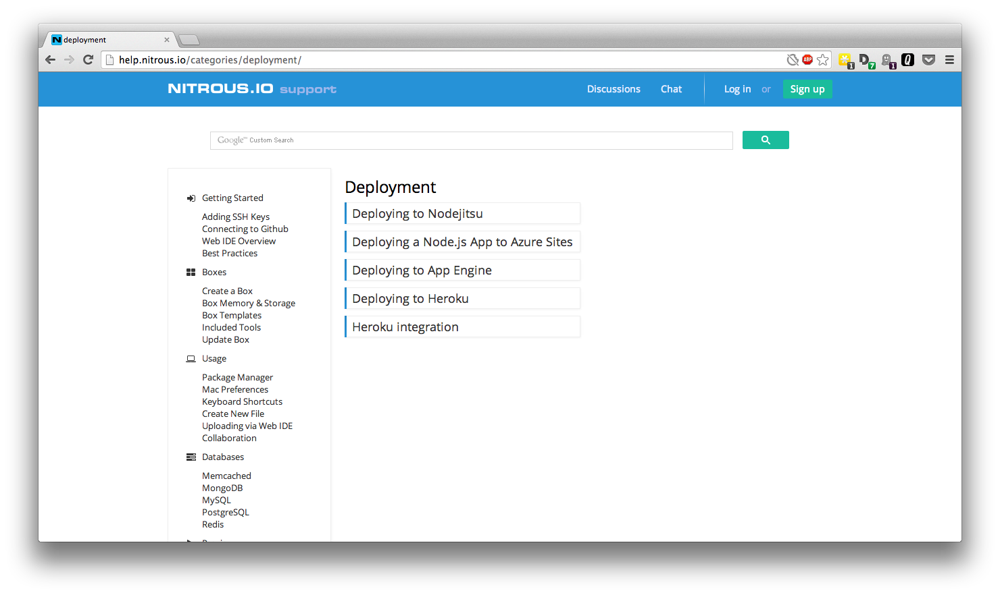
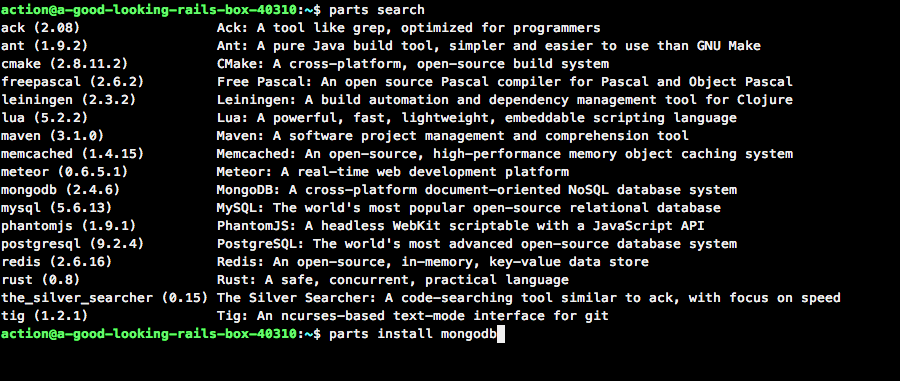
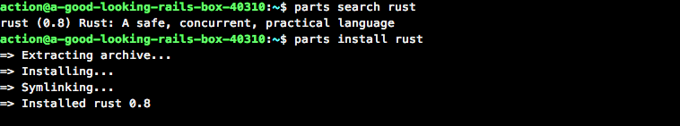
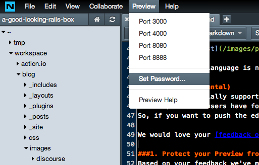

Sometimes here at Nitrous.IO, we get so heads down on building new features and functionality for developers that we forget to let people know that we've built them.
Here are five things you can do on Nitrous.IO today that you probably think you can't.

<!--break-->
###5. Use **vim**

You're not hardcore unless you use vim or so they say. Well at Nitrous.IO, if you want to be hardcore we got your back. Just type `vim` in the console and away you go with with colors and even split screen goodness.
PS: You can also use **emacs**.

<blockquote class="twitter-tweet" lang="en">
Ah ha, so I just have to maximize the terminal window and vim works. Awesome. /cc <a href="https://twitter.com/NitrousIO">@NitrousIO</a>
&mdash; Steve Klabnik (@steveklabnik) <a href="https://twitter.com/steveklabnik/statuses/405776743505489920">November 27, 2013</a></blockquote>

###4. Deploy from Nitrous to hosting services such as Google App Engine, Heroku, and Azure.
Deploying to your production host is simple from the Nitrous.IO Console.
We have detailed instruction for [popular deployment targets on our help site.](http://help.nitrous.io/categories/deployment/{{page.utm}})
If there is a particular one that you feel we should include [please send us a note.](mailto:feedback@nitrous.io)

###3. Add a data store like Postgresql, Redis, Memcached for your project
As you start to build projects of substance you will want to use datastore. *Autoparts*, Nitrous.IO's package manager allows you to install the datastores that you need for your project.
You can get a full list of the supproted data stores by typing `parts search` and install your selected data store with `parts install <name>`

Eg: `parts install mongodb` to install mongo on your current box.

Alternately if you use a cloud storage provider such as [MongoHQ](http://www.mongohq.com/{{page.utm}}) or [RedisCloud](http://redis-cloud.com/{{page.utm}}) you can always use that with Nitrous.IO.

###2. Code in Lua || Rust || Pascal || Java*
While we don't have a custom environment for these languages, you can use the `autoparts` feature discussed above to install these languages for your box.
Simply type `parts search <name>` for the language of your choice and install it with `parts install`

For Example if I wanted to install rust :

`parts search rust` followed by `parts install rust`

If your favorite language is not on the list - [checkout how to make an autopart and submit a pull request](https://github.com/action-io/autoparts/{{page.utm}}).

####JAVA (Experimental)
Java is not officially supported on Nitrous.IO as we haven't fleshed out all the details of a Java webapp workflow.
However, as some users have found out each Nitrous.IO Box has a Java VM and Java Compiler built-in.
So, if you want to push the edge, feel free to pull in your code in from your favorite github Java repo and give it a whirl.

We would love your [feedback on successes and issues.](mailto:feedback@nitrous.io)

###1. Improved Previews: Port 3000 Forwarding and Basic Auth
And the #1 - Based on your feedback we've made changes to the way the **Preview** works.

First, we now forward port 3000 to Port 80 so that you can preview your applications from even behind corporate firewalls.
(Be sure to check out this link if you are having trouble [connecting to the web IDE from behind a firewall.](http://help.nitrous.io/faq-unable-to-connect-to-web-ide/{{page.utm}}))

You can also control who has access to your previews with *Basic Authentication.*
Simply click on **Set Password...** from the **Preview Menu** to set a *username* and *password* for your preview links.

Share your projects with clients without having to make it available to the whole world.

Feel free to tweet us a link too - We love seeing how talented developers are using our platform.
