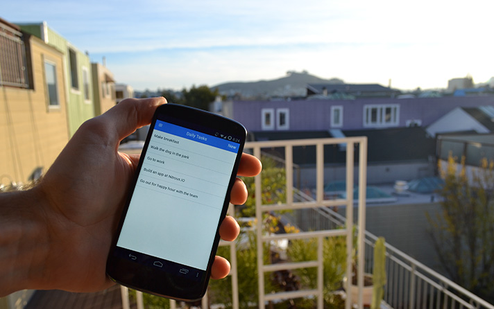

Origionally a guest post on the Ionic Framework <a href="http://ionicframework.com/blog/ionic-and-nitrousio/" target="_blank">blog</a>.

Looking to build a mobile app with the Ionic Framework? This guide quickly covers how to build a native Android app on [Nitrous.IO](http://www.nitrous.io/?{{page.utm}}) with [PhoneGap Build](http://build.phonegap.com/). You will also learn how to use [AngularFire](http://angularfire.com/) to connect your app to [Firebase](https://www.firebase.com/index.html) for a backend service. All of these services provide a free tier, so you can try this out without dropping a dime.

<!--break-->
### Prerequisites

Before we get started, make sure you have the following:

* A Node.JS box on [Nitrous.IO](http://www.nitrous.io/?{{page.utm}})
* A [Github account](http://www.github.com) which is [connected](http://help.nitrous.io/github-add-key/) to your Node.JS box
* A [PhoneGap Account](https://build.phonegap.com/plans)

### Create a Node.JS box on Nitrous.IO

If you haven't already, sign up at [Nitrous.IO](http://www.nitrous.io/?{{page.utm}}) and create a Node.JS box.

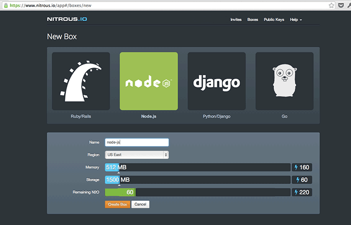

Once your Node.JS box is created you will need to [connect](http://help.nitrous.io/github-add-key/) it to your Github account. This will add a Public SSH key so you may update repos from Nitrous.

### Get Started with Ionic Framework

To get started with the [Ionic Framework](http://ionicframework.com/), we will build a Todo app. Although the [Ionic guide](http://ionicframework.com/docs/guide/installation.html) goes into detail with building the initial app, this article provides you with the app ready to clone from Github.

Cd into `~/workspace/` and run the following command in your console to clone the starter project into `/myproject`:

    git clone git@github.com:nitrous-examples/ionic-todo.git myproject

cd into the `~/workspace/myproject` folder, and from there run the app within the Nitrous box with Python (yes, Python along with other tools and interpreters are already installed on Node.JS boxes):

    cd myproject
    python -m SimpleHTTPServer 4000

You can view the app by navigating to **Preview > Port 4000** in the Nitrous.IO web IDE menu bar:

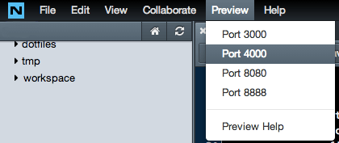

### Create a New Repository at Github

[Create a new repo](https://github.com/new) at Github for this project.

Once the project is created on Github, you should see the following page with your repo URI as well as some instructions on the next steps.

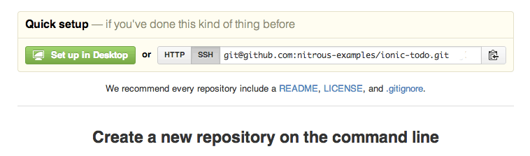

Make note of your HTTP URI at the top of the page. You will want to push your existing project from Nitrous to this location. Navigate within the console to `~/workspace/myproject` and modify your git remote to point to the new repo:

    git remote set-url origin git://YOUR-NEW.HTTP-URL.HERE

Push the Ionic starter project files to the repository by running the following command:

    git push -u origin master

Your project should now be found in the Github repo.

### Host the App with PhoneGap Build

Now, let's setup PhoneGap Build. First you will need to sign up at [https://build.phonegap.com/](https://build.phonegap.com/).

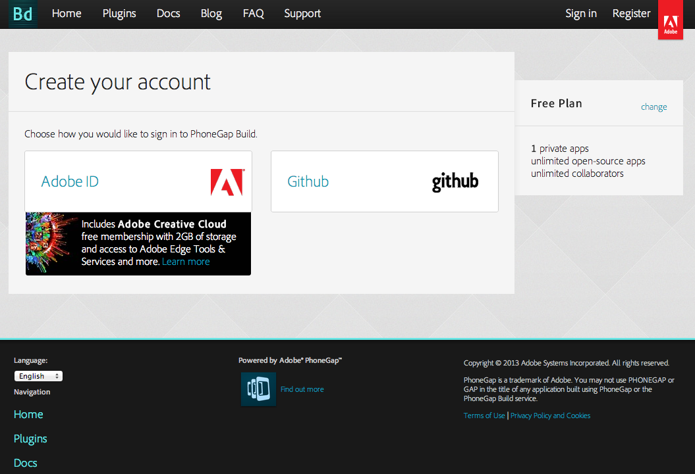

You can login with your existing Github account to make connecting to your repo easier, but if you login with your Adobe ID then then you will have to manually paste in your Github project repo URI.

Once logged in, create a new app and select the Github repo we just created. Once this has been added, select **Build App** as seen below:

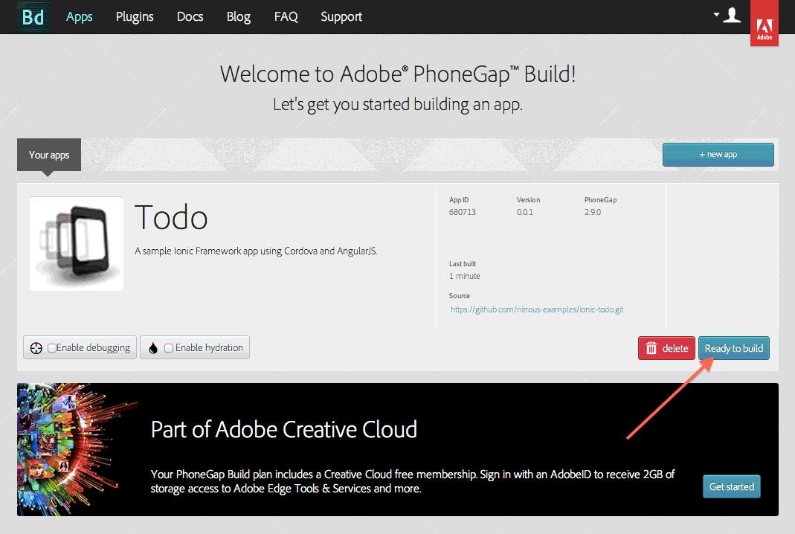

This should only take a minute to build. Once ready you will have instant access to download the app for Android, Windows Mobile, WebOS, or Symbian.

>If you are working with iOS in developer mode, you must provide a signing key before downloading the app.

To download the APK for Android, click the android logo seen below. You can also click the preview page if you wish to scan the QR code on your phone for an instant download.

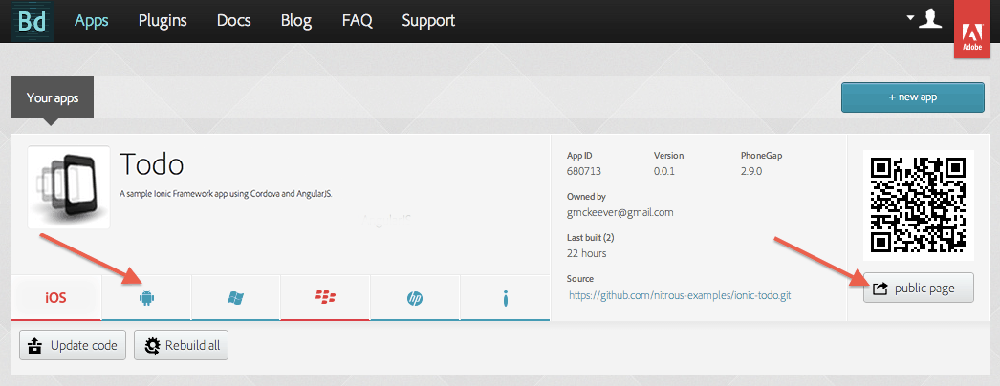

>Note: To allow 3rd party apps to be install on Android 4.2+, open your `Settings` and enable the option `Security > Unknown Sources`.

Click on the downloaded APK file and install the app. Click the app icon once installed.

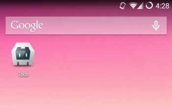

The tasks will save to your phone locally, but you will not be able to sync the data elsewhere. In order to create a more robust app which can read and write to a database, we will need to connect to [Firebase](https://www.firebase.com/index.html).

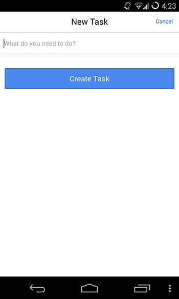

### Setting up Firebase for a Backend Service

At this point you will notice that the app is static, and that there is no real functionality to it. Since the Ionic Framework utilizes AngularJS, we will be easily able to easily connect to [Firebase](https://www.firebase.com/index.html) using [AngularFire](http://angularfire.com/).

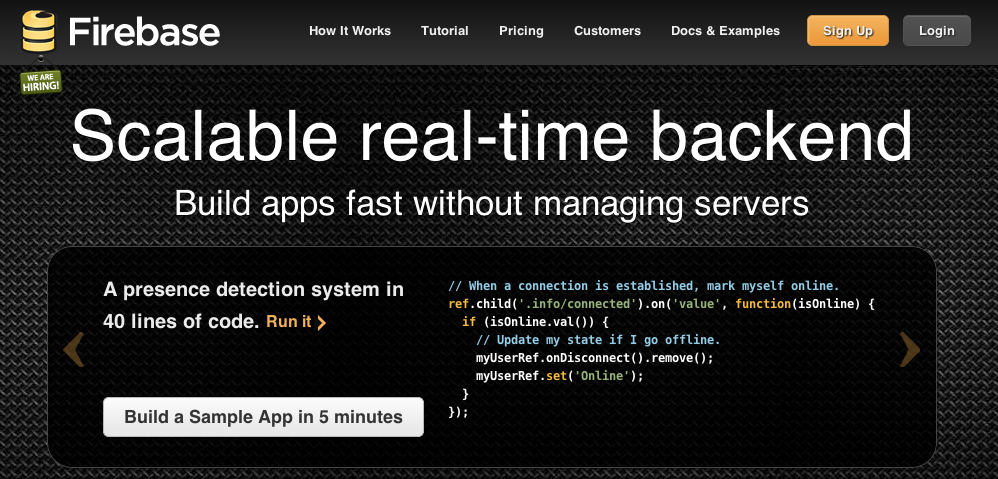

[Firebase](https://www.firebase.com/index.html) provides a backend service which saves you the time of setting up your own backend server. [Sign up](https://www.firebase.com/signup/) for a new account and create a Firebase instance. Remember the name of your Firebase which you create as we will be referencing it later (you can find your Firebase instance on the [account overview](https://www.firebase.com/account/) page).

### Connecting to Firebase with AngularFire

[AngularFire](http://angularfire.com/) is a AngularJS binding for [Firebase](http://www.firebase.com), which allows us to connect our app to a backend service. Let's get started with setting up AngularFire.

Include Firebase and AngularFire to your project by adding the following lines within the `<head>` section of your `index.html` file:

    <!-- Firebase and AngularFire Extensions -->
    
    

### Updating the Controller for Firebase

Before integrating with [Firebase](https://www.firebase.com/index.html), we utilized local data only to store values. In this next section we are going to add Firebase as a dependency to the app module, and we will also update the controller to connect to Firebase.

Update the code in `www/js/app.js` and `www/index.html` with the corresponding Gists, replacing the two Firebase URL's (https://YOUR_FIREBASE_NAME.firebaseio.com) with the Firebase URL you created:

### Testing the App

You should now be able to run the app while utilizing Firebase for a backend service. Within the main project folder, run the python command again to start the app on your Nitrous box:

    python -m SimpleHTTPServer 4000

Navigate in your Nitrous.IO web IDE menu bar to **Preview > Port 4000** to view the app again:

Try adding some sample data into your app. When the tasks save you should see the changes reflect in your Firebase account. Take a look at your Firebase URL (https://YOUR_FIREBASE_NAME.firebaseio.com/) within the browser to see similar data as seen in the screenshot below.

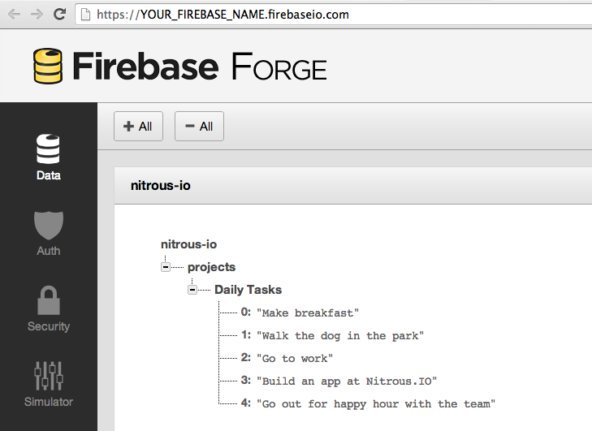

### Updating the App in PhoneGap

In order to update the code for your app you will need to first push the changes to Github. Run the following commands within the project folder in your console:

    git add .
    git commit -m "Integrated Firebase with AngularFire"
    git push origin master

You can now simply click 'update' in your PhoneGap account to pull the latest changes from your Git repo, and from there click 'rebuild' to generate a new build for your app.

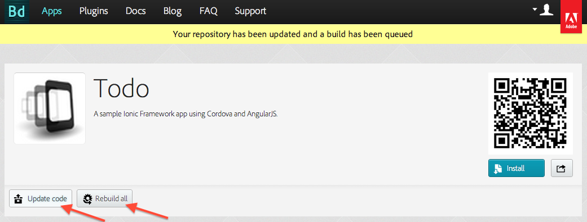

Uninstall any existing Todo app you have on your phone and download the latest version. You now have a todo list which syncs with Firebase.

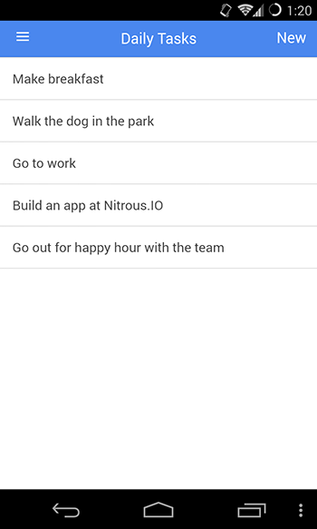

### The Next Steps

If you are looking to publish the App within the Google Play store, or are looking for a more in depth explanation on some of the code, follow the [Ionic Framework Guide](http://ionicframework.com/docs/guide/preface.html) and take note of the [publishing section](http://ionicframework.com/docs/guide/publishing.html).

Visit the [forums](http://forum.ionicframework.com/) to connect with other developers, or ask questions related to the Ionic Framework. If you are looking for an API reference for utilizing mobile phone functionality, take a look at the [PhoneGap documentation](http://docs.phonegap.com/en/3.2.0/index.html).

How did it go for you? If you have any sample apps you wish to share, free free to let the Nitrous.IO team know via [twitter](http://www.twitter.com/nitrous.io) as we would love to take a look!
