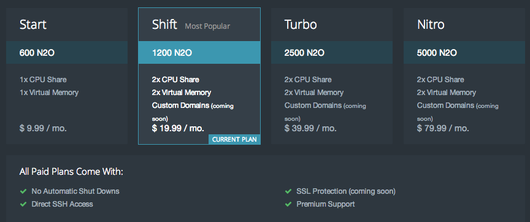

Over the last six months we've seen tremendous adoption of Nitrous.IO's blazing-fast cloud development boxes on [our Web App](https://www.nitrous.io/?{{page.utm}}), [our Chrome App](https://chrome.google.com/webstore/detail/nitrousio-web-app/kcbmakmdbnehgbakmgibcpjpafenmohd?hl=en&{{page.utm}}) and through [our Mac App.](https://www.nitrous.io/mac/?{{page.utm}})

Many of you asked us how to increase your N2O to create additional boxes, create a box with more memory, and increase storage on a box. 

Today, we are excited to announce our new [N2O Subscription Plans.](https://www.nitrous.io/pricing/?{{page.utm}}&utm_keyword=atf-cta) You can now increase your N2O capacity to **supercharge your Nitrous.IO development boxes**.  We have four plans which allow you to choose the right amount of N2O for your needs.

<!--break-->
####The Plans: Start, Shift, Turbo & Nitro

By purchasing an upgraded N2O Plan, you are increasing the resources available to you on the Nitrous.IO platform.  

Each box you create will utilize a portion of your N2O based on the resources you allocate to the box.  If you no longer need a box - you can terminate the box and the Box's N2O will be allocated back to your available pool for you to use again.

In addition to the increased N2O, all your development boxes get:

  *   Higher priority execution
  *   More virtual memory
  *   (And best of all) boxes on paid plans are **not automatically shutdown, when they are left idle**.

####FAQ and More Information

You can [upgrade your plan from our Subscriptions page](https://www.nitrous.io/pricing/?{{page.utm}}&utm_keyword=upgrade_bottom) and [Check out our FAQ](http://help.nitrous.io/categories/billing/?{{page.utm}}) to see some of the more commonly asked questions. 

Or email us via [support@nitrous.io](mailto:support@nitrous.io) if we can be of any additional assistance.

<a href="https://www.nitrous.io/pricing/?{{page.utm}}&utm_keyword=upgrade_bottom" class="btn btn-primary" target="_blank">Supercharge your box today!</a>

