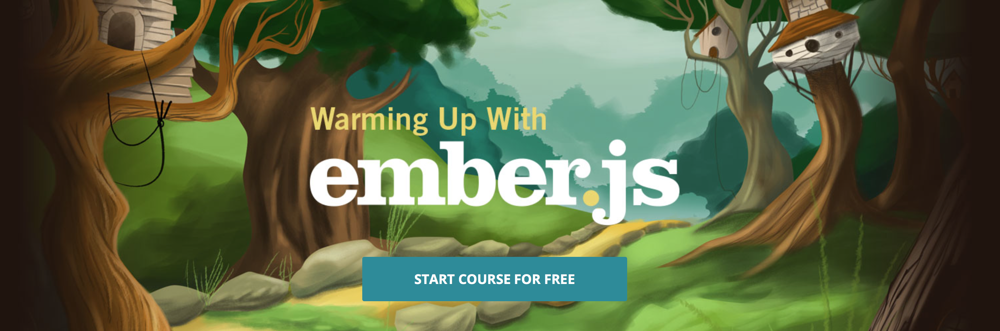
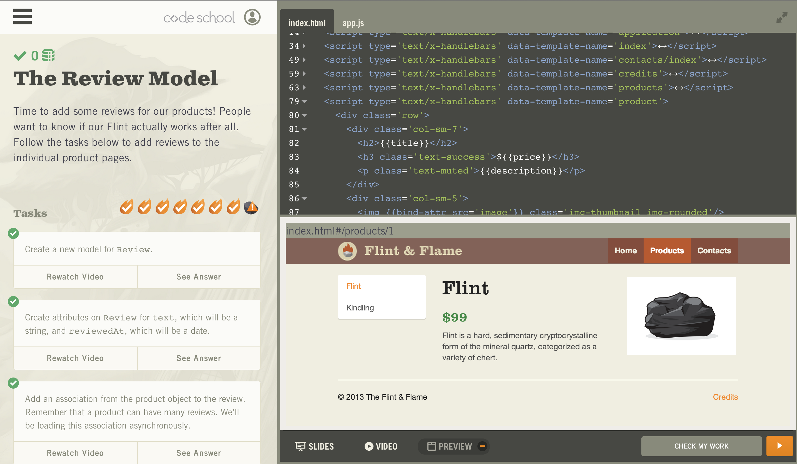
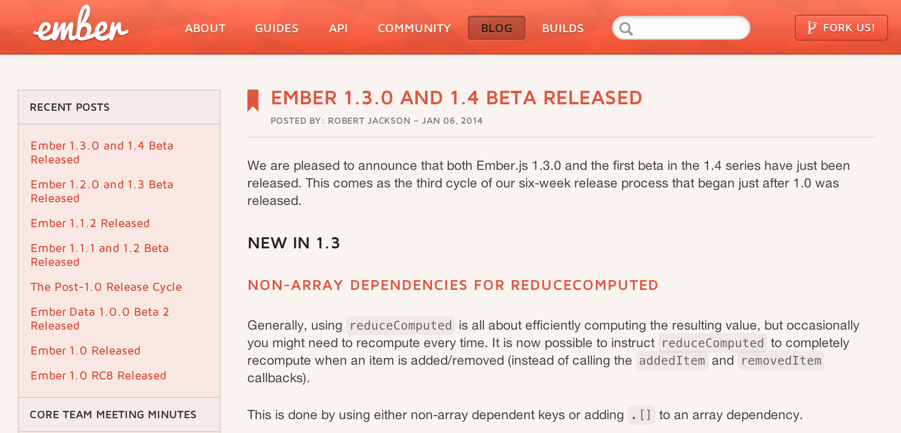

*This is a guest post by [Adam Fortuna](http://adamfortuna.com) from [Code School](http://codeschool.com) about their new class "Warming up with Ember.js" along with some pointers on additional Ember.js resources.*

Recently, we've been working hard creating our latest course, [Warming Up With Ember.js](https://www.codeschool.com/courses/warming-up-with-emberjs) at Code School.

## Code School and Envy Labs

One thing to know about Code School, is that it's an internal project created by [Envy Labs](http://envylabs.com), a web development shop in Orlando, FL. The Envy side handles consulting, while a dedicated team works exclusively on Code School. I'm on the Code School side myself, but the Envy side helps us keep our ear to the ground on what technologies clients are asking for. Ember.js was chosen for an education platform for Cisco worked on by the Envy Labs team, and I knew it was only a matter of time before we wrote a course on it.
<!--break-->

## Choosing a Subject

But maybe we should back up to how we choose topics. On Code School we have a [suggest a course](https://www.codeschool.com/courses/suggest) page that we monitor to gauge what our students want to learn. We did a pair of Backbone.js courses earlier in year, but since then Ember.js had hit 1.0 and it had climbed to the top 10 spot on our list.

Having written a great deal of Backbone.js, including the Backbone.js code we use for our existing courses, learning Ember.js had been an interest of mine for a while. I jumped at the chance to immerse myself in it and teach a course.

## Deciding on a Teaching Style

Each Code School course has a slightly different teaching style. When thinking of how we want to teach a subject, we start with how we would want to learn it. For this course this included a number of new ideas:

* Full HTML preview of a running Ember Application, with a simulated location bar
* Individual tasks for challenge, rather than having overly long instructions
* Content that carries over from challenge to challenge that we build on throughout the course
* Videos inline for each task that can be used as a refresher while working through a challenge

With all of these ideas in mind, we got to work creating them! A team working on a course usually consists of a few people for a surprisingly short time. From start to finish, we worked on the code for the course for less than a month before releasing it. We build a team from within Code School just for the course, which is then disbanded to work on other courses. For most courses, including this one, the team includes about 2 developers (myself being one of them), a graphic designer and a front end designer.

We were lucky enough to work with some amazing designers for this one, including David Mott, who created some of the [unique characters](http://blog.codeschool.com/post/69796088149/design-preview-warming-up-with-ember-js) used in this course. The finished product of this month long project is a full course for learning Ember.js in the browser. If you're curious about the course, you can play through the [first level for free](https://www.codeschool.com/courses/warming-up-with-emberjs).

## Ember Roadmap

Once you understand the Ember basics, keeping up with the rapidly evolving framework might sound difficult, but not if you know where to look. The [Ember Blog](http://emberjs.com/blog/) is one resource that is surprisingly helpful for this. More so than other open source frameworks I've watched, the core team has communicated publicly and often detailing their roadmap.

If you've been following Ember for a while, you'll know that the last 6 months has been a crazy time. Not only did Ember hit 1.0, but versions 1.1, 1.2 and 1.3 dropped as well. Ember Data hit a beta release with a new `store` interface that formalizes how we communicate with a fixture store or a REST adapter using the same interface.

    App.PostRoute = Ember.Route.extend({
      model: function(params) {
        return this.store.find('post', params.post_id);
      }
    });

### What's Next For Ember?

I can't guess at how the Ember team has been able to make such great progress in such a short timespan, but the communication initiatives must have helped. They've begun to release [meeting minutes](http://emberjs.com/blog/2014/01/06/core-team-meeting-minutes-2014-01-03.html) detailing discussions taking place every two weeks which are worth reading.

This is also an amazing way to learn about new features and where they are on the roadmap. One of the most interesting new features of Ember for me, is the new query params interface.

    // Given a request to this URL:
    //   /books?genre=fantasy
    App.Router.map(function() {
      this.resource('books', { queryParams: ['genre'] });
    });
    App.BooksRoute = Ember.Route.extend({
      model: function(params, queryParams) {
        // queryParams will now be a hash, say: 
        //   { genre: 'fantasy' }
        // Would make a URL request to the server:
        //   /books?genre=fantasy
        return this.store.find('books', queryParams);
      }
    });

This is a new features that isn't yet in Ember, unless you check out the Canary version and enable experimental features. There's also a great video on it from a [talk at emberFest](http://www.infoq.com/presentations/ember-query-string?utm_source=infoq&utm_medium=videos_homepage&utm_campaign=videos_row1).

If you're looking for a good way to learn the basics of Ember.js, I'd encourage you to check out [Warming Up With Ember.js](https://www.codeschool.com/courses/warming-up-with-emberjs) from Code School, download the starter kit from the Ember.js website and follow the (very communicative) Ember.js blog to stay up to date!