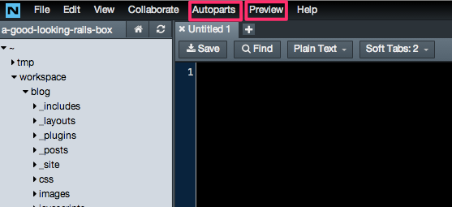
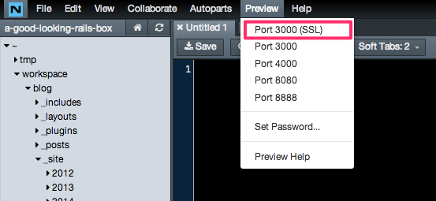
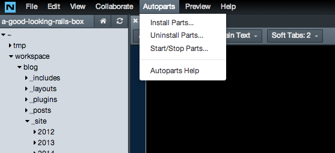
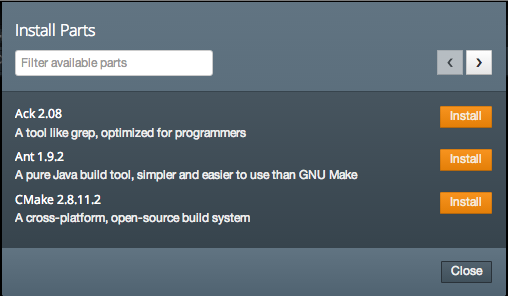

It's been a busy post holiday season for the Nitrous.IO team. We are excited to introduce two features that our customers have been requesting - **SSL Support for Live Preview** and **One Click AutoParts installation**.

Both these features available in your existing Nitrous.IO workspaces today so [log on and check them out](http://nitrous.io/users/sign_in/?{{page.utm}}) or keep reading to see how they work.

<!--break-->

###SSL Support for Live Preview (Port 3000)

Live Preview allows you to quickly showcase your development build on a live URL. This popular feature is now avaialble over SSL- allowing you to connect over https and showcase your app to clients and customers directly from your development machine.

Simply launch your app on port 3000 and navigate to it using the **Port 3000 (SSL)** Link from the **Preview Menu**.

###One Click AutoParts Installation

[*AutoParts*, the powerful open-source package manager,](http://help.nitrous.io/autoparts/?{{page.utm}}) is now available from within the web IDE.

You can *install, uninstall, start and stop* **databases** (e.g.:Postgresql, MySQL), **datastores** (e.g.:memcachier,redis) **new languages** (e.g.:Rust, Pascal) and other tools from your [your Nitrous.IO IDE.](https://www.nitrous.io/join?{{page.utm}})

Don't see your favorite package? [Send us a pull request.](http://help.nitrous.io/autoparts-packages/)