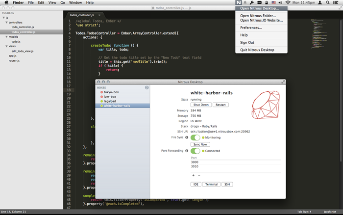

Last year, we released a beta version of our Mac app. The Mac app provided a
way to synchronize code edits between your Mac's file system and
Nitrous.IO boxes, and we've received tons of compliments from our users
using the Mac platform.

<!--break-->

However, the app was not compatible with the latest Mac operating
system, dubbed Mavericks. Unfortunately, due to the way the app was
built, a quick update to support the new operating system was not
feasible. Some of the required features of the OS were either deprecated
or removed and a large portion of the app had to be rewritten.

So we've completely re-architected the application from the ground up
with a future-proof technology, and the new app, now called Nitrous
Desktop, is available today!

<a href="https://www.nitrous.io/mac" class="btn btn-success">Download Nitrous.IO for Mac</a>

What makes the new Mac app really interesting from a technical point of
view is that the large portion of the app is built with the same
technologies that power our web app such as
[Ember.js](http://emberjs.com/) and [Node.js](http://nodejs.org/). This
not only lets us to re-use code, but also makes it easier for us to port
our application over to other platforms. We will write more about this
in detail in future posts.

Head over to the [Nitrous Desktop Help](http://help.nitrous.io/nitrous-desktop/)
to see how it works, and enjoy!
