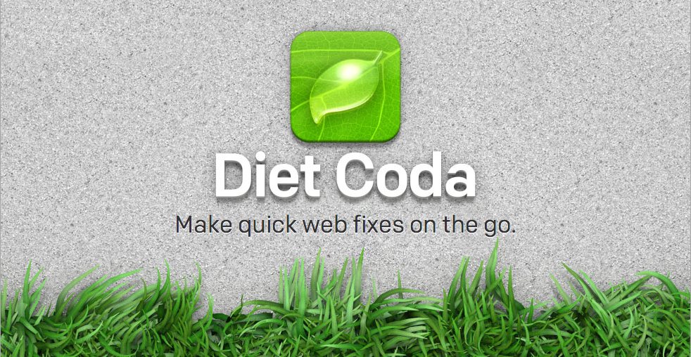
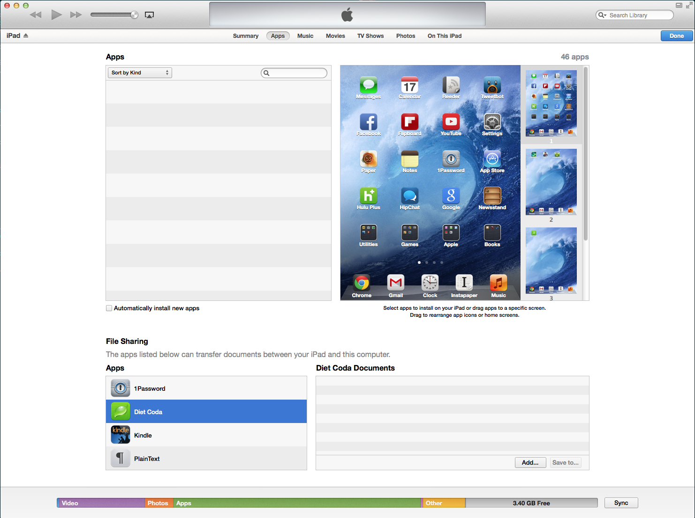
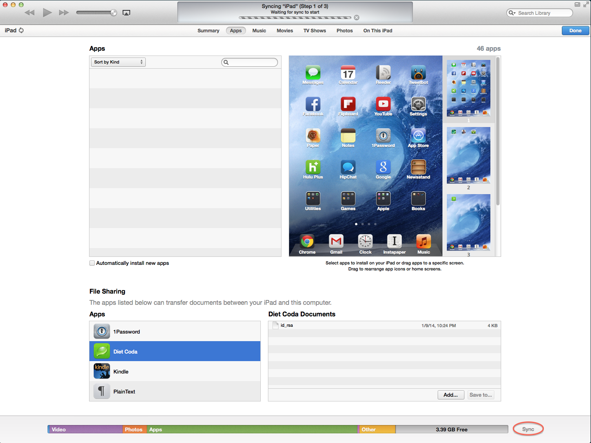
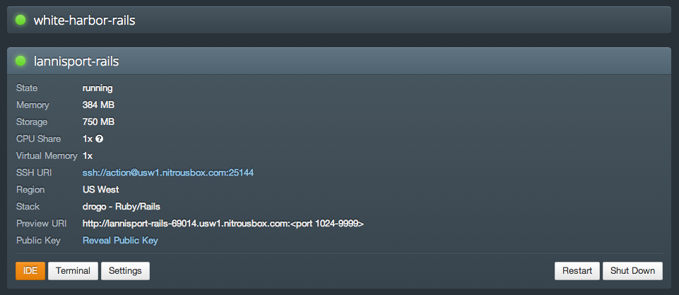
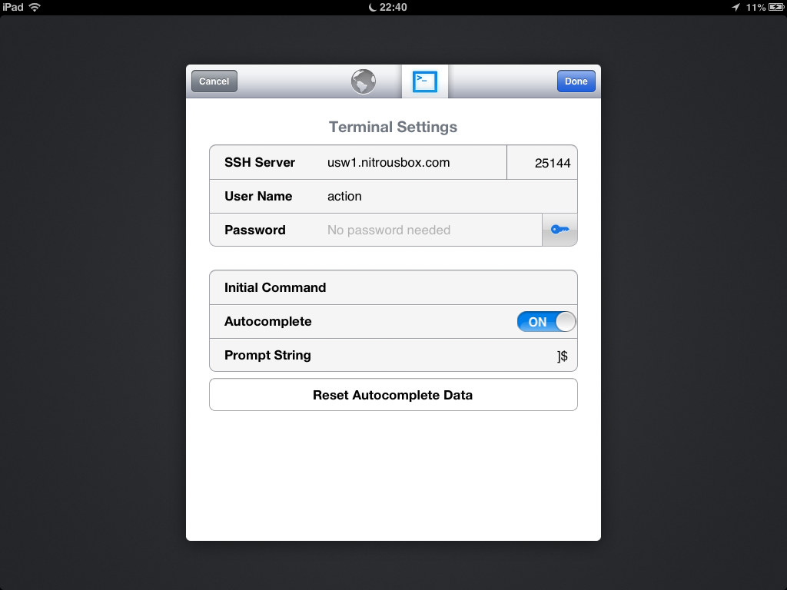

We at [Nitrous.IO](https://www.nitrous.io/?{{page.utm}}) love [Panic](http://panic.com/?{{page.utm}}) and the amazing products that they have
shipped over the years. One of the more interesting products they've
launched most recently is [Diet
Coda](http://www.panic.com/dietcoda/?{{page.utm}}) a
world-class code-editing tool for the iPad.

Diet Coda is aimed at developers who have a server setup and want to
make quick fixes to code on said server using an iPad. With Nitrous.IO's dev
environments that are accessible from anywhere, Diet Coda can be used
not just for quick fixes, but for full-blown development.

## No Computer? No Problem 

If you're travelling light and have only packed your iPad with you, or
if you're at a conference and an urgent bug needs to be fixed, or even
when you're relaxing on the couch watching MLB on your iPad late at night and remembered that one
commit you forgot to make &ndash;
you can do that now with Diet Coda and [Nitrous.IO](https://www.nitrous.io/?{{page.utm}}).

Let me show you how.

<!--break-->

## Setup SSH Keys on Diet Coda

If you don't already have a [Nitrous.IO account sign up here for free.](https://www.nitrous.io/?{{page.utm}}&utm_keyword=top)

Then the first step is to set up your SSH keys on Diet Coda.

This assumes that you have SSH keys already generated on your
Mac/Windows machine and you have [uploaded them to
Nitrous.IO](http://help.nitrous.io/ssh-add/?{{page.utm}}).

Make sure you have iTunes open with your iPad connected to your machine.
(For the purposes of this blog, we will assume that you have a Mac, but
the instructions should work for Windows users as well).

Open up iTunes and click on the "iPad" button in the top right.

Then click on the "Apps" tab and in the section called "File Sharing" at
the bottom, make sure you can see "Diet Coda" and select it.

Once you have your private key ready (they are usually located in the
`~/.ssh` folder (if you're using a Mac), and drag it the "Diet Coda
Documents" section. (Mine is called "id_rsa" but yours might be named
differently).

Make sure you can see your private key as part of Diet Coda Documents.

Once you've completed these steps, hit Sync and wait for your key to be
synced to Diet Coda.

Great! Your private key is now on your iPad and you're ready to connect
to your Nitrous.IO box using Diet Coda.

## Setup Login Credentials on Diet Coda

Look up the SSH Host and Port and username for your box and keep it handy. You can
look it up from your [boxes dashboard on
Nitrous.IO](https://www.nitrous.io/app#boxes/?{{page.utm}})

For this example, by observing the SSH URI for the box `lannisport-rails`, we can deduce
the SSH Host to be `usw1.nitrousbox.com`, the Port to be `25144` and the
username to be `action`.

Open up Diet Coda on your iPad and create a new site. This opens up a
dialog where you can fill in your credentials. Give your site a name,
mine just says "NitrousBox". Set the "Remote Root" to be `/home/action`
and, make sure the protocol is set to "SFTP",
and the host and port to be the SSH Host and Port that you collected
from the previous step and set the "User Name" to "action".

Click on the little key next to the "Password" field. This should
already have the private key that you uploaded via iTunes. Select it and
the key should turn blue.

Click on the "Terminal" tab in the top and repeat the steps for your SSH
connection.

## Editing

Still with me? Great! You're now all setup to start editing code on your
Nitrous.IO box right from your iPad.

Tap on the Nitrous.IO box, go to your workspace, create new files

and edit them!

## Terminal

It's not just simple code editing though, you can run code on the server
too, whether it is your Rails app, your node.js Socket.IO server or your
new shiny Go App.

Switch to the Terminal by tapping the purple icon on the top left and
then tapping on "Terminal".

...and you can start coding away in your terminal.

## The Power of Nitrous.IO, now on Diet Coda

There you have it folks - this is just a glance at what the future holds
for us - dev environments in the cloud that are spun up within seconds,
and accessible from any device of any form-factor.

Get your [Nitrous.IO Account here](https://www.nitrous.io/?{{page.utm}}&utm_keyword=bottom)
and get Diet Coda from the [App Store](https://itunes.apple.com/us/app/diet-coda/id500906297?mt=8).

We have more great stuff planend this year, so [follow us on twitter](http://twitter.com/nitrousio) and stay tuned!
