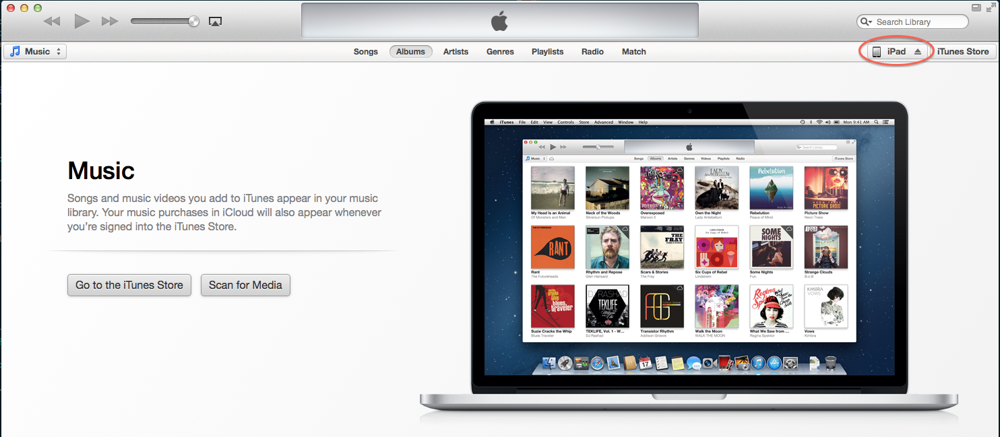
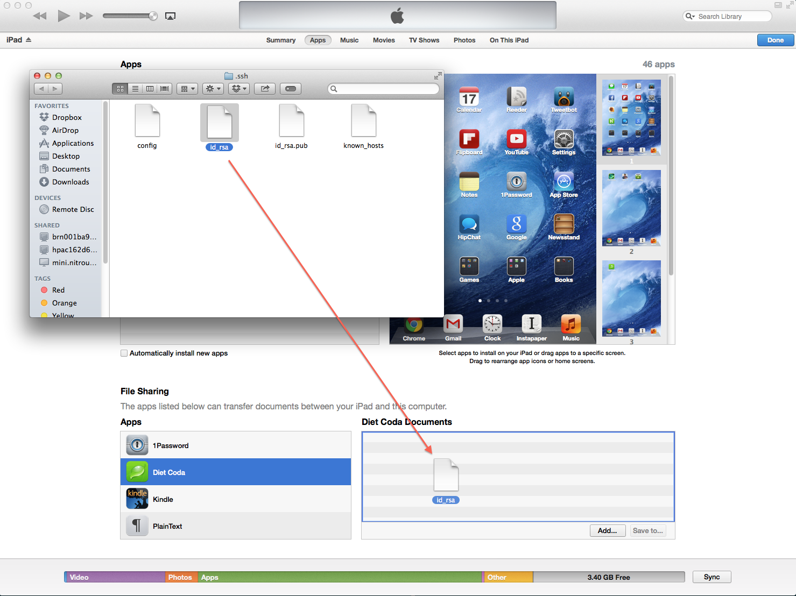
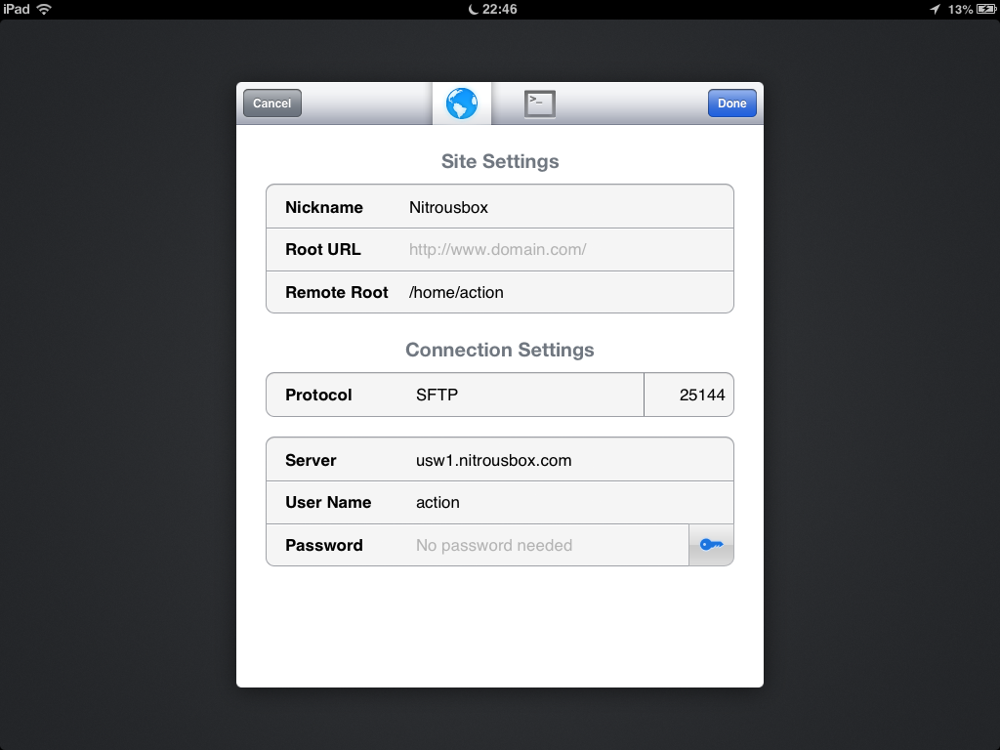
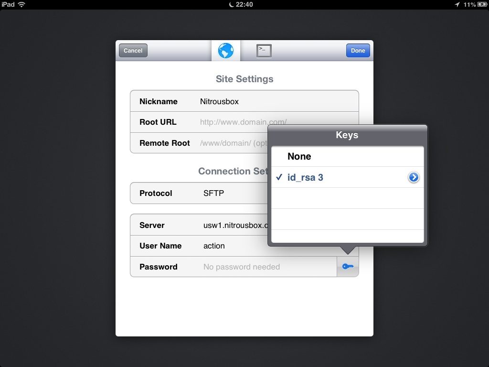
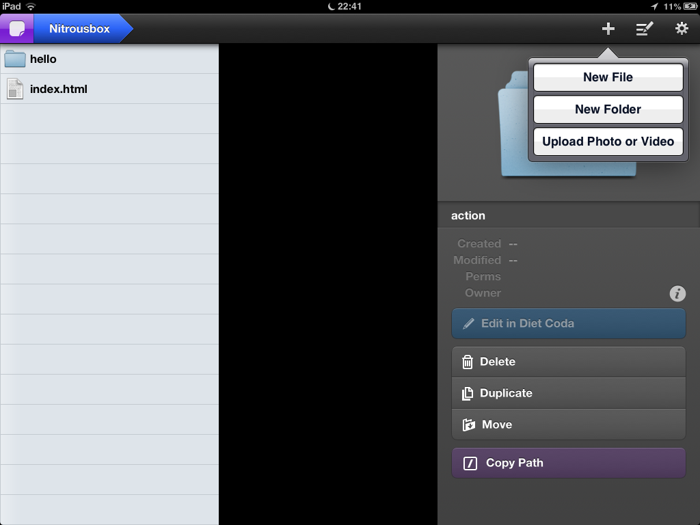
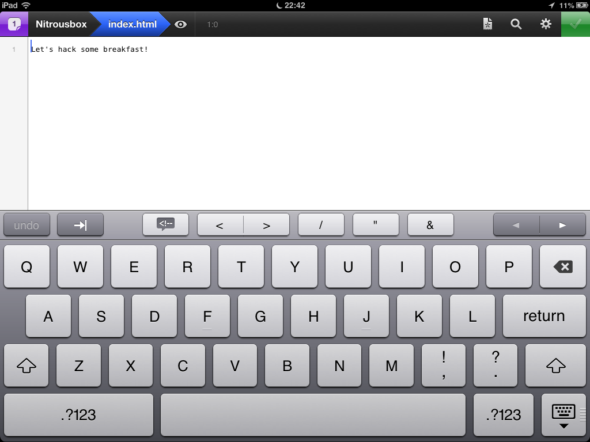
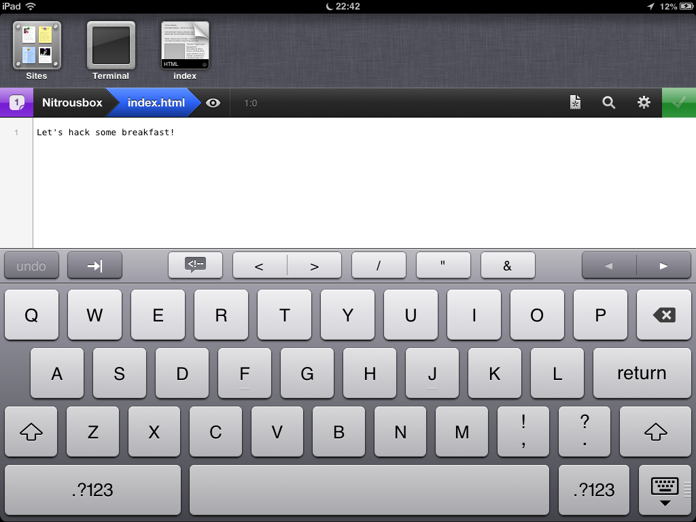
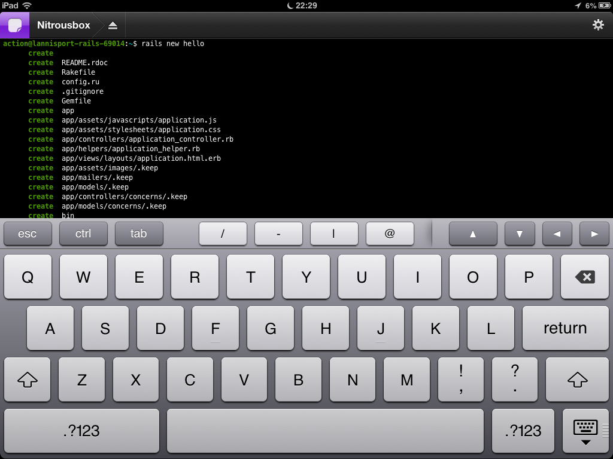

At [Nitrous.IO](https://www.nitrous.io/?{{page.utm}}), we love [Panic](http://panic.com/?{{page.utm}}) and the amazing products that they have shipped over the years. One of the more interesting products they've launched recently is [Diet
Coda](http://www.panic.com/dietcoda/?{{page.utm}}): a world-class code-editing tool for the iPad.

Diet Coda is aimed at developers who have a server setup and want to make quick fixes on their server using an iPad. With Nitrous.IO's dev environments that are accessible from anywhere, Diet Coda can be used not just for quick fixes, but for full-blown application development.

## No Computer? No Problem

If you're travelling light and have only packed your iPad, or if you're at a conference and need to be fix and urgent bug &ndash;you can still be dangerous with an iPad, Diet Coda and [Nitrous.IO](https://www.nitrous.io/?{{page.utm}}).

Now I'll show you how.

<!--break-->

## 1. Get a Nitrous.IO Account

If you don't already have a Nitrous.IO account, [click here to signup for free](https://www.nitrous.io/?{{page.utm}}&utm_keyword=top).  It's free, and takes about 10 seconds.

## 2. Adding SSH Keys to Diet Coda

This article assumes you've already generated SSH keys on your Mac/Windows machine and you've [uploaded them to Nitrous.IO](http://help.nitrous.io/ssh-add/?{{page.utm}}).

Make sure you have iTunes open with your iPad connected to your machine. (For the purposes of this blog, we will assume that you have a Mac, but the instructions should work for Windows users as well).

Fist, Open up iTunes and click on the "iPad" button in the top right.

Then click on the "Apps" tab and in the section called "File Sharing" at the bottom, make sure you can see "Diet Coda" and select it.

Once you have your private key ready (usually located in the `~/.ssh` folder if you're using a Mac), drag it to the "Diet Coda Documents" section. Mine is called "id_rsa" but yours might be named differently.

Make sure you can see your private key as part of Diet Coda Documents.

Once you've completed these steps, hit Sync and wait for your key to be synced to Diet Coda.

Great! Your private key is now on your iPad and you're ready to connect to your Nitrous.IO box using Diet Coda.

## 3. Setup Login Credentials on Diet Coda

Look up the SSH Host and Port and username for your box and keep it handy. You can look it up from your [boxes dashboard on Nitrous.IO](https://www.nitrous.io/app#boxes/?{{page.utm}})

For this example, by observing the SSH URI for the box `lannisport-rails`, we can deduce the SSH Host to be `usw1.nitrousbox.com`, the Port to be `25144` and the username to be `action`.

Open up Diet Coda on your iPad and create a new site. This opens up a dialog where you can fill in your credentials. Give your site a name, mine just says "NitrousBox". Set the "Remote Root" to be `/home/action` and, make sure the protocol is set to "SFTP" and the host and port to be the SSH Host and Port that you collected from the previous step and set the "User Name" to "action".

Click on the little key next to the "Password" field. This should already have the private key that you uploaded via iTunes. Select it and the key should turn blue.

Click on the "Terminal" tab in the top and repeat the steps for your SSH connection.

## 4. Editing Code

Still with me? Great! You're now all setup to start editing code on your Nitrous.IO box from your iPad.

Tap on the Nitrous.IO box, go to your workspace, and create some new files.

Now we'll edit them!

## 5. Terminal

In addition to simple code editing, you can also run code on your server. Rails apps, node.js Socket.IO servers, Python apps or Go Apps. If you want support for an additional package, [you can help us add them](https://github.com/action-io/autoparts).

Switch to the Terminal by tapping the purple icon on the top left and then tapping on "Terminal".

...and start coding directly in your terminal.

## The Power of Nitrous.IO, now on Diet Coda

This was just a glance at what the future has in store &ndash; dev environments in the cloud created in seconds, accessible from any device.

Get your [Nitrous.IO Account here](https://www.nitrous.io/?{{page.utm}}&utm_keyword=bottom) and get Diet Coda from the [App Store](https://itunes.apple.com/us/app/diet-coda/id500906297?mt=8).

We have more great stuff planend this year, so [follow us on twitter](http://twitter.com/nitrousio) and stay tuned!