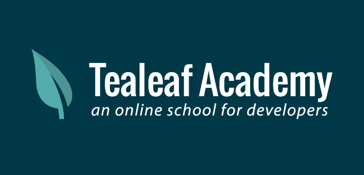

*We recently interviewed [Chris Lee](https://twitter.com/cglee). Chris is the co-founder of [Tealeaf Academy](http://www.gotealeaf.com/), an online professional grade ruby on rails bootcamp. He tells us about Tealeaf Academy and How Nitrous.IO saves educators time by simplifying the setup process for new students.*

### Tell us about Tealeaf Academy.
 
We started teaching Ruby on Rails in 2012 - so it's been about 2 years. We used to be called "Rails Tutors" and rebranded to "[Tealeaf Academy](http://www.gotealeaf.com/)" last year. About half of our students look for jobs, and the other half are either working on their own apps or are currently employed but want to level up their development skills. Our program goes really deep on the Rails stack, so we also get a lot of company sponsored developers in our program.
 
Other than the course projects that everyone has to build from scratch (which are pretty impressive in their own right), some projects by our past students include: [Bisaikong.com](http://www.bisaikong.com): the largest marathon community in China, [Clickbooq](http://www.clickbooq.com): a popular online portfolio site, [CappedIn](http://cappedin.com): a social network for sports gambling, [Smileku](http://www.smileku.com/front): a collective rewriting site, [EssaySage](http://essaysage.com): an essay editing service, and [Chestnut](http://chestnut.yoniweisbrod.com): an online book catalog, just to name a few.
 
More than just a showcase of applications, our flagship course covers advanced topics that you won't find in many places. The first half of our program teaches Ruby and shows how Rails works. But in the second half of our program, we really get into why we build applications this way, and how to manage growing complexity, all guided by tests. It's really intense, but also very rewarding.
<!--break-->
 
### What range of skill sets do students join with, and what can they expect to learn from Tealeaf Academy by the end of the course?
 
Students come to us with a wide variation in skill levels, and this is part of the reason why we structured our program in 3 courses. Our program goes very deep in the Rails stack - if a student can commit and complete all the topics we teach, not only will he or she be able to build production quality applications, but also master the more advanced software craftsmanship concerns, such as dealing with application complexity, understanding architectural tradeoffs, and forming a good grasp of the technology landscape within web development. On top of those topics, one of the most important attributes our graduates will have is being able to learn new topics on their own. Most of our graduates who looked for jobs were able to get an offer within a few months of graduating. It's pretty amazing to see the transformation of our students.
 
### Do you connect with students after the course is over?
 
Absolutely. We have a community where we support our past students after they've graduated. Our program is unlike many others in that it's meant to be taken part-time (roughly 20 to 30 hours/week), so we engage with our students for a much longer duration - our entire program takes approximately 4 months to complete. In that duration, we get to know our students pretty well, and the ones who work hard and make it through the entire curriculum become not only our graduates but in many cases our friends. So we definitely all stay in touch, and many of our alumni are still very active in our community, starting book clubs, referring each other for jobs, and even pairing up to build their own product ideas.
 
### How is Tealeaf, which is a 100% online program, different from some of the physical coding bootcamps?
 
This question comes up a lot, and we answer it pretty extensively in our [FAQ](http://www.gotealeaf.com/faq). In a nutshell: our technical track stands up to any physical bootcamp, and probably goes much deeper on Ruby on Rails than most of them. A few other differences are: first, we don't do admissions. Most in-person bootcamps have an aggressive admissions process, because they care about placement. We don't do that, so we teach everyone who is motivated. Second, we don't trap you in a classroom for 8 hours a day, so we can't force you to work. You have to be self motivated and self disciplined, to a certain extent. We have support staff around the world, and there is usually someone ready to help at all hours of the day, but we can't physically trap you in front of a computer and force you to work, like an in-person bootcamp can.
 
So if you're interested in learning Ruby on Rails very deeply, and you're someone who is self disciplined, we are probably a good fit.
 
### Where do your students have the most trouble when setting up development environments?
 
The Ruby and Rails ecosystem has improved dramatically over the last few years, so beginners are able to get going pretty easily now. However, there are typically two areas where we see problems. The first is when things need to be upgraded. For example, a new version of OSX comes out, and things start breaking. Trying to hunt down the offending executables and reconciling dependencies can be a daunting experience for beginners. The second area involves dealing with Windows issues when we start tackling advanced topics. For example, we teach background jobs using Redis in our 3rd course. Installing Redis on Windows can be problematic, and even if the Redis team came out with a Windows installer tomorrow, the problem is that many libraries and tools we use as web developers treat Windows users as second class citizens. We typically see Windows users run into problems in our 3rd course, when we really start to tackle the advanced topics.
 
 
### How has Nitrous helped save time within the curriculum/class?
 
Our philosophy is that people should learn to code like real professional developers: on their own machines, using a real code editor. Some of our students have older machines or have conflicting libraries, and have a hard time setting up their development environment. [Nitrous.IO](http://www.nitrous.io/?{{page.utm}}) has saved us a lot of time, because its one-click development environment allows our students to focus on the most important thing: learning to code. What we love about Nitrous.IO is that it's all that you need as a developer and nothing more. In other words, when our students use Nitrous, they're learning how to work like a real developer, not learning a proprietary product. The Nitrous development environment is just Unix, and a code editor - that's how real programmers work. We love that about [Nitrous.IO](http://www.nitrous.io/?{{page.utm}}).
