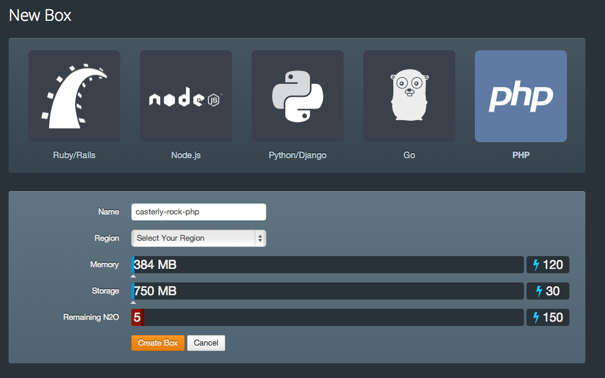

There are millions of PHP developers on this planet, and most of them emailed us, tweeted, and sent us letters begging for PHP support on Nitrous.IO.

Today, we are excited to announce that your PHPrayers have been answered.

<!--break-->

To get started, head over to your [list of boxes](https://www.nitrous.io/app#/boxes?{{ page.utm }}) and create a new box using the PHP template.

PHP Boxes come pre-installed with PHP5, Apache2, and Composer.

### PHP + MySQL + Memcache + Etc...

Of course, like Batman & Robin, PHP is nothing without its sidekick [MySQL](http://help.nitrous.io/mysql/?{{ page.utm }}).  For all your database needs [Autoparts](http://help.nitrous.io/autoparts?{{ page.utm }}) has you covered. You can use the [Autoparts](http://help.nitrous.io/autoparts?{{ page.utm }}) package manager to quickly install PHP5, Apache2, Composer, and other tools and databases like MySQL in just seconds.

You can also [read our PHP guide](http://help.nitrous.io/php?{{ page.utm }}) to help you get started with your PHP project.

### PHP Frameworks, CMS & More

If you're looking to install other frameworks such as Laravel, Phalcon, Symfony, or Yii, follow along with the official installation documentation on each framework's website. Many of these frameworks can be installed just as they are documented, but you may need to view our [PHP FAQ's](http://help.nitrous.io/php/#faqs) for any configuration help.

We've also added [WordPress](http://help.nitrous.io/wordpress?{{ page.utm }}) support to Autoparts.  With just one click, you can have a fully functioning WordPress site setup in seconds.

To install WordPress within your box, simply navigate in the IDE menu to **Autoparts > Install Parts**, and search for WordPress.  You can preview your app by navigating to **Preview > Port 3000** in the IDE menu.

What are you waiting for?  [Setup a free PHP development box today!](https://www.nitrous.io/?{{ page.utm }})
