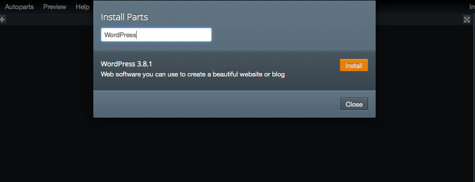

After much demand, we are welcoming PHP as the next box template available on [Nitrous.IO](http://www.nitrous.io?{{ page.utm }}). To get started, head over to the [boxes page](https://www.nitrous.io/app#/boxes?{{ page.utm }}) and create a new box with a PHP template. Boxes come pre-installed with PHP5, Apache2, and Composer.

Want PHP on your existing box? [Autoparts](http://help.nitrous.io/autoparts?{{ page.utm }}) will help you with that. You can use the [Autoparts](http://help.nitrous.io/autoparts?{{ page.utm }}) package manager to quickly install PHP5, Apache2, Composer, and other tools and databases such as MySQL. Read the [PHP guide](http://help.nitrous.io/php?{{ page.utm }}) to get started on your PHP project.

### One-Click WordPress Installation

With these new additions we have also added [WordPress](http://help.nitrous.io/wordpress?{{ page.utm }}) to Autoparts. With one-click installation you can have a fully functioning WordPress site setup in seconds.

<!--break-->

To install WordPress within your box, simply navigate in the menu to **Autoparts > Install Parts**, and search for WordPress.

Once installed, WordPress will be located in `~/workspace/www/WordPress/`. You can view the site by navigating in the menu to **Preview > Port 3000**. For more help with installation and configuration, take a look at the [WordPress guide](http://help.nitrous.io/wordpress?{{ page.utm }}).

### PHP Frameworks

If you're looking to install other frameworks such as Laravel, Phalcon, Symfony, or Yii, follow along with the official installation documentation on each framework's website. Many of these frameworks can be installed just as they are documented, but you may need to view our [PHP FAQ's](http://help.nitrous.io/php/#faqs) for any configuration help.

Have any issues or requests regarding PHP? Feel free to [email us](mailto:support@nitrous.io) with your thoughts.