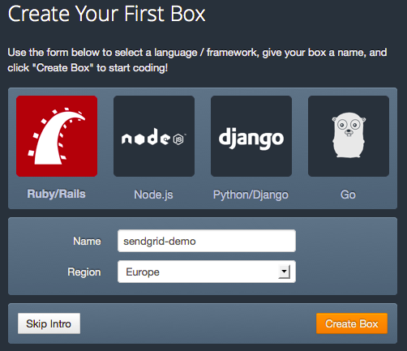
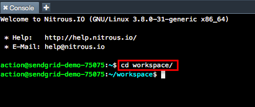
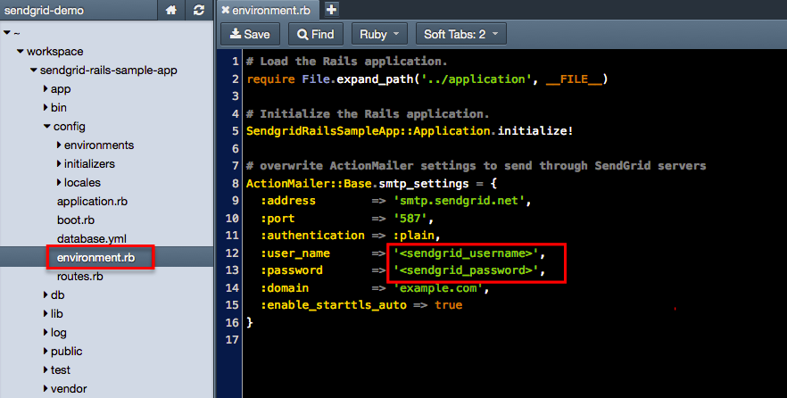
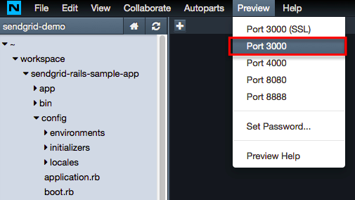
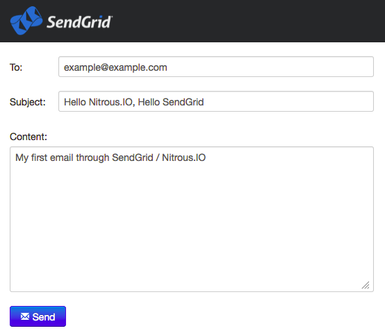
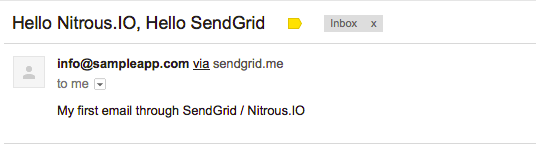

*[SendGrid](https://sendgrid.com/?{{page.utm}}) replaces your email infrastructure, so you don't have to build, scale, and maintain email servers on your own.*

*This guest blog post by Adam DuVander, Developer Communications describes how developers can leverage SendGrid's service on Nitrous.IO to include transactional and marketing emails right in their Rails Application.*

### About SendGrid

SendGrid's cloud-based email infrastructure relieves businesses of the cost and complexity of maintaining custom email systems. SendGrid provides reliable delivery, scalability and real-time analytics along with flexible API's that make custom integration a breeze.

<!--break-->
### Send Email from a Rails App
Using a [sample app on GitHub](https://github.com/sendgrid/sendgrid-rails-sample-app), this tutorial will show you how to integrate SendGrid in a Ruby on Rails app being built on Nitrous.IO.

1. If you don’t already have one, [create a SendGrid account](http://sendgrid.com/partners/nitrous-io) and [a Nitrous.IO account.](https://www.nitrous.io/?utm_source=sendgrid&utm_campaign=partnership&utm_medium=blog)

2. From the Nitrous.IO [New Boxes Page](https://www.nitrous.io/app#/boxes/new/?utm_source=sendgrid&utm_campaign=partnership&utm_medium=blog), create a new box using Ruby/Rails.

    

3. Launch the IDE and go to the workspace folder in the Nitrous.IO terminal console.

    

4. Clone the SendGrid sample application:

        git clone https://github.com/sendgrid/sendgrid-rails-sample-app.git

5. In the Nitrous.IO file browser, open config/environment.rb and change the username/password data within ActionMailer to be your SendGrid credentials.

    

6. In the terminal console go to the sendgrid-rails-sample-app folder and run the command: `bundle install`
7. Start the server with the command: `rails s`
8. Now go to the Nitrous.IO *Preview* menu and select *Port 3000*  

    

    The sample application will be opened in your browser.
    

9. Send your first email through SendGrid / Nitrous.IO by filling out the form. 
    Now go check your email.
 
    

    Your message will be there, waiting for you.

This basic application shows you how simple it is to incorporate SendGrid email into your application. The code is also simple and is based on Rails ActionMailer. You can send the email using code in the controller app/controllers/email_controller.rb and app/mailers/sendgrid_mailer.rb contains the mailer settings.

As a next step, you can build email into your own Rails application on Nitrous.IO. Perhaps you need to send social notifications, for example. With SendGrid, email is easy.

Getting started is simple, sign-up with [a free SendGrid account](http://sendgrid.com/partners/nitrous-io) and [claim your free cloud development environment with Nitrous.IO](http://nitrous.io/join/?{{page.utm}})

