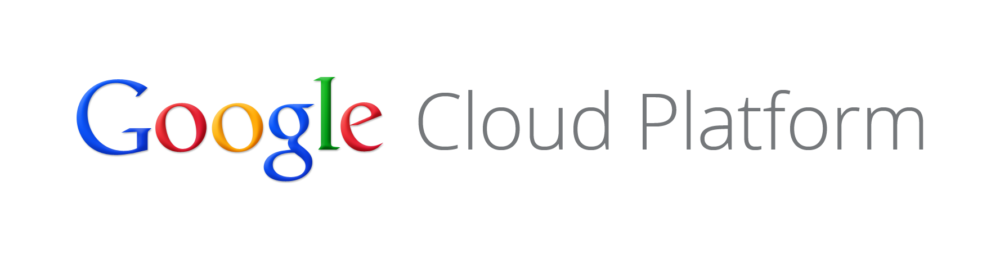
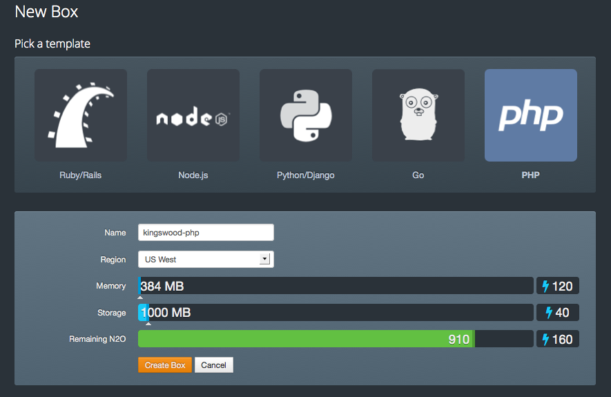
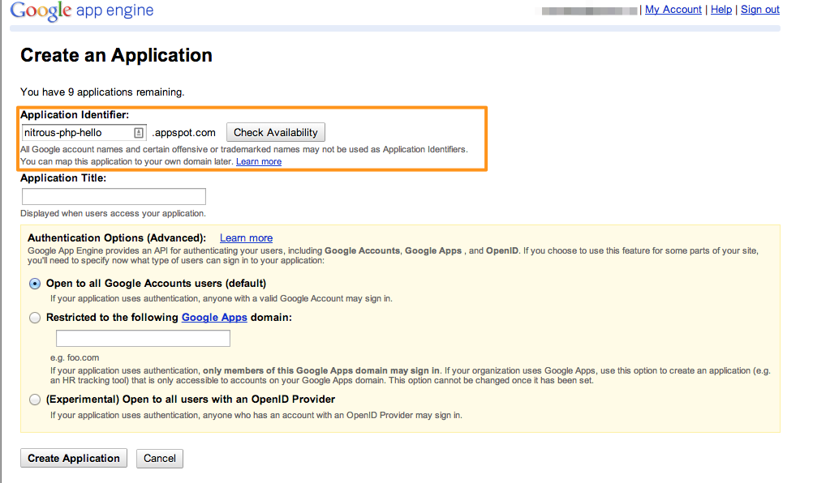
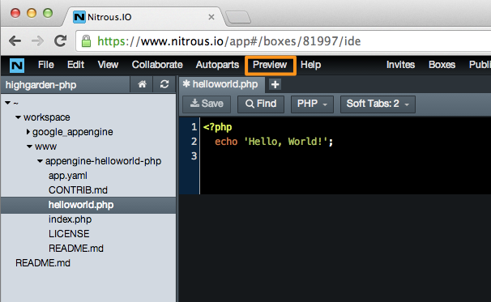
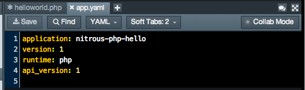
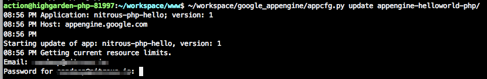
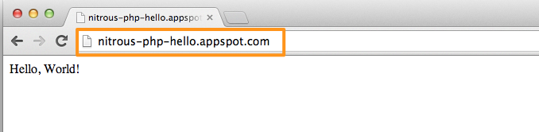

Nitrous.IO allows developers a choice in web application languages, frameworks and production environments. We are joining the Google Cloud Platform Partner Program as a Technology Partner so that our customers have an easy path to deploy and scale their applications on Google's Infrastructure.

### Google App Engine (Now w/ PHP!)

Google App Engine (GAE) is the Platform-as-a-Service portion of Google Cloud Platform that allows developers to easily deploy their app and effortlessly scale with demand. GAE supports Java, Python, PHP, and Go Applications.  The remainder of this post walks you through building  a PHP app on the recently launched Nitrous.IO PHP enviroment and pushing it to production on Google App Engine. ([See here for Python Apps](http://help.nitrous.io/app-engine/?{{page.utm}}))
<!--break-->
### Set up PHP on Nitrous.IO

Start at [the new boxes page](https://www.nitrous.io/app#/boxes/new?{{page.utm}}) on Nitrous.IO and select a new PHP Box.

That's it. **Your PHP environment is now ready to go.**

If you don't have a Nitrous.IO account [you can sign up  for free using your Google or Google Apps credentials](http://nitrous.io/join/?{{page.utm}}&utm_keyword=new)

### Create a New Application on GAE

Sign in to [App Engine Console ](https://appengine.google.com/?{{page.utm}})with your Google credentials or use [Google Apps crendentials.](https://developers.google.com/appengine/docs/adminconsole/)

Click the **Create a new Application** Button and register an application ID.

### Add the GAE SDK to your Nitrous.IO environment.

We'll install the Google App Enigne SDK from Nitrous.IO's package manager *[autoparts.](http://help.nitrous.io/autoparts/?{{page.utm}})*

In the terminal type:

         parts install googleappengine

You can also install it from the UI by selecting AutoParts >> Manage Packages.

### Build and Test on Nitrous.IO

Let's start by cloning the _HelloWorld_ PHP example

    cd ~/workspace/www
    git clone https://github.com/GoogleCloudPlatform/appengine-helloworld-php

We can now make any changes we want to this code with the WebIDE or locally in your favorite text editor if you use the [Nitrous Desktop Apps.](http://nitrous.io/desktop/?{{page.utm}}) 

Nitrous.IO web IDE's [live preview feature](http://help.nitrous.io/preview/) let's you view your code before pushing to production. Check it out by clicking *Preview>> Port 3000* from the IDE menu.

### Deploy to GAE

Edit the [app.yaml settings file](https://developers.google.com/appengine/docs/php/config/appconfig?{{page.utm}}) to change `application` field to point to your application ID that you create on Google App Engine

Now to deploy simply run the command below from within the `www` directory

    appappcfg.py update appengine-helloworld-php

Enter your Google App Engine credentials and the script will push your code to the Google App Engine Application that you created earlier in this walk through.

### Viewing your Live Application
You can now access the production version hosted on Google App Engine at:
`http://your_app_id.appspot.com/`

Get started coding in PHP today with [your free Nitrous.IO Account ](http://nitrous.io/?{{page.utm}}&keyword=bottom)