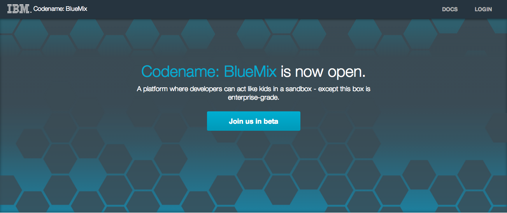
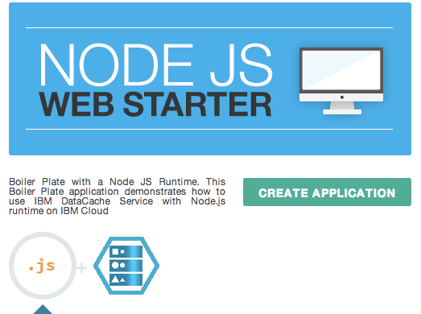

[IBM announced](http://www-01.ibm.com/software/ebusiness/jstart/bluemix/?{{page.utm}}) their new PaaS offering *[BlueMix](https://ace.ng.bluemix.net/?{{page.utm}})* earlier this week.
If you joined their open Beta you can now deploy NodeJS, Ruby on Rails, Python, PHP and Java apps to BlueMix.

Here at Nitrous.IO we like shiny new things as much as the next developer. We will show you how to connect your BlueMix account to Nitrous.IO and push a NodeJS app into production on BlueMix.

<!--break-->
### Sign Up and Create a new Node Box..

1. Sign up for the BlueMix [Beta](https://ace.ng.bluemix.net/?{{page.utm}}) and Login in to your account once you're accepted into the beta. 
You can [sign up for a Nitrous.IO Account here.](https://nitrous.io/join/?{{page.utm}})

2. From the Dashboard select *Add Application* button.

3. Select _NodeJS WebStarter_ from the *Boilerplates* 

4. Click the *Create Application* Button and follow the instructions to select *App Name/Hostname*

    

### On Nitrous.IO, install and Login into the BlueMix CLI

4. Fire up your NodeJS Dev Box on Nitrous.IO. See this page [for detailed instructions.](http://help.nitrous.io/box-templates/?{{page.utm}})

5. BlueMix uses a Cloud Foundry command line interface called *cf*.  We'll install it from Nitrous.IO's package manager *autoparts.* In the terminal type:
  
         parts install cloudfoundry
         
   You can also install it from the UI by selecting AutoParts >> Manage Packages 

6. Connect to BlueMix and Login with your username and password
        
        cf api https://api.ng.bluemix.net
        cf login

### Clone a Sample App and Deploy

7. Clone a sample app from your own repos. We'll use this 'HelloWorld' sample app.
    
        cd workspace
        git clone https://github.com/heroku/node-js-sample/
        cd node-js-sample
        npm install

8. Use the CLI in your working directory to deploy your code to BlueMix:
        
        cf push <yourappname> -c "node web.js"

    [Check out this link if you need a build pack for other languages](http://www.ng.bluemix.net/docs/DeployApps.jsp)

9. See your beautiful code at: `http://<yourappname>.ng.bluemix.net`
