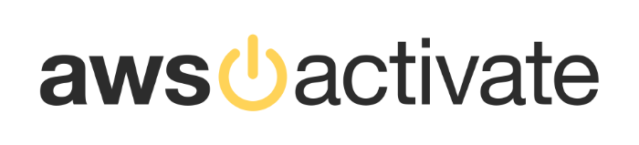

Nitrous.IO is excited to be included in Amazon Web Services Activate Program. AWS Activate is a program designed to provide startups with the resources needed to get started building their businesses.

Nitrous.IO's solutions help developers create Ruby, Python, Go, and NodeJS environments in the cloud, so they can start coding instantly rather than waste time configuring development environments. With built-in collaboration and Live Preview, developers can easily pair program with their colleagues and get feedback from clients from directly within the development environment. Developers can use the highly responsive web IDE with any modern browser (including Google Chromebooks and Microsoft Surfaces) or they can program locally using their favorite Mac text editor while Nitrous.IO Desktop for Mac, our native mac application, syncs their code to the cloud.
<!--break-->
"As a startup, collaboration and rapid iteration is critical," said Miles Tinsley, Founder and CEO of Claimable. "Nitrous.IO lets our contractors and new employees start working in minutes on our development environment rather than spending the first few days setting up the environment. We can take advantage of the collaborative hosted solution that Nitrous.IO provides to work seamlessly while allowing each developer to use the OS and Hardware of their choice."

If you're already an AWS Activate member you can find the details of the current offer under the [Benefits / Special Offers Section](http://aws.amazon.com/activate/benefits/special-offers/) of the AWS website. Simply sign up for Nitrous.IO and email us at [awsactivate@nitrous.io](mailto:awsactivate@nitrous.io). Your plan will be upgraded once we have confirmation of your AWS Activate membership.

