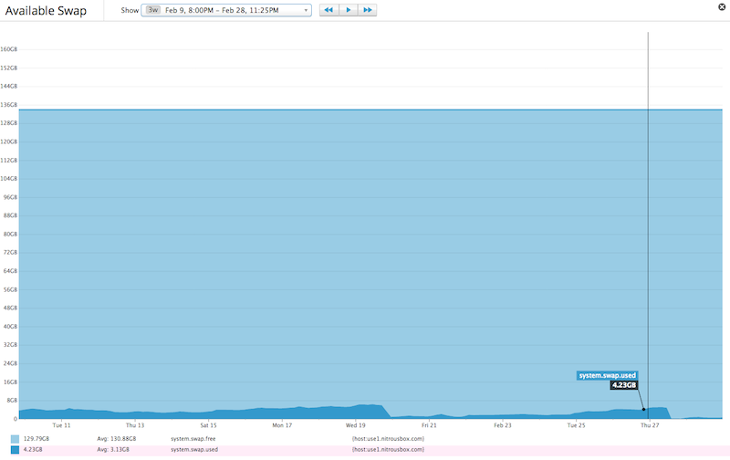

We recently deployed a kernel patch to our servers that resolved a recurring stability issue. Our team is truly ecstatic to have solved this issue which has been troubling us for the past few months. Our customers rely on Nitrous.IO for their "always on" development box in the cloud, and these randomly-timed service outages have been a huge pain.

We sincerely apologize to those of you who were inconvenienced by the recent outages. You deserve better and we'll do better. At this moment, we're just extremely happy to have stable servers once again.

INSERT PICTURE OF SORRY CAT

The rest of this blog post is a technical postmortem and a log of our adventures trying to solve what ultimately turned out to be a bug in the Linux kernel.

TL;DR: there's a pretty serious race-related bug in the Linux OOM killer that's been fixed on the Linux mainline and 3.14 branch. If you're experiencing lockups where the OOM killer appears in your `kern.log`/`syslog` shortly before the lockup, you should patch your kernel.

<!--break-->

### Early Signs

Our first record of a server outage was sometime in October 2013 &mdash; our host servers in the Southeast Asia region went down inexplicably. Our metrics and AWS CloudWatch indicated that CPU utilization spiked to 100%. We chalked it down to an overloaded server, which we now know was naïve.

Last month, these outages began to happen more regularly but also very *randomly*. The symptoms were quite similar:

* CPU spiked to 100% utilization.
* Disk I/O spiked.
* Server became completely inaccessible via SSH, etc.
* Logs show the Linux Out Of Memory (OOM) killer killing user processes that have hit their [cgroup](https://www.kernel.org/doc/Documentation/cgroups/cgroups.txt)'s memory limit shortly before the server froze.
* Host memory was *not* under pressure - it was close to fully utilized (which is normal) but there was a lot of unused swap.

### Theories and Failed Solutions

Everyone on the engineering team had their pet theories and proposed solutions, some of the notable ones being:

1. A Xen hypervisor bug on the Amazon EC2 host.
* User processes were overloading the host.
* The host was denied share of CPU, causing user processes to deny system processes (like `sshd`) from responding in a timely fashion.
* The host was experiencing a stampede of memory pages being swapped out of memory.


#### Theory #1: Xen hypervisor bug

We didn't find many clues on the Internet (as everybody knows, anything on the Internet has to be true) and had no real control over this one, so we didn't really give this theory much weight. Although, when we were throwing up our hands in the air, we might have declared it as "it's an effing Xen bug" a couple of times.

#### Theory #2: User processes overloading the host

The most obvious course was to de-prioritize user processes that were running into CPU contention issues.

We introduced a process watcher called Bulldog that reaps abusive or malicious processes that were sucking up precious CPU time &mdash; Bitcoin miners (e.g. `minerd`), password miners and scrapers were not uncommon. This is a simplified animation of how Bulldog works:


Bulldog worked fine and also showed us that we were allowing user processes to consume too much CPU time &mdash; they were basically allowed to use all CPU cores if there was no competition (we were using the [`cpu.shares` cgroup parameter](https://access.redhat.com/site/documentation/en-US/Red_Hat_Enterprise_Linux/6/html/Resource_Management_Guide/sec-cpu.html) to allocate relative CPU shares).

We ended up using quotas so that the [Completely Fair Scheduler](http://en.wikipedia.org/wiki/Completely_Fair_Scheduler) (CFS) will cap CPU usage of user processes. The [`cpu.cfs_quota_us` and `cpu.cfs_period_us` parameters](https://www.kernel.org/doc/Documentation/scheduler/sched-bwc.txt) are well-documented and easy enough to use.

And just like that, our `minerd` woes were solved. But this still wasn't the solution to the random lockups.

#### Theory #3: Host denied share of CPU

Another theory was the the host processes were being starved of the CPU by user processes. We used the [`cpus.cpuset`](https://www.kernel.org/doc/Documentation/cgroups/cpusets.txt) parameter to reserve at least 1 CPU for the host.

Again, this wasn't the solution, but it definitely made sense to have this CPU isolation in place.

#### Theory #4: Swap stampede

We'd initially set the [`vm.swappiness`]([Swappiness](http://en.wikipedia.org/wiki/Swappiness)) parameter to 0 for performance reasons. As expected, swap was very little used:



The theory was that an OOM condition on the host caused [kswapd](http://www.science.unitn.it/~fiorella/guidelinux/tlk/node39.html) to start swapping out too many pages, thus causing CPU utilization and disk utilization to spike.  At a `vm.swappiness` of 0, the kernel will swap only to avoid an out of memory condition.

We set `vm.swappiness` back to the default of 60 to encourage the kernel to use swap.

We also set `vm.min_free_kbytes` to ~5% of memory to reduce the possibility of the host going OOM before using swap.

For a week or so, we had no outages, and we thought we'd nailed it. And then a spate of random outages hit us again and we realized we had declared victory prematurely.

#### OMG it's a kernel bug

At this point, one of our engineers, Daniel, was pretty sure it's a Linux kernel bug, and went digging through the commit history of [the OOM killer](https://github.com/torvalds/linux/blob/master/mm/oom_kill.c) and noticed [these commits](https://git.kernel.org/cgit/linux/kernel/git/torvalds/linux.git/log/?id=4d4048be8a93769350efa31d2482a038b7de73d0&qt=range&q=9853a407b97d8d066b5a865173a4859a3e69fd8a...4d4048be8a93769350efa31d2482a038b7de73d0).

The commit messages were pretty damning:

```
2014-01-22  oom_kill: change oom_kill.c to use for_each_thread()
2014-01-22  introduce for_each_thread() to replace the buggy while_each_thread()
````

**Jackpot!** There was a possible race condition in the OOM killer where it tries to kill a process that was already killed (probably by its parent process), and `while_each_thread()` goes into an **infinite loop**. [This commit message](https://git.kernel.org/cgit/linux/kernel/git/torvalds/linux.git/commit/?id=0c740d0afc3bff0a097ad03a1c8df92757516f5c) goes into greater detail.

We [patched](https://github.com/nitrous-io/linux/tree/stable-trusty) the Ubuntu Trusty tree of the kernel (which based off of 3.13-mainline) and compiled a custom kernel with [Packer](http://www.packer.io/). As good scientists, we made sure we could reproduce the OOM killer bug on our current 3.8 kernel but not on the new kernel.

The new kernel was deployed last week and things have been stable since then.

#### Relief and what's next?

Having lived through weeks of random outages and hairy on-call schedules, I am extremely relieved that our users are no longer affected &mdash; unpredictable uptime is unacceptable.

I'm also very happy that the engineering team can get back to focusing on features and customer requests, instead of being distracted by fire-fighting and baby-sitting scheduled maintenance periods.

Want to get on Nitrous.IO service status and scheduled maintenance? Follow [@N2OStatus on Twitter](https://twitter.com/n2ostatus) or get updates on our [status page](http://status.nitrous.io)


