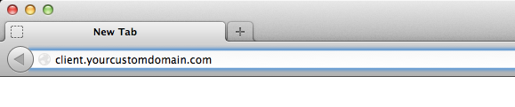
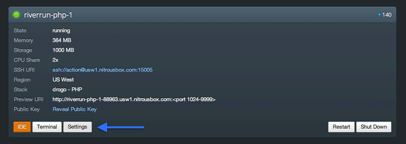
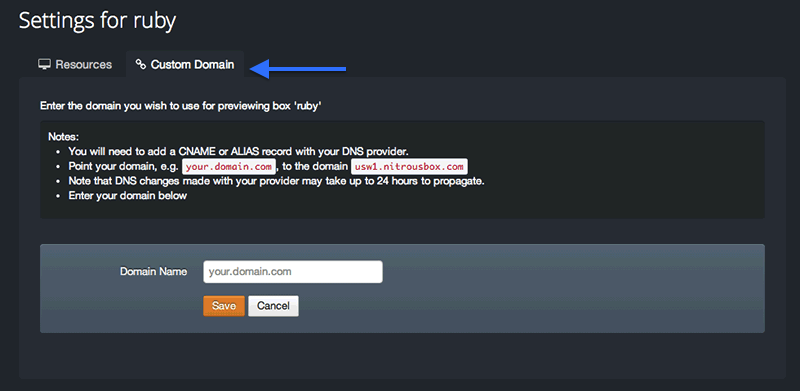
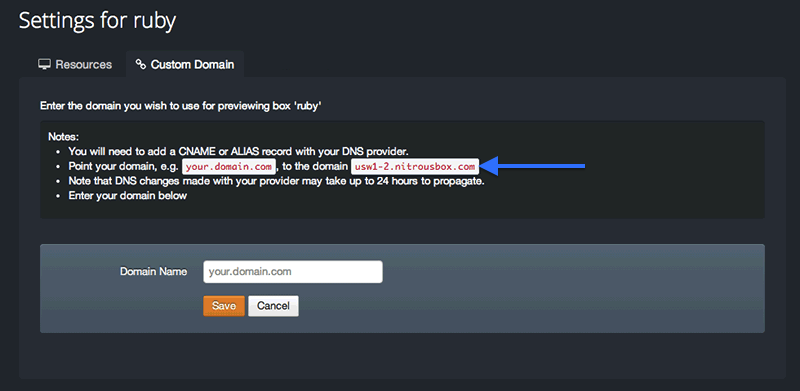

_TL/DR; You can now preview the applications on your Nitrous.IO Boxes on a custom domain._

[Live preview](http://help.nitrous.io/preview) is an awesome feature that let's you easily share what you're working on for rapid feedback and iteration.
By default your app is "preview-ed" at URL that is based on the name of your development box.

Starting today, you can personalize that preview URL with your own custom domains.

This means you can send your clients to your domain name rather than something arbitrary like: `http://kings-landing-rails-14592.usw1.nitrous.io`

So grab a [Shift or Turbo level plan](https://www.nitrous.io/pricing) and let's setup your custom domain today.

<!--break-->
### Getting Started

Navigate to the [boxes page](https://www.nitrous.io/app#/boxes/?{{page.utm}}), and click **Settings** within your box information.

On the box settings page, look for the **Custom Domain** tab. On this tab you will be able to enter in the custom domain of your choice.

### Creating a DNS Record

Next, you will need to set up changed with your DNS provider. DNS changes made with your provider may take up to 24 hours to propagate.

Within your domain registrar you will need to create either a CNAME or ALIAS record with your DNS provider. Let's go over both methods.

#### Subdomains (CNAME Records)

CNAME records must point to a subdomain, which allows the DNS to automatically adjust if the server's IP is ever changed.

When using a subdomain, like `www.your-domain.com`, create a **CNAME** record pointing `www` to the Nitrous box's subdomain. The Nitrous subdomain can be found on the **Custom Domains** page and it will include the region your box runs within (e.g. `usw1-2.nitrousbox.com`).

Once the CNAME record is created, you could forward your domain `your-domain.com` to your subdomain `www.your-domain.com` if your DNS provider supports this. Doing this will ensure both the **www** subdomain and **non-www** domain are supported.

View the [Google Support Guide](https://support.google.com/a/topic/1615038?hl=en&ref_topic=1687211) for information on setting up a CNAME record with your DNS provider.

#### Apex Domains (Alias Records)

Some DNS hosts provide a way to get CNAME-like functionality at the zone apex using ALIAS or ANAME record types. Such records include:

* [ALIAS at DNSimple](http://support.dnsimple.com/articles/alias-record)
* [ANAME at DNS Made Easy](http://www.dnsmadeeasy.com/technology/aname-records/)
* [ANAME at easyDNS](http://docs.easydns.com/aname-records/)

If using a DNS provider above (or one with these capabilities), point the ALIAS or ANAME record for your apex domain to the Nitrous box's subdomain. The Nitrous subdomain can be found on the **Custom Domains** page and it will include the region your box runs within (e.g. `usw1-2.nitrousbox.com`).

>Note: If your DNS does not support the ALIAS or ANAME records mentioned above, try using CNAME records as this is recommended. There is also a method of using A-records to configure apex domains (aka bare, naked, or root domains), but it is not recommended as this requires a hard-coded IP address within your DNS configuration. This prevents your infrastructure provider from assigning your box a new IP address when adverse conditions arise.

### Previewing Your App

To preview your app with your domain, simply run the app within the console with the appropriate command (e.g. rails server).

Ports 1024 - 10,000 are open within your Nitrous box. To view the app on a specific port just add `:port-number` to the end of your domain when visiting it (e.g. your.domain.com:4000).

If you wish to view your app directly on your domain (e.g. domain.com), run the app on port 3000. The Nitrous boxes automatically forward this to port 80, eliminating the need for specifying a port within the URI.

### Behind a Firewall?

If you're inside a corporate or school network which blocks these ports then you may only be able to preview your app on port 80.

If this is the case then you will want to configure your app to run on port 3000. Each Nitrous box automatically forwards port 3000 to 80, so you can simply visit your custom domain without any ports specified within the URL.
