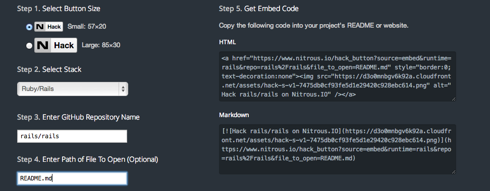

It's no secret that Nitrous.IO makes it unbelievably simple to start a new Rails, PHP, Python or Go project with our instantly provisioned development workspaces in the cloud. Today, we're excited to announce that we're taking simple to the next level with the launch of the [Nitrous.IO Hack button](https://www.nitrous.io/hack?{{page.utm}}).

The *Hack* button makes any open source project, tutorial or sample application immediately available in a fully-functional linux workspace, so you can start hacking on any Github Project in seconds. Whether you're contributing to great open source projects like [Grape](), leveraging a new [Rails Apps]() starter project, integrating powerful platform APIs like [Twilio]() or [Sendgrid]() or following a [Discover Meteor]() tutorial, you'll be coding in seconds without any installation or configuration required.

<!--break-->

### Hackers: Getting Started

1. Click any "Hack" button you see in a Github repository, blog post or e-book and start coding on that project immediately on Nitrous.IO.  It's really that easy.  Here's an example with [Meteor's](https://www.meteor.com) [telephone-pictionary](https://github.com/meteor/telephone-pictionary) app on Github.

 

### Project Authors: Getting Started

Sharing an environment for your own popular project on Github has never been easier.  Simply choose a project you want to create a Hack button for and follow these easy steps:

1. [Create a button](https://www.nitrous.io/embed?{{page.utm}}) using your Github repository name.  You can optionally choose a file to open after opening the IDE.

2. Copy and paste the embed code in a Github README, a blog post or tutorial.

A number of partners have already embedded the Hack button on their Github repositories, including [Sendgrid](), [Twilio](), [Meteor](), [Firebase](), [RailsApps](), [Shopify](), [and more](https://www.nitrous.io/hack?{{page.utm}}).  You can click any of the buttons below to launch one of their projects:

<ul class="hack-partners">
  <li class="partner">
    

      
    

    

      

        <a href="https://www.github.com/meteor">meteor</a>
      

      

        telephone-pictionary
      

      

        
      

    

  </li>
  <li class="partner">
    

      
    

    

      

        <a href="https://www.github.com/firebase">firebase</a>
      

      

        angularFire
      

      

        
      

    

  </li>
</ul>

 

<a href="https://www.nitrous.io/embed?{{ page.utm }}" class="btn btn-block btn-success">Create your own Button Today!</a>

### Benefits for Developers and Customers

With companies such as Shopify, Twilio, Sendgrid and others, it means that developers can started working on their APIs much faster without any setup, thus improving the value of their business.

This benefits content creators and publishers - code snippets can be used and reused by larger audience increasing the value to the original author. Evergreen Content and Quality Improvements: Since students are interacting with the code they can submit code back to the author’s repository as the technology evolves.
