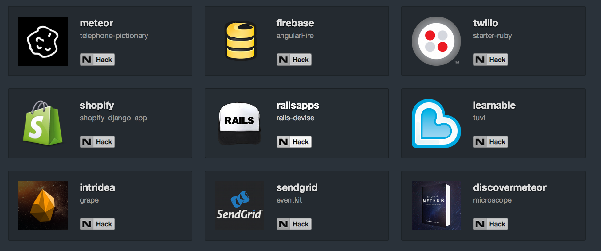

It's no secret that Nitrous.IO makes it unbelievably simple to start a new Rails, PHP, Python or Go project with our instantly provisioned development workspaces in the cloud. Today, we're excited to announce that we're taking simple to the next level with the launch of the [Nitrous.IO Hack button](https://www.nitrous.io/hack?{{page.utm}}).

The *Hack* button makes any open source project, tutorial or sample application immediately available in a fully-functional linux workspace, so you can start hacking in seconds without any installation or configuration required.

We are pleased to announce that the [following partners have already joined the Hack Movement](http://nitrous.io/hack?{{[page.utm]}}).

[Kevin Whinnery](https://twitter.com/kevinwhinnery), Developer evangelist at [Twilio](https://www.twilio.com) has this to say about the
Hack on Nitrous movement:

> Twilio's mission is to empower developers to change the way the world
> communicates. Hack with Nitrous.IO is a great tool to help us
> accomplish our mission. By making it possible to set up a development
> environment with one of our sample web apps in seconds, developers can
> spend less time configuring and more time learning and building.

Want other people to hack on your projects ? Adding a Hack button is simple and using one is even easier.

<!--break-->

### Hackers: Getting Started

1. Click any "Hack" button you see in a Github repository, blog post or e-book and start coding on that project immediately on Nitrous.IO.  It's really that easy.  Here's an example with [Meteor's](https://www.meteor.com/?{{page.utm}}) [telephone-pictionary](https://github.com/meteor/telephone-pictionary) app on Github.

 

### Project Authors: Getting Started

For Authors, embedding a Hack button allows developers to started working with your code or APIs that much faster. Additionally, your code sample and snippets can be used and reused by a larger audience and users can submit pull requests with any updates or changes making your evergreen.

Sharing an environment for your own popular project on Github is easy. Simply choose a project you want to create a Hack button for and follow these easy steps:

1. [Create a button](https://www.nitrous.io/embed?{{page.utm}}) using your Github repository name. You can optionally choose a file to open after opening the IDE.

2. Copy and paste the embed code in a Github README, a blog post or tutorial.

A growing number of partners have already embedded the Hack button on their Github repositories, including [Sendgrid](http://sendgrid.com/?{{page.utm}}), [Twilio](http://twilio.com/?{{page.utm}}), [Meteor](http://meteor.com/?{{page.utm}}), [Firebase](http://firebase.com/?{{page.utm}}), [RailsApps](http://railsapps.github.io/?{{page.utm}}), [Shopify](http://shopify.com), [and more](https://www.nitrous.io/hack?{{page.utm}}).

