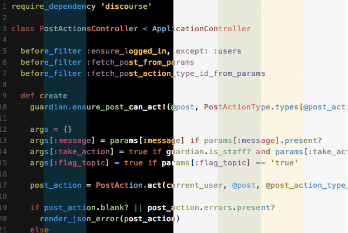
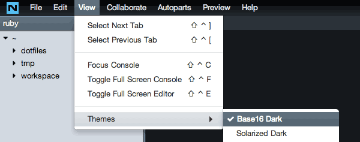

Light on Dark Theme is great for working in the Nitrous.IO Product Cave
but we know that some of you want to project your Nitrous.IO environment
or perhaps have a different preference.

As of Last night you can now switch the color scheme for the Nitrous.IO
editor.

### How to Change the Theme

To change your theme, [login](https://www.nitrous.io?{{page.utm}}) to
your account and open the Web IDE. You will be able to change the theme
by navigating in the menu to `View > Themes`, and select one of four
light and dark themes.

Enjoy!
