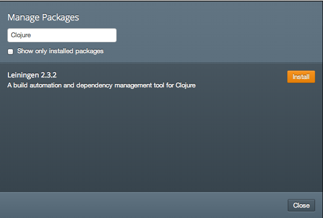
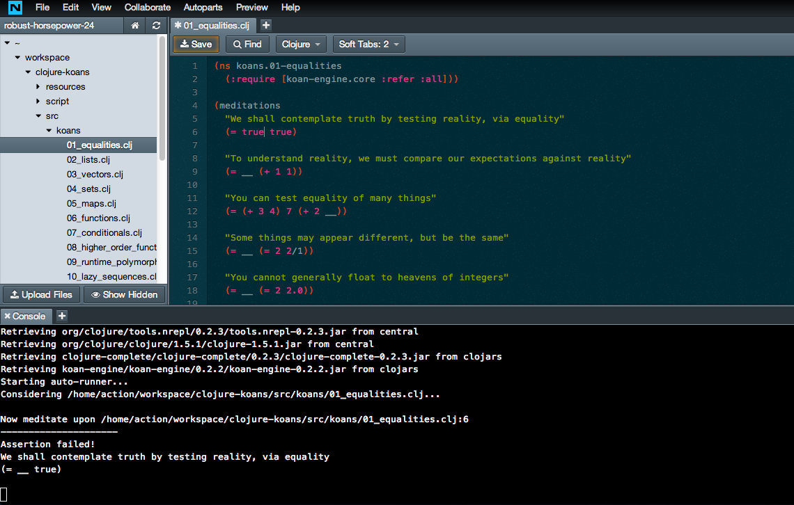

In the last couple of months, I've been spending some of my free time learning [Clojure](http://clojure.org/).
If you haven't heard of Clojure, it is a dialect of LISP. Clojure is a great way to pick-up functional programming concepts, by using them in real-life applications.
Another interesting point about Clojure is that it can be compiled to JVM bytecode, as well as to [JavaScript](https://github.com/clojure/clojurescript).
This means, it can be used to write both server-side and client-side applications.

However, when I first wanted to get my hands dirty with Clojure, my immediate reaction was "Eww... I don't want to install Java in my machine!". Then I realized this is exactly the reason why we have [Nitrous](https://nitrous.io).
With Nitrous, I can start off with a clean-slate development environment tailored for Clojure itself. Though Nitrous doesn't offer a ready made Clojure template, it is super simple to setup a Clojure environment in Niitrous. (Random Fact: we'll soon be offering more customisable templates).

Let's pick any existing template for now and create a new box. All templates comes with Java 1.7 pre-installed. That satisfies the first requirement for trying Clojure.
Before trying to manually install Clojure, let's see if it's already available as an Autopart package in Nitrous. Autoparts is Nitrous' own package manager, which provides an easy way to install some of the common and popular tools/libraries.
In the IDE, I opened `Autoparts` > `Manage Packages..` and searched for 'Clojure'. It brought up this package called 'Leiningen'.



## What is Leiningen?

[Leiningen'](http://leiningen.org/) claims to be the easiest way to use Clojure. Coming from a Ruby background, I understood it as a tool which combines RVM/RubyGems/Bundlr/Rake into a single tool.
So installing Leiningen should be good enough to get started with Clojure projects.

## Play with REPL

Once we have installed Leiningen, we can use its REPL to get the first taste of Clojure.

Run, `lein repl` in the console:

```
    user=> (+ 1 2 3)
    6

    (doc +)
    -- displays documentation for `+` function.

    (source +)
    -- displays the source of `+` function.
```

**Tip:** If you feel the REPL is kinda laggy, it's because JVM process consumes more resources. I'd recommend you to upgrade to a [paid plan](https://nitrous.io/pricing), which will give your box more CPU share and memory.

## Try Clojure Koans

Playing with REPL is a good start. But I'd prefer a more structured guide to get acquainted with the language. I found following [Clojure Koans](http://clojurekoans.com/) is a perfect way to do this.

To Try out Clojure koans, start by cloning its repository into your box:

    cd ~/workspace

    git clone git://github.com/functional-koans/clojure-koans.git

Then on console, start it by running:

    cd ~/workspace/clojure-koans
    lein koan run

On the first run, you will see an failed assertion. In order to make it pass, let's open the relavant source file in the editor (`~/workspace/clojure-koans/src/koans/01_equalities.clj`).
Change the first meditation to satisfy the assertion and press 'Save' (or `CTRL + S`). When the file is saved, console will re-run the koans and output the result. You can step through the koans, by fixing one assertion at a time.



## Little taste of ClojureScript

At the beginning of the post, I mentioned Clojure can also be compiled to JavaScript. This compiler is known as [ClojureScript](https://github.com/clojure/clojurescript).
There's a [Leiningen plugin](https://github.com/emezeske/lein-cljsbuild), which can be used to compile and run ClojureScript apps.

Let's try running the sample app provided with the plugin.

We should first clone the repo:

    git clone git://github.com/emezeske/lein-cljsbuild

Then go to the sample app directory and run the following commands to start the server.

    cd ~/workspace/lein-cljsbuild/example-projects/simple
    lein cljsbuild once
    lein ring server-headless 3000

Once the server is started, you can preview the app by selecting `Preview` > `3000` in the IDE.

## More resources

There's plenty of resources available online to learn [Clojure](http://clojure.org/documentation).
I personally recommend following the [presentations by Rich Hickey](https://www.youtube.com/playlist?list=PLZdCLR02grLrEwKaZv-5QbUzK0zGKOOcr) (the creator of Clojure), which gives good insight on how to approach problems in functional way.
