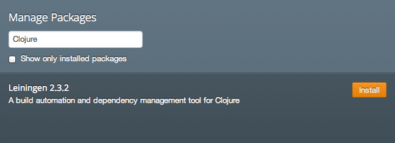
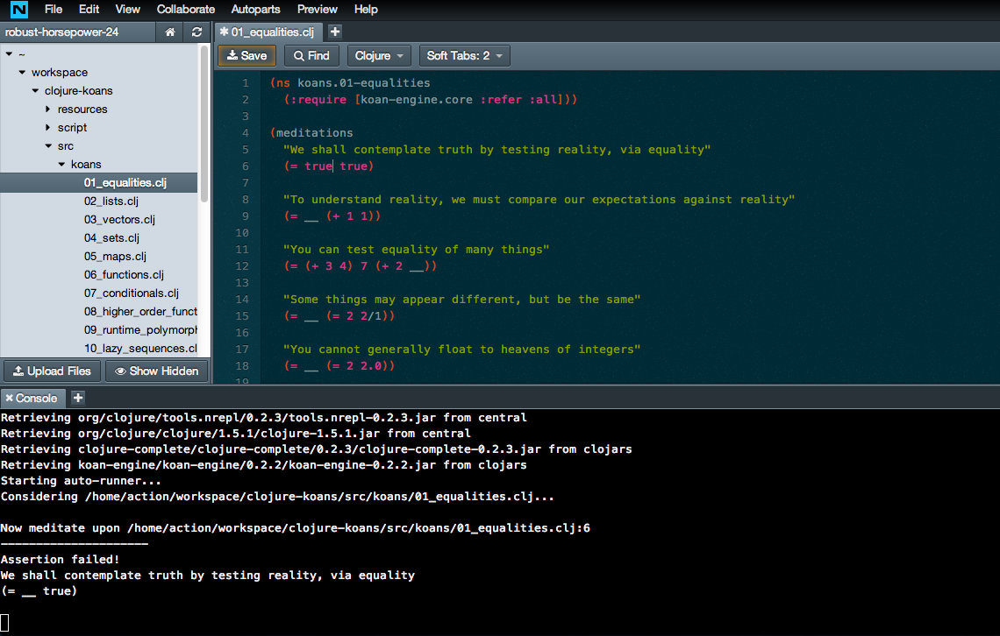

I've been spending some of my free time learning [Clojure](http://clojure.org/) in the past two months.  If you haven't heard of Clojure, here's the elevator pitch: it is a dialect of LISP, a great way to pick up functional programming, and can be compiled to both JVM bytecode and [JavaScript](https://github.com/clojure/clojurescript).  This makes it a viable language for writing both server-side and client-side applications.

Back when I first wanted to get my hands dirty with Clojure, my immediate reaction was "Eww... I don't want to install Java on my machine!". Then I realized this use case is a perfect fit for [Nitrous.IO](https://nitrous.io?{{page.utm}}), where I can start off with a clean-slate development environment. Though Nitrous.IO doesn't offer a ready-made Clojure template, setting up a Clojure environment is straightforward.

Let's pick any box template for now and [create a new box](https://www.nitrous.io/app#/boxes/new). All templates come with Java 1.7 pre-installed. That satisfies the first requirement for trying Clojure.

Before trying to manually install Clojure, let's see if it's already available as an Autoparts package in Nitrous.IO. Autoparts is Nitrous.IO's own package manager.  It provides an easy way to install tools/libraries.

In the IDE menu , go to `Autoparts` > `Manage Packages...` and search for 'Clojure'. This brings up a single package, 'Leiningen'.

<!--break-->

## What is Leiningen?

[Leiningen'](http://leiningen.org/) is a popular tool for automating Clojure tasks.  In my brief experience with it, I've come to see it as a super-tool which combines RVM, RubyGems, Bundler, and Rake.
It turns out installing Leiningen is sufficient to get started with Clojure projects, so let's do that.

## Playing with the REPL

Once we have installed Leiningen, we can use its REPL to get our first taste of Clojure.

Run, `lein repl` in the console:

    user=> (+ 1 2 3)
    6

    (doc +)
    -- displays documentation for `+` function.

    (source +)
    -- displays the source of `+` function.

**Tip:** If you feel the REPL is kinda laggy, it's because JVM processes consume more resources.  Upgrading to a [paid plan](https://nitrous.io/pricing?{{page.utm}}) will give your box the extra CPU share and memory goodies the JVM is so hungry for.

## Trying Clojure Koans

Playing around with a REPL is a good start, but I prefer a more structured approach to getting acquainted with a language. I found following [Clojure Koans](http://clojurekoans.com/) to be the perfect way to do this.

To try out Clojure Koans, start by cloning its repository into your box:

    cd ~/workspace
    git clone git://github.com/functional-koans/clojure-koans.git

Then start it by running:

    cd ~/workspace/clojure-koans
    lein koan run

On the first run, you will see an failed assertion. In order to make it pass, open the relavant source file in the editor (`~/workspace/clojure-koans/src/koans/01_equalities.clj`).

Change the first meditation to satisfy the assertion and press 'Save' (or `CTRL + S`). When the file is saved, console will re-run the koans and output the result. You can step through the koans by fixing one assertion at a time.

## A little taste of ClojureScript

I mentioned earlier that Clojure can also be compiled to JavaScript. The compiler for this is known as [ClojureScript](https://github.com/clojure/clojurescript).
There's a [Leiningen plugin](https://github.com/emezeske/lein-cljsbuild), which can be used to compile and run ClojureScript apps.

Let's try running the sample app provided with the plugin.

First clone the repo:

    cd ~/workspace
    git clone git://github.com/emezeske/lein-cljsbuild

Then go to the sample app directory and run the following commands to start the server.

    cd ~/workspace/lein-cljsbuild/example-projects/simple
    lein cljsbuild once
    lein ring server-headless 3000

Once the server is started, you can preview the app by selecting `Preview` > `3000` in the IDE menu. If we do some changes to the sample app code, we can see the generated JavaScript also changes accordingly.

## Moving on...

If this introduction made you want to dig deeper into Clojure, there are plenty of [resources](http://clojure.org/documentation) to guide you.
I personally recommend following the [presentations by Rich Hickey](https://www.youtube.com/playlist?list=PLZdCLR02grLrEwKaZv-5QbUzK0zGKOOcr) (the creator of Clojure), which give good insight on how to approach problems in a functional way.

We are excited to see what kind of Clojure projects you are going to build on [Nitrous.IO](https://nitrous.io?{{page.utm}}). Feel free to share your work with us either via [Twitter](https://twitter.com/nitrousio) or [Email](support@nitrous.io).
