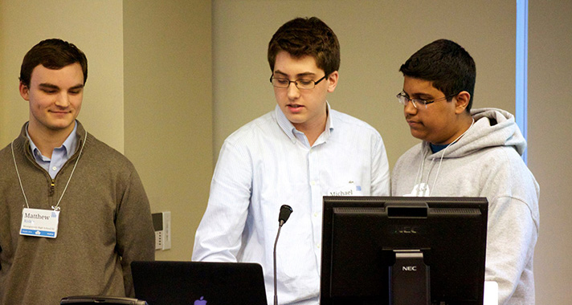

Michael Reininger, Matthew Risley, and Sri Velagapudi formed a team to participate at [PilotDC hackathon](http://dc.gopilot.org/) last March. Coming from Montgomery High School in New Jersey, this was their first hackathon. The team decided to code on [Nitrous.IO](https://www.nitrous.io?{{page.utm}}) in order to collaborate and build their app within the 24 hour timeframe. We talked to Michael and got the full story on how his team became great developers early on, and how they used Nitrous.IO to build the winning app at PilotDC.

##### *From left to right: Matthew Risley, Michael Reininger, and Sri Velagapudi*

### What was your experience with coding before using Nitrous?

My friends and I have taught ourselves how to code through watching videos on YouTube and reading programming blogs. After publishing several iPhone apps and developing various websites for our local customers, we felt like it was time to test our skills at programming in an environment different from our basement and classroom.

We were already familiar with the college hackathon scene, however, we didn't expect it to reach high schools by the time we would graduate. Fortunately, we came across an ad for a high school hackathon in Washington D.C. called [PilotDC](http://dc.gopilot.org/). Immediately, we signed up and eagerly planned our trip to the nation's capitol.

### How did you utilize Nitrous.IO to build the app, and what other resources did you use?

For our project, [Memreduxx](http://memredu.herokuapp.com/), we used Nitrous.IO's PHP environment and HTML/jQuery for the site's front-end. Part of our project utilized [AlchemyAPI's Natural Language Processing engine](http://www.alchemyapi.com/resources/natural-language-processing/) to analyze subjects in sentences, and to efficiently create flashcards for fact memorization. Nitrous.IO was great in quickly allowing us to upload the API PHP files and seamlessly integrate the NLP engine with our site.
<!--break-->
### What aspects of Nitrous.IO do you love most?

We definitely love the easy to use coding interface and the amazing collaborative technology that Nitrous.IO offers. In the past, we had used other code sharing software such as Git and Dropbox, but the [live code collaboration](http://help.nitrous.io/collab?{{page.utm}}) that [Nitrous.IO](https://www.nitrous.io/?{{page.utm}}) provides is just awesome.

### How did Nitrous.IO help you deploy an app within 24 hours?

[Nitrous.IO](https://www.nitrous.io?{{page.utm}}) definitely increased our productivity a great deal, especially in an overnight event, where fatigue can catch up with your body and tempers can rise quickly if software doesn't cooperate.

One of the biggest problems we had in the past was with miscommunication of information regarding what files needed work. For example, one of my teammates would accidentally edit a file that wasn't supposed to be modified, or was being worked on already by a teammate. However, Nitrous.IO's [Collab Mode](http://help.nitrous.io/collab/) button was a life-saver at many times throughout the night. We were able to disable partner collaboration on a specific file that needed full attention, and not be vulnerable to an accidental edit that could have drastic consequences.

All in all, we were able to maintain focus and win the award for Best Design and Greatest Social Impact with help from Nitrous.IO's excellent IDE and collaboration technology.
