At Nitrous.IO, we like to say that our Web IDE is the easiest way to code in
your web browser. While that's mostly true™, the Web IDE had a pretty limited
feature set &mdash; there was no autocompletion, no linting and even little
things like a shortcut key to comment out blocks of code weren't available.

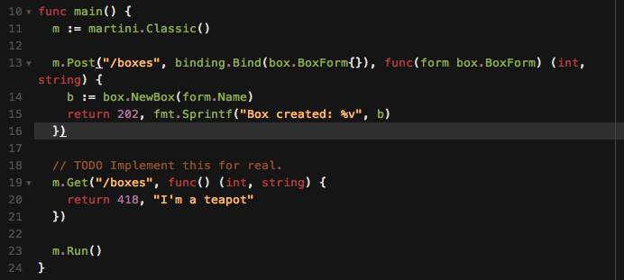

Today, we shipped a bunch of features to the IDE that most of you have been
requesting.

<!--break-->

### Brackets, parentheses and mustaches

Brackets, braces, parentheses and quotes (i.e. `[], {}, (), '', ""`) are now
auto-closed for you.

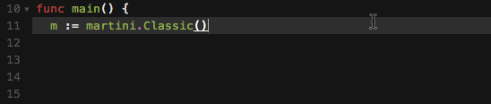

You'll notice that matching brackets are highlighted as well. To jump to the
matching bracket, hit `Ctrl-M`.

You can turn off the auto-close brackets feature in the `Edit` menu while the
highlighting of matching brackets can be disabled in the `View` menu.

### Lines and rulers

The line your cursor is on is now highlighted. This makes it easier to see
where your cursor is at. You can turn off this behavior in the `View` menu.

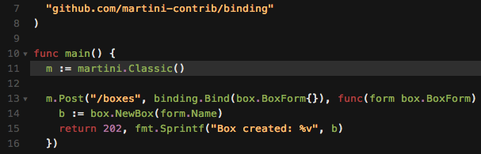

Line numbers can now be hidden. This makes the IDE slightly more minimalist for
those of you who find line numbers unnecessary. You can find this setting in the
`View` menu.

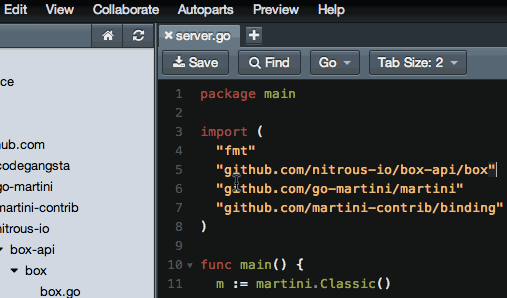

Long lines of text are now soft-wrapped. This is sometimes nicer than having to
scroll horizontally.

You can also display a vertical ruler at 78, 80, 100 or 120 column. This is
useful for making sure you keep to a sane character limit and conform to your
team's styleguide.

You can change both of these settings in the `View` menu.

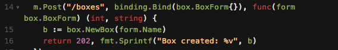

### Code folding

Code blocks can now be folded. Click the indicators in the gutter or use the
`Cmd-Alt-[` () / `Ctrl-[` (Windows) shortcuts. You can access this in the
`Edit` menu too.

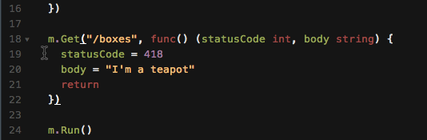

### Trailing whitespace is bad mmkay

Trailing whitespace in code is bad &mdash; it messes up movement within code
blocks and adds unnecessary noise to revision control systems. We've added an
option to highlight trailing whitespace:

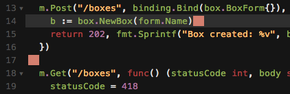

Trailing whitespace is *not* highlighted by default &mdash; turn it on from the
`View` menu.

### Autocompletion hints

Autocompletion hints are now available for `CSS`, `XML`, `HTML` and `JavaScript`
files. For other types of files, autocompletion is still available but it only
shows entries from *surrounding blocks of text*.

To see autocompletion hints, hit `Ctrl-Space`.

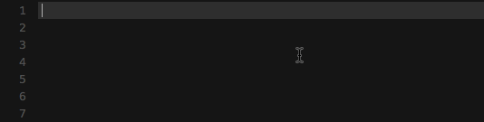

`Tab` or `Enter` inserts your current selection. If there's only one choice,
it gets entered for you. Nifty.

### Code linting

Code linting is now available for JavaScript &mdash; we rely on the popular
[JSHint](http://www.jshint.com/) library.

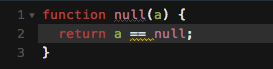

If you ever needed to edit a JSON file directly, you'll also be warned when you
enter invalid JSON.

### Vim keybindings

We've also added a set of basic Vim keybindings &mdash; most of the basic
keystrokes, like delete, yank and movement keystrokes work.

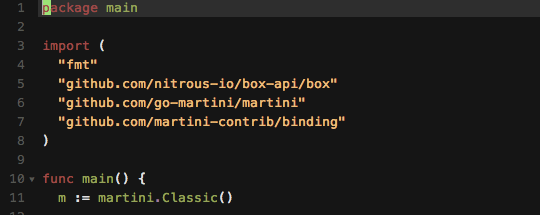

The Vim keybindings are available in `Edit` menu.

For Vim lovers, I strongly suggest you either run Vim in the web console or
login to your box via SSH &mdash; this way you get the benefit of using your
`.vimrc` and Vim plugins.

### Commenting code

I often found myself hitting `Cmd + /` in the web IDE to comment out code, only
to realize we'd not implemented it. I got to scratch a tiny itch when I added
this &mdash; you can now hit `Cmd + /` () / `Ctrl+/` (Windows) to comment out
code. Hitting `Cmd + /` or `Ctrl+/` again will un-comment.

You can also access this via the `Edit` menu.

### Sublime Text influences

I use Sublime Text as my primary editor (although the rest of the team loves
Vim) so I stole a couple of features that I really liked.

Firstly, occurrences of selected text in the document are now highlighted:

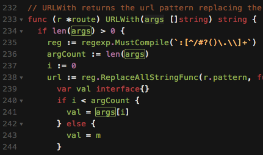

This is a feature I first saw in [Sublime Text](www.sublimetext.com/) that I
really liked when reading code because it allowed me to easily spot where a
variable or function is being used.

Also, `Cmd-Enter` () / `Ctrl-Enter` (Windows) inserts a line below even if you
are in the middle of the current line. This is useful when you are making an
edit in the middle of a line and want to start a new line.

### Remembering what you said

All of the settings above are saved and shared across all your boxes, even new
ones, so you don't have to re-configure your IDE all the time.

### We're not done yet

We want to make the Web IDE better: tell us how we can do better by chatting
with our team in our [chatroom](https://www.nitrous.io/chat) or by
[emailing us](mailto:support@nitrous.io).

We recently shipped some [new themes](/2014/05/02/new-themes-available-for-web-ide.html)
as well, so do try them out and be sure to let us know if you have a favorite
theme you'd like us to add.
