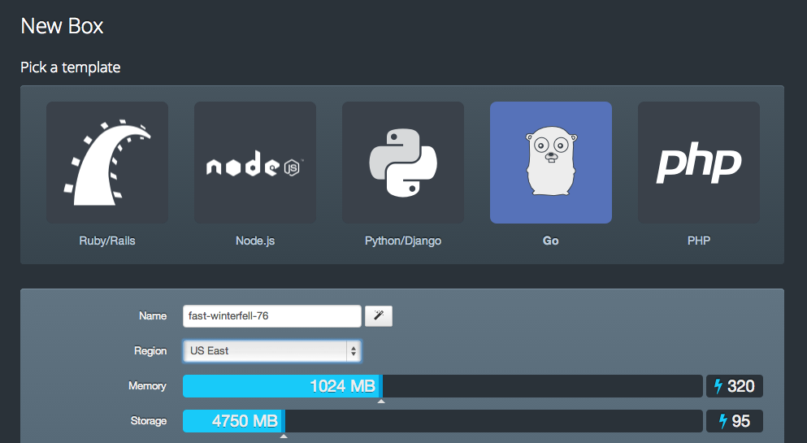
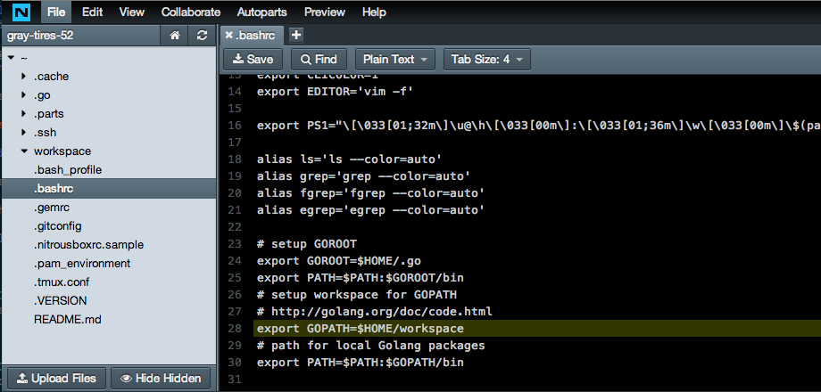
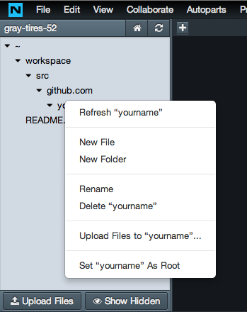
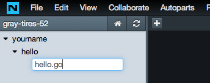
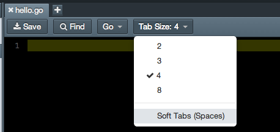
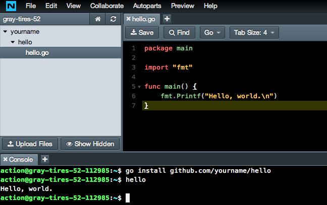

When starting to learn [Golang](http://golang.org), understanding the nuances in [organizing and handling code](http://golang.org/doc/code.html) will take some extra effort.
Though these conventions might feel strange at the beginning (especially if you're switching from another language), embracing them will ease your path to language mastery.

To help you to start coding easily while following the conventions, [Nitrous.IO](https://nitrous.io?{{page.utm}}) offers a pre-configured Go template.
All you need to do is [sign up for a free account](https://nitrous.io/join?{{page.utm}}) and create a box with the Go template.



## Understand Go Workspaces

According to [Golang's coding conventions](http://golang.org/doc/code.html) all code should reside inside a workspace. This workspace is set via the `GOPATH` environment variable.

Open the web IDE of your newly created box, switch to the console and type `echo $GOPATH`.


You will see `GOPATH` is already set for you and it points to the `workspace` directory inside your box.

## Set the Go environment

Let's find out where the `GOPATH` and other Golang related environment variables are set in your box. In the IDE, click the `Show Hidden` button under the file tree. This will reveal bunch of dotfiles.
Click on the `.bashrc` file and scroll down to the bottom.



Out of those variables, `GOROOT` is interesting. This points to the location where Golang run time is installed in your box (`~/.go`). If you want to upgrade to the latest version of Go, you can download it and set the `GOROOT` to point to the newer version.
The default version that comes with the box is good enough for you to get started, so you don't need to worry about changing it for now.

You will also see `$GOPATH/bin` is appended to the `PATH`. This allows you to easily execute any Golang programs you build, by just typing program name in console.

## Writing code

Since the stage is set, let's get to the fun part - writing code. All Golang code must be wrapped in a package and each package must have its own unique base path to avoid collisions with other packages.
Recommended convention is to use the URL of the source repository you'd host the code for the base path. For example, if you are planning to publish your code in GitHub account, then it make sense to set your base path as `github.com/yourname`.

To create the base path, run the following command in the console:

    mkdir -p ~/workspace/src/github.com/yourname

Also, to easily access your package files in the editor, you can set the base path as the root in file tree.



Now let's try to write and execute a simple hello world program.

Under the base path, create a new directory called `hello`. Then inside this directory create a new file named `hello.go`.



Click on `hello.go` to open it in the editor. You will see syntax highlighting is already set to Go.
Since Golang prefers tabs over spaces indentation, let's uncheck 'Soft Tabs' option in the editor to use actual tabs.



Enter the following code in the editor and save.

```go
  package main

  import "fmt"

  func main() {
    fmt.Printf("Hello, world.\n")
  }
```

As you may have already guessed when built and executed, this should output "Hello, world." in the console.

## Building and executing program

We can use `go install` command to build and install the program we just wrote. In the console, type:

```
  go install github.com/yourname/hello
```

You will notice that you can run this command from any path and Go tools will smartly pick the right package to build. This is one of the advantages of sticking with Golang's workspace conventions.

The `go install` will create a `bin` directory inside the `workspace` directory and place the compiled binary of the program inside it. Since `~/workspace/bin` path is already available under `PATH`, we can simply execute the program by running `hello`.



## Formatting the code

It's [recommended](http://blog.golang.org/go-fmt-your-code) that you use `gofmt` tool to automatically format your code before publishing. You can run it from the console:

```
  cd ~/workspace/src/github.com/yourname/hello/
  gofmt -w *.go
```

You can also go one step further and add a [Git pre-commit hook](http://tip.golang.org/misc/git/pre-commit) to prevent incorrectly-formatted Go code from being committed. The sample pre-commit hook script is available in `~/.go/misc/git/pre-commit`.
You will need to copy it your repo and set it as executable:

```
  cp ~/.go/misc/git/pre-commit .git/hooks/pre-commit
  chmod +x .git/hooks/pre-commit
```

## Managing Multiple Projects

As you start to work on multiple Golang projects, sharing same workspace with multiple package dependencies might start to look tedious.
If you prefer to have isolated workspaces per project, Nitrous.IO offers [paid plans with multiple boxes](https://nitrous.io/pricing?{{page.utm}}) starting at $19.95 per month.

## Grow with the Community

Another amazing fact about Golang is the helpful and enthusiastic [community](golang.org/help) around it. I have had really good experiences with *#go-nuts* channel on *irc.freenode.net*.
If you got any Nitrous.IO related questions, you can also ask them on [Stack Overflow](http://stackoverflow.com/questions/tagged/nitrousio) by adding the **nitrousio** tag to the question.
