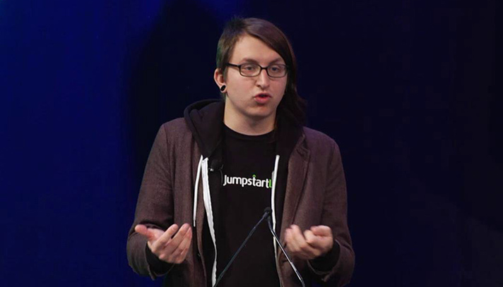

### Who are you and what do you do?

Hi there, I'm [Steve](https://twitter.com/steveklabnik). *waves*

Most of my life I have written code for computers, but I've slowly
transitioned to writing more words for humans instead. Sometimes, the
words for humans are even about computers!

When I'm [writing code](https://github.com/steveklabnik), it's quite often Ruby, as I maintain a lot of
gems and work on Rails. But it's increasingly been more [Rust](http://www.rust-lang.org/) lately
instead, and I'm pretty psyched about that.

I also like to read books. Mostly by those [French philosophers](http://words.steveklabnik.com/protological-control-an-introduction) that
you probably get really annoyed with, or at least the people who talk
about French philosophers at parties. If I come to your party, there's
only a 60% chance I'll reference some random French philosopher, don't
worry.
<!--break-->
### What hardware do you use?

I have two computers, and would like to acquire a third.

The first is a [Chromebook Pixel](http://www.google.com/intl/en-US/chrome/devices/chromebook-pixel/). I don't even have Crouton on it. I
like the Pixel because I'm interested in having the web browser
eventually merge with the operating system, and ChromeOS is the
closest we have to that yet. So I'm dogfooding.

My other computer is an [X1 Carbon](http://www.lenovo.com/us/en/solutions/x1carbon.shtml). It's awesome because it's the
opposite of a black box: it's running Linux, and I have exactly what I
want on it. Well, right now I have Ubuntu because I accidentally
messed things up when I tried to update glibc... such is the life of a
Linux machine.

I'd like to get a [Gluglug X60](http://shop.gluglug.org.uk/product/ibm-lenovo-thinkpad-x60-coreboot/) soon, and have a computer with 100% Free
software. Then I'd have the full spectrum: an appliance, a totally
open machine, and one somewhere in the middle.

### What do you code on [Nitrous.IO](https://www.nitrous.io?{{page.utm}})?

Mostly [Ruby](https://www.ruby-lang.org/en/) stuff. Nothing too exciting, to be honest. It just works like
everything else.

### What aspects of [Nitrous.IO](https://www.nitrous.io?{{page.utm}}) do you love the most?

I know how to administer a computer well enough. But I don't want
to. [Nitrous.IO](https://www.nitrous.io?{{page.utm}}) allows me to just say "I want to code some Rails now,
kthx" and not have to worry about getting all the details straight.
Sometimes, I care about the details, but most of the time, I don't.

Also, when I think about pair programming via shared tmux on some VPS
vs. Nitrous's [sharing features](http://help.nitrous.io/collab?{{page.utm}}), I appreciate [Nitrous.IO)](https://www.nitrous.io?{{page.utm}}) a lot.

### What’s your dream dev environment setup?

My dream setup is a computer that just works. I don't think that it
exists, but I can dream.