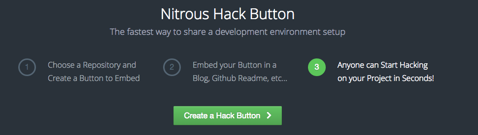
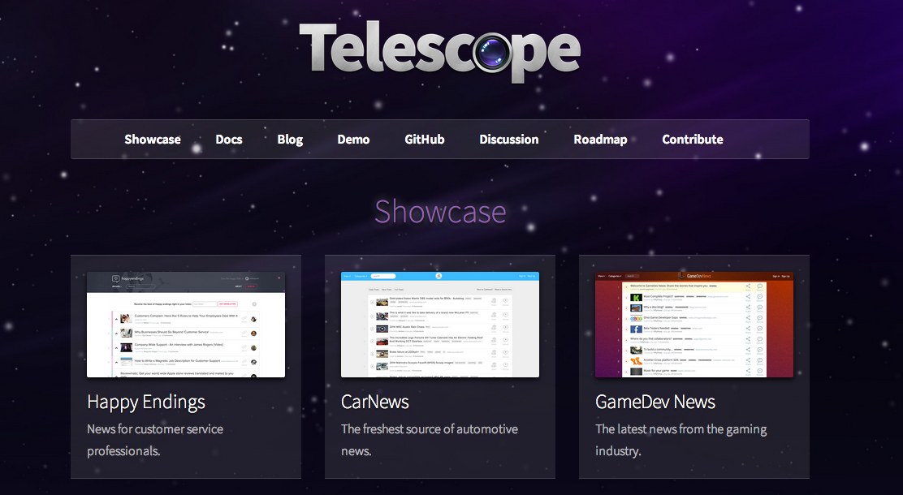
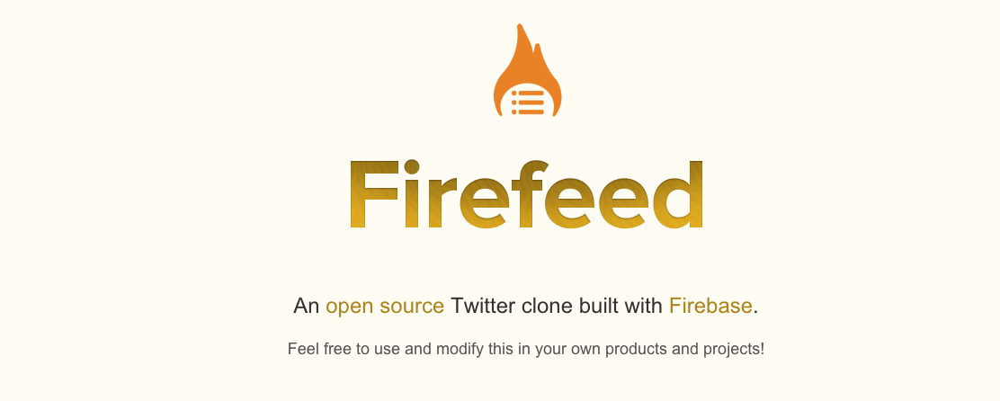

We launched [Hack on Nitrous.IO](https://www.nitrous.io/hack?{{page.utm}}) in April and were surprised by the groundswell of support and adoption from various partners and open source projects. Almost 3000 individual repos were cloned over 6000 times using an [embedded hack button](https://www.nitrous.io/embed?{{page.utm}}) in the project repo on GitHub or the [Bookmarklet.](https://www.nitrous.io/hack#bookmarklet?{{page.utm}})

So with out further ado, here are the most popular projects that Nitrous.IO users cloned over the last six months:

<!--break-->

### Meteor and Meteor Apps

Nitrous.IO remains a popular way to create and customize Meteor Apps. This is not much of surprise since Nitrous.IO makes it incredibly easy to build meteor Apps on any machine especially Windows machines.

Examples from Author [Sacha's Greif's](http://sachagreif.com/?{{page.utm}}) book, [Discover Meteor](https://www.discovermeteor.com/?{{page.utm}}) were some of the post popular clones on Nitrous.IO. Sacha tells us that both the Book and Microscope, the example app, have been updated for the upcoming Meteor 1.0 release.

Customizing [sample apps from MeteorJS](https://www.meteor.com/examples) and the Telescope app was another popular use of the Hack Button. The [Telescope Showcase](http://www.telesc.pe/showcase?{{page.utm}}) demonstrates what can be done with that template.

If that inspired you, you can start [hacking on your own creation based on Telescope on Nitrous.IO.](https://www.nitrous.io/hack_button?source=embed&runtime=nodejs&repo=TelescopeJS%2FTelescope&file_to_open=README.nitrous.md&{{page.utm}})

### Rails Starter Apps and Ruby Workbooks

[Nitrous.IO](https://nitrous.io/join?{{page.utm}}) is built on Rails and the Rails community was one of the first to embrace the convenience and simplicity of Nitrous.IO to build their rails based projects.

One of the more popular rails repos is [Rails Apps](http://railsapps.github.io/?{{page.utm}}), an open source project that many people use to get started creating, well, Rails applications. Led by Daniel Kehoe, author of the book [Learn Ruby on Rails](http://learn-rails.com/learn-ruby-on-rails.html?{{page.utm}}), Rails Apps, is an interesting experiment where subscribers get access to in-depth tutorials and walk throughs of the open source code through a subscription model. [Starting Hacking on Rails-Devise-Pundit App on Nitrous.IO](https://www.nitrous.io/hack_button?source=embed&runtime=rails&repo=RailsApps%2Frails-devise-pundit&file_to_open=nitrous.txt)

Nitrous.IO hack button is also being used extensively by a variety of students who are learning to code.  One such example is the [Ruby Calisthenics Repo](https://github.com/saasbook/ruby-calisthenics) - a set of exercises to teach basic Ruby coding and RSpec, the unit testing tool as a part of the larger [Engineering Software as a Service: An Agile Approach Using Cloud Computing MooC](http://beta.saasbook.info/courses) by y Profs. Armando Fox & David Patterson.

### Real Time Apps With Firebase

Finally, [Firebase](https://firebase.com?{{page.utm}}) eliminates the hassle of having to write your own backend for realtime syncing apps. Firebase's example and seed apps were among the most popular Hack on NitrousIO repos during the last six months.

[Firefeed](https://github.com/firebase/angularfire-seed?{{page.utm}}) showcases Firebase's realtime sync capability in a web app that lets users post small messages to their feed. [AngularFire Seed](https://github.com/firebase/angularfire-seed?{{page.utm}}) is Firebase's seed app to get you to get going on integrating Firebase into an angular app.

### Put a Hack Button On It

Well that's it for this edition of popular repos on Nitrous.IO. If you have sample code that you want to let other people easily hack on your project's code consider [adding a hack button to your repo to your repository.](https://www.nitrous.io/embed?{{page.utm}})
