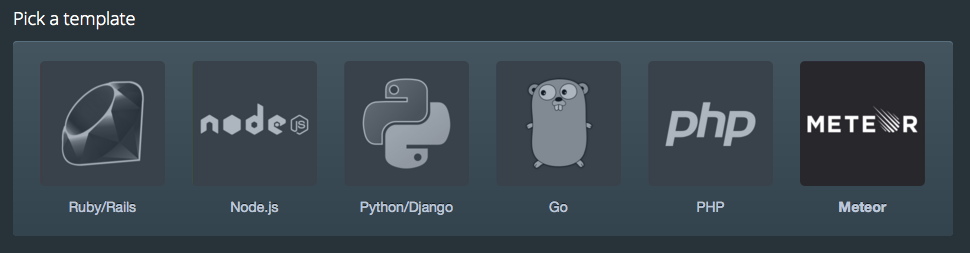

Congratulations to the Meteor team for reaching 1.0! It has been exciting to witness the amazing progress the Meteor team has made on the framework. We've supported many thousands of Meteor developers on Nitrous.IO and are only seeing those numbers skyrocket as Meteor approached its 1.0 release.

For those whom haven't had the pleasure of trying it yet, [Meteor](https://www.meteor.com) is an open source platform for building web and mobile applications solely using JavaScript. Meteor applications have live-updating interfaces that let people see information and collaborate with each other in real time, and can run in a browser or be installed on any mobile device from the app store.

To celebrate the 1.0 milestone we've added a custom Meteor template to our box creation page. When creating a new box you will see an option to select a Meteor template.

Simply select the Meteor template to create a development environment with Meteor 1.0 installed. Take a look at [Meteor's new
guide](https://www.meteor.com/try) to build your first Meteor app using 1.0.

If you want to try out a sample application, you can start hacking on [Discover Meteor's
Microscope](https://github.com/DiscoverMeteor/Microscope) application by clicking the **Hack** button below.

