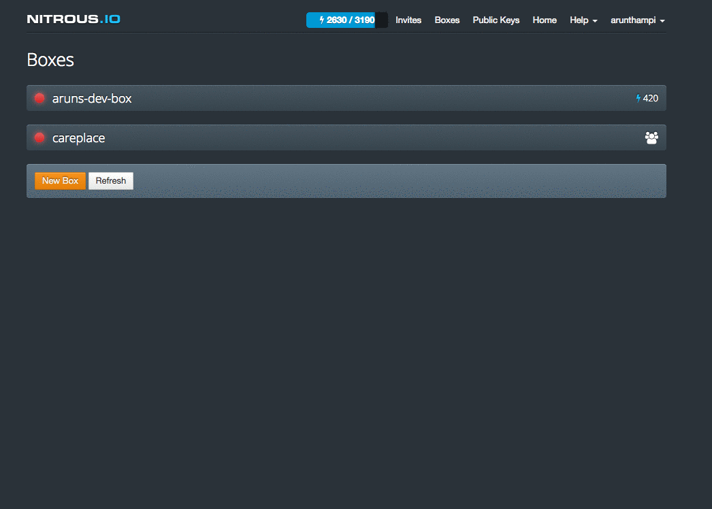

Nitrous.IO is the fastest and easiest way to setup and start working on a new web application. Our recent [Meteor template](/2014/10/28/meteor-template-on-nitrous-io.html) launch is yet another example of our commitment to providing developers the latest versions of the hottest frameworks.

After creating a box with one of our public templates, developers often install additional services on top. Common installations include databases like MySQL, Postgres, or MongoDB. We make these services easy to install and configure with our [Autoparts](http://help.nitrous.io/autoparts/) package manager. Some users will also customize their [dotfiles](http://dotfiles.github.io/) to get their perfect development workflow in place.

Our mission at Nitrous.IO is to reduce the amount of setup and complexity when dealing with your development workflow. With that in mind, we're excited to announce the availability of [Private Box Snapshots](http://help.nitrous.io/snapshots?{{page.utm}}) on all [Shift and Turbo paid accounts](https://www.nitrous.io/pricing?{{page.utm}}).

With snapshots, you can set your own custom starting point for new boxes. If you're a consultant, this means you can start each new project with a clean environment pre-configured just the way you like it. If you teach a class, you can start with a master template and duplicate it for each of your students. And finally, if you're a fast growing startup making changes to the Dev stack regularly, you can keep your team happy and ship faster by capturing and sharing an entire Development Environment with the whole team at the click of a button.

If you're a large team or class who needs more boxes than the current plans allow please reach out to
us: [hello@nitrous.io](mailto:hello@nitrous.io?subject=Private%20Snapshots)

NitrousIO Box Snapshots are available on the [Shift and Turbo plans!](https://www.nitrous.io/pricing?{{page.utm}})
  
