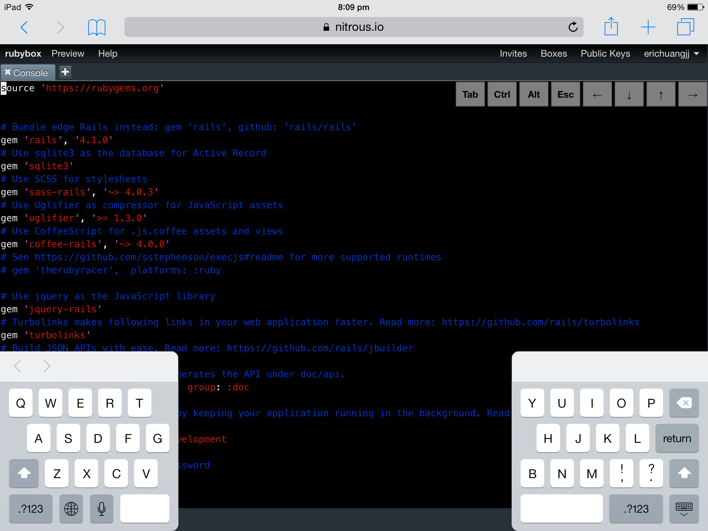

Many developers dreamt of turning their iPad into a full-fledged development machine. It’s the promise of freedom to work on the go and not being chained to a primary machine that’s too heavy to carry along. No doubt, coding on iPad has also been a facet of Nitrous.IO’s vision. Pete, our CTO, had always wanted to [develop on his iPad](https://www.firebase.com/blog/2013-12-03-nitrousio-interview.html) before Bluetooth keyboards were even sold on the market.
 
While the iPad itself is still in its infancy as a dev machine, it is a viable option when coupled with cloud IDE platforms like [Nitrous.IO](http://www.nitrous.io?{{page.utm}}). In a way, we have fast-forwarded into the future as our cloud IDE transforms iPads (and [Chromebooks](https://chrome.google.com/webstore/detail/nitrousio-web-app/kcbmakmdbnehgbakmgibcpjpafenmohd?hl=en), for that matter) into powerful software development tools. This translates into workspace accessibility, as you can work across devices while using the same, consistent development environment, maintained in the cloud.
 
 
##Benefits of Coding on iPad

Be that as it may, do note that Nitrous.IO’s support for iPad is still experimental i.e. things might still break. However, it is more than sufficient for small edits and bug fixes. Here are some of the benefits we find coding on iPad provides –
 
- **iPad is the ideal contingency plan while on vacation/on-the-go.** Whenever you need to travel light or happen to be on the move, you can just take your iPad with you instead of a clunky laptop. The need to code on the fly can switch from non-existent to that of utmost immediacy in a matter of seconds whenever a complication arises.  Make a quick code edit/bug fix regardless of where you are, without having to cut short your vacation plans. 

- **No complicated setup required, just code from your browser for free.** There are several paid iOS apps out there that allow coding on iPad. But with Nitrous.IO, no installation is required, just code off a box within your browser itself.

- **Consistent development environments regardless of your primary machine’s OS.** Whether you are a Windows/Mac/Linux user, you can set up similar development environments in the cloud, without worrying about wrestling with different environments across devices.
 

##Caveats

Alright, that’s enough self-plugging. Here comes the trade-offs.

- **You can only use Editors with Console support in Nitrous.IO for iPad.** This means that Nitrous.IO’s built-in File Directory and Editor won’t be available in iPad mode. But if Vim, Emacs and Nano happen to be your tools of choice, you’re in luck.

- **iPad’s native keyboard eats up much of your screen’s real estate.** This can be an annoying hindrance especially if you code for longer lengths of time. That being said, it can be gotten used to if you’re just making a quick bug fix/code edit. A quick get-around is purchasing a Bluetooth keyboard or using the native virtual keyboard in split-pane mode. For your convenience, we built a Softkey panel with shortcuts for tab, ctrl, alt, esc and directional keys, which don’t appear on the virtual keyboard.
 
All things considered, if you think you can’t live with these shortcomings, there are great choices out there such as Textastic, Diet Coda, iOS Vim + Firebug Lite. Check out our tutorial post on using [Diet Coda with Nitrous.IO](http://blog.nitrous.io/2014/01/22/nitrous-io-3-diet-coda.html). However, these options might be costly and take time to install and set up.
 
 
##Go Mobile

So, yes, it’s not perfect, but it’s pretty great if you’re looking for a simple, fast and free solution to coding on iPad. [Sign up for a free account](http://www.nitrous.io?{{page.utm}}) and follow our [iPad tutorial](http://help.nitrous.io/coding-on-ipad/) to experience the benefits of developing on iPad for yourself.  Share with us your experiences, we’ll send you some swag (hoodie & stickers) if your story happens to be published on our blog!
 
Now the question is, whose iPad are you going to filch if you didn’t even bring that on vacation? And if you have children or teenagers, try not to start a family drama.
 
