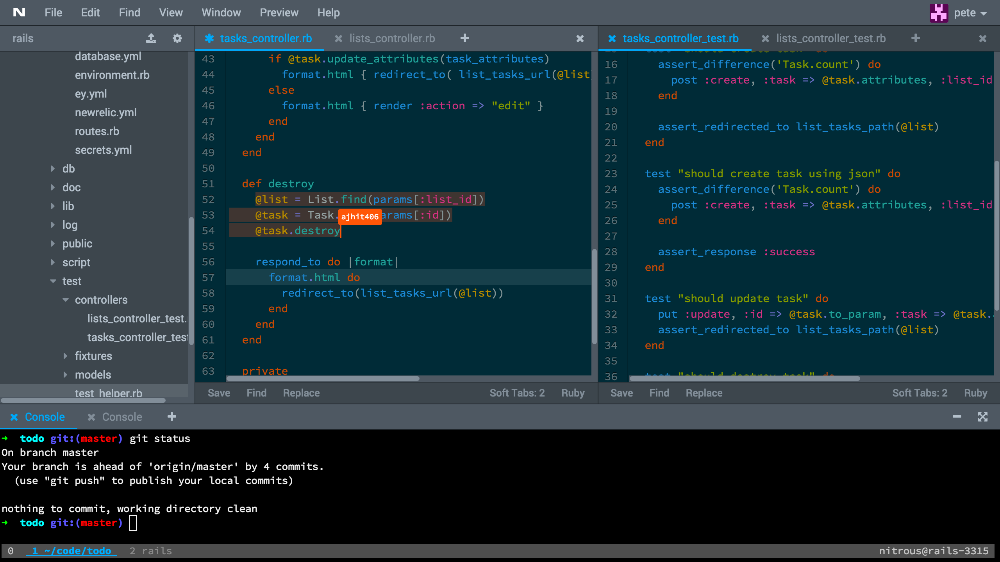

<h1 class="logo" style="text-align:center;">Nitrous</h1>

  <h3 style="padding: 0;margin-bottom:5px;">Nitrous Releases Professional Software Development Platform</h3>
  <h4 class="subheader" style="padding: 0;margin: 0 0 16px; font-size: 14px;color:#888;">Pro Cloud-Based IDE Launches with Real-Time Collaboration, Root Access and Docker Integration</h3>

 

SAN FRANCISCO, CA – (April 22, 2015) Nitrous today released [Nitrous Pro](https://pro.nitrous.io), a cloud-based software development platform designed for professional software developers. Building on the tremendous success of its [free version](https://lite.nitrous.io), the company has designed Nitrous Pro to meet the growing demand for powerful and secure software development environments that streamline sharing and collaboration.

As the only professional-grade cloud-based development environment platform, Nitrous Pro features full support for [Docker images](https://index.docker.io), [desktop file system synchronization](https://pro.nitrous.io/features), full Linux shell environment, split pane editing, and [real-time collaboration](https://pro.nitrous.io/features). Dedicated resources with root access make Nitrous Pro the most secure cloud-based development platform. Since 2013, over 200,000 people have registered and built applications using the first free version of Nitrous. Users included everyone from undergraduates learning to code, to professional developers at start-ups and consultancies, government and large enterprises.

Standardization of project environments is a key challenge for software developers working in distributed teams. Nitrous Pro allows developers to use pre-built templates for over 90 programming languages and frameworks including Go, Ruby, Python and Javascript. Developers can save and share their own customized environment as a team template for consistency. Nitrous Pro also launches with full support for Docker container management. With over 300 million downloads and over 33,000 related projects on Github, Docker is becoming hugely popular with developers.

Seamless real-time collaboration is a key feature of Nitrous Pro. Developers can invite anyone to their workspace and start coding together in a full development environment. Developers can also provide teammates temporary or permanent access to a workspace, enabling flexible collaboration.

> “Collaboration is so central to the software development experience that developers go to great trouble to do this today. Nitrous Pro’s powerful cloud environments make sharing development environments a breeze. And this isn’t just techno-rhetoric: Every engineer on our team uses Nitrous Pro exclusively to build Nitrous Pro. This ‘dogfooding’ means that you can expect an already great product to get even better, virtually every day.”

&mdash; Andrew Solimine, co-founder of Nitrous.

> “Highly distributed development teams are a challenge for large enterprises. Project teams with the right skills and access to the right tools and environments will span locations and timezones, complicating collaboration. Nitrous is built from ground up to solve collaborative development challenges, giving all developers access to the powerful tools and environments they need for picking up new skills, developing and testing, and enabling team members to work together real-time in the style of Google Docs or Etherpad. By allowing developers to share common templates for projects and environments, we can ensure teams are working with the same libraries, dependencies, and best practices, reducing integration risk, saving time and money,”

&mdash; Richard Tibbetts, former CTO at TIBCO Software (TIBCO Software is an investor in Nitrous).

 
<h4>About Nitrous</h4>
Nitrous provides powerful, fast, preconfigured development environments in the cloud. Developers can create and start programming in a brand new PHP, Java, Node.JS, Python, Ruby or Go development environment - in a matter of seconds - from any modern browser or using their favorite desktop editors. Rich collaboration features enable developers worldwide to work together while using the individual tools they love combined with the convenience of cloud. Over 200,000 developers have created, used, and shared Nitrous development environments for professional, open-source, and personal projects. Sign up at [www.nitrous.io](https://www.nitrous.io). Learn about product updates and announcements via Twitter [@nitrousio](https://www.twitter.com/nitrousio). Read more on our blog at [blog.nitrous.io](https://blog.nitrous.io).

<h4>Attachments</h4>

