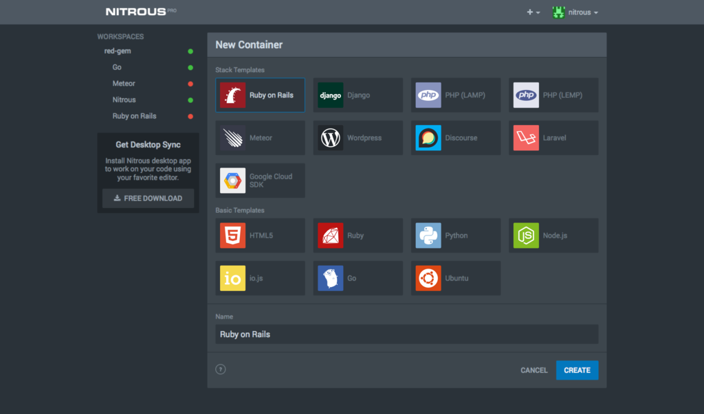

At Nitrous we believe the software development process is faster and more enjoyable when developers can easily connect and work together from anywhere in the world. We’ve been hard at work the past few months improving the everyday experience on the [Nitrous platform](https://www.nitrous.io). Today, we’re excited to share a few of the exciting changes of a new product we’re calling Nitrous Pro. 

 
<a class="btn btn-success ripple" data-ripple-color='rgba(255,255,255,.1)' href="https://pro.nitrous.io/app/#/signup?promo=PRO10">Sign up today and get $10 in free credits</a>

#### Dedicated Resources with Root Access

Each workspace on Nitrous Pro runs on its own dedicated virtual machine. Workspaces are more secure, and top-notch performance is guaranteed. Dedicated resources mean that our workspaces are also root-safe, so you can install everything you need.

#### Dogfooding

One of our biggest goals as a company was to get to the point where we could build Nitrous Pro entirely using [Nitrous Pro](https://pro.nitrous.io/app/#/signup).  We’re very proud to announce that the Nitrous team now fully develops Nitrous Pro using Nitrous Pro. 

We think dogfooding is absolutely the best way to build the best products; so much so that we’ve made it a company requirement -- everyone on our team has to use Nitrous Pro to build Nitrous Pro. This means you can expect an already great product to get even better, virtually every day. 

#### A New, Powerful Cloud IDE

<video autoplay="autoplay" loop="loop" muted="true">
 <source src="https://nitrous-image-icons.s3.amazonaws.com/nitrous-pro-collab.webm" type="video/webm">
 <source src="https://nitrous-image-icons.s3.amazonaws.com/nitrous-pro-collab.mp4" type="video/mp4">
</video>

The [Nitrous Pro IDE](https://www.nitrous.io/features/) is faster, more functional and more beautiful than ever. Our new IDE includes split pane editing, file watching, support for additional themes, and live collaboration. It’s incredibly easy to invite teammates to your workspace and start coding together in a fully-loaded development environment. You can give teammates temporary or permanent access to your workspace, allowing collaboration whenever is best for them.

#### Expanded Template Library 

We’ve also added support for a number of [new stack templates](https://www.nitrous.io/stacks/), including the [Google Cloud SDK](https://cloud.google.com/sdk/), [Discourse](http://www.discourse.org/), [Meteor](https://www.meteor.com/), [Laravel](http://laravel.com/) and more. We’ll be adding support for other popular frameworks and languages in the coming weeks.  

#### Transitioning to the new Nitrous Pro Platform 

With the launch of Nitrous Pro, we will be phasing out support for the original Nitrous product on July 1st 2015. We are extremely confident that you will find Nitrous Pro a much better fit for your needs, as we’ve improved every aspect of the experience. There is a free tier available on Nitrous Pro that will allow you to utilize the platform up to 2 hours per day without paying or needing to add a credit card. You can read more about migrating your boxes to your new Nitrous Pro workspace [here](http://docs.nitrous.io).  

If you’re running a class or workshop using the original version of Nitrous, we’re happy to help you transition to the new system and work with you personally to leverage all the new benefits. Please email us at [pro@nitrous.io](mailto:pro@nitrous.io) to learn more. 

We’re super proud of the new [Nitrous Pro](https://pro.nitrous.io/app/#/signup?promo=PRO10) platform, and hope that the changes help you work better than ever before. We’d love to hear what you think!

You can send us feedback directly via email at [pro@nitrous.io](mailto:pro@nitrous.io). Or tweet at #nitrouspro and <a href="https://twitter.com/nitrousio">@nitrousio</a>.

