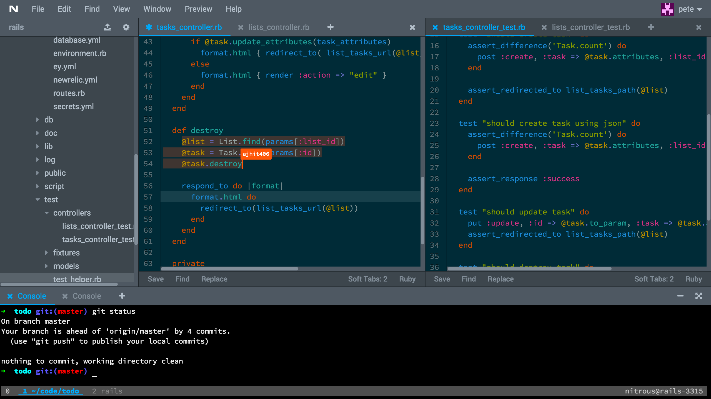

We [recently announced](http://blog.nitrous.io/2015/04/22/introducing-nitrous-pro.html) that we will be sunsetting the original Nitrous product in favor of our new Nitrous Pro offering.

We worked hard to ensure that [Nitrous Pro](https://pro.nitrous.io) has all of the great features you loved in the original Nitrous product, and we’ve added a ton of improvements. Below you’ll find most of the details you need regarding Nitrous Pro and the migration. If there’s something missing, please [send us an email](mailto:support@nitrous.io).

 

#### __What are the biggest differences between Nitrous Pro and the original Nitrous (Nitrous Lite)?__

[Nitrous Pro](https://pro.nitrous.io) is a completely new and separate platform that requires a [new account login](https://pro.nitrous.io/app/#/signup). The biggest difference is that Nitrous Pro runs on your own, dedicated cloud machine. This enables us to provide root access to all users, and also improves stability and performance across the board.

We’ve also made [a ton](https://pro.nitrous.io/features) of other improvements to the IDE, collaboration, as well as added first-class Docker integration for advanced users.

#### __How long will I be able to access my old Nitrous account?__

Your old Nitrous account will be accessible at [https://lite.nitrous.io](https://lite.nitrous.io) until we sunset the old product on July 1st, 2015. If you have files that you would like to move to Nitrous Pro, you can read about migration options here:

[http://docs.nitrous.io/v1.0/docs/migrate-your-data-to-the-new-platform](http://docs.nitrous.io/v1.0/docs/migrate-your-data-to-the-new-platform)

If you were using the original Nitrous (Nitrous Lite) for a workshop or class, [please contact](mailto:pro@nitrous.io) us and we will discuss migration options for your class and students.

####  __Can I still sign up for a paid plan on the original Nitrous?__

As of Wednesday April 22nd, you can only purchase paid plans on Nitrous Pro. Pricing plans on Nitrous Pro are less expensive, and the platform is significantly improved across the board, so we are requesting all paid users to migrate to the new platform. We are confident that you will enjoy your experience with the new Nitrous Pro platform.

#### __Will my account be converted to Pro automatically?__

Your account will not be converted automatically. Nitrous Pro and Nitrous Lite (the original Nitrous) are completely separate products. You will need to create a new account for Nitrous Pro. If you are having trouble [creating a new account](https://pro.nitrous.io/app/#/signup) or you are a paid user on Nitrous Lite, please [send us an email](mailto:pro@nitrous.io).

#### __Do I need to migrate my boxes to Nitrous Pro?__

We provide all of the same starter templates on Nitrous Pro that we had on previous versions, so you are not required to migrate boxes. If you have some customizations that you would like to migrate, you can check out this help article with more details:

[http://docs.nitrous.io/v1.0/docs/migrate-your-data-to-the-new-platform](http://docs.nitrous.io/v1.0/docs/migrate-your-data-to-the-new-platform)

If you made specific customizations that you’re having difficulty getting up and running on Nitrous Pro, [please contact us](mailto:pro@nitrous.io).

#### __I'm an educator and you just borked my workflow! What do I do now?__

We will continue to support educational organizations with Nitrous Pro and do have a free tier available, especially for qualified educational, not-for-profit organizations. Please [contact us](mailto:pro@nitrous.io) so we can set up your organization with the appropriate transition plan.

#### __I’m a paid user on the original Nitrous (Nitrous Lite). How do I move to Nitrous Pro?__

You will need to create a completely [new account on Nitrous Pro](https://pro.nitrous.io/app/#/signup), and then you will need to [cancel your account](https://lite.nitrous.io/app#/account) on the original Nitrous.

#### __How will pricing change?__

Individual pricing plans on Nitrous are currently [$15, $30, and $65](https://pro.nitrous.io/pricing) for Basic, Standard, and Pro plans respectively. Please note that not only are the prices for Nitrous Pro lower than our old Nitrous lite plans but also that your cloud workspace is on a dedicated machine with root access and significant IDE and collaboration improvements.

#### __In what ways did you improve the IDE?__

We’ve added split pane editing, a more intuitive collaboration workflow, additional themes, better GitHub integration, and have generally streamlined the design to allow for more focus on your code. More details on Nitrous Pro features can be found here:

[https://pro.nitrous.io/features/](https://pro.nitrous.io/features/)

#### __How does the free plan work on Nitrous Pro?__

Providing dedicated cloud virtual machines to hundreds of thousands of developers while maintaining superior performance is a difficult technical problem. A minority of users also unfortunately don’t follow our [terms of service](http://help.nitrous.io/admin-terms/), which makes providing an unlimted free tier a difficult task.

In an effort to maintain the best user experience for all of our users, the free workspace on Nitrous Pro is limited to 2 hours of usage per day, and then will automatically shut down. We also require free users to verify themselves with a mobile phone number, to restrict the amount of abuse on free accounts.

We’ve found the 2 hour limit is sufficient for a reasonable amount of usage and enables most developers to benefit from the system while still allowing us to provide the best experience possible.

If you are using Nitrous for more than 2 hours per day, we hope you consider a paid subscription with unlimited hours.
  