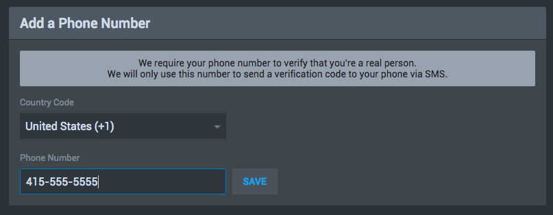

We [recently announced](http://blog.nitrous.io/2015/04/22/introducing-nitrous-pro.html) that we will be sunsetting the original Nitrous product in favor of our new [Nitrous Pro](https://pro.nitrous.io) offering. The original product, [Nitrous Lite](https://lite.nitrous.io) is a freemium product that allows anyone to create a free cloud development environment.

The new platform refines our free tier in order to provide the best possible development experience for our active users. This required a few small, but important to understand changes.

#### __Orders of Magnitude Better__

At Nitrous, we believe that developing in the cloud is the future. Consistent environment templates help your team focus on their code and not their development machines. Cloud infrastructure allows your organization to scale up computing power for developers on demand without waiting to purchase new machines. Developers can also work from anywhere and collaborate in real-time with anyone in the world.

In order for the cloud development movement to succeed, we know that your experience has to be _orders of magnitude better_ than your experience with your own computer. And at the foundation of that improvement is to provide superior stability and performance.

As a public PaaS, Nitrous manages all of the infrastructure required for your projects. Maintaining scalable cloud infrastructure for hundreds of thousands of users comes at a considerable cost, in both dollars and the time it takes our operations and system engineers to ensure things are running smoothly.

 

(Not our actual data center, but it looks something like this)

#### __Nitrous Pro Free Tier__

Providing dedicated cloud virtual machines to hundreds of thousands of developers while maintaining superior performance is a difficult technical problem. A minority of users also unfortunately don’t follow our terms of service, which makes providing an unlimited free tier a difficult task.

The free workspace on Nitrous Pro is limited to 2 hours of usage per day, and then will automatically shut down. We will alert you at set intervals before your workspace is going to shutdown to allow you to wrap up your work for the day.

In addition to limiting the duration of use, we also require users to verify themselves with a mobile phone number, to restrict the amount of abuse on accounts.

Phone verification screen

We’ve found the 2 hour limit is sufficient for a reasonable amount of usage and enables most developers to benefit from the system while still allowing us to provide the best experience possible.

If you are using Nitrous for more than 2 hours per day, we hope you consider a [paid subscription](https://pro.nitrous.io) with unlimited hours.