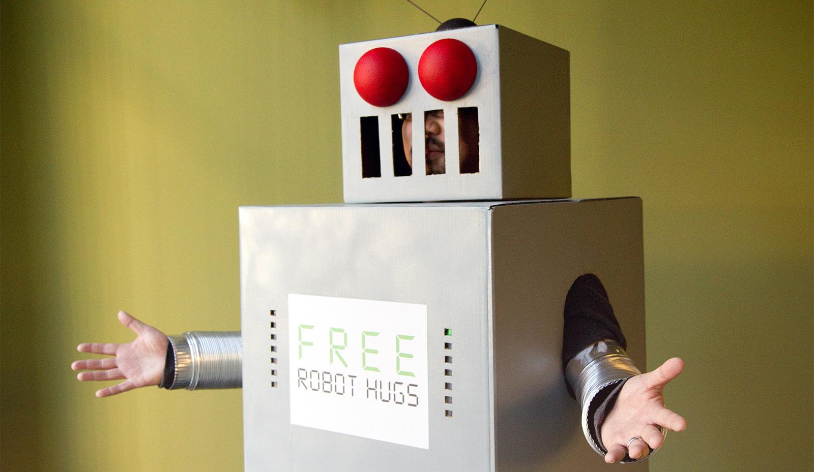

<small style='display: block; text-align: right'>Photo Credit: [Ben Husmann](https://flic.kr/p/8NYffe)</small>

It's been two months since we launched Nitrous Pro and we have been very excited about the response so far. Feedback has been very positive, from both existing users of Nitrous Lite and newcomers to the Nitrous experience.

Unfortunately, not all user comments have been rainbows and unicorns...

The time limit on the free tier was something that many people found really frustrating, and we really want to fix that. That's why we are so happy to announce that, starting today, [**there is no time limit on the free tier**](https://pro.nitrous.io/app/#/signup?{{ page.utm }})

#### **What's changed?**

There will no longer be a daily time limit applied to free tier users! Instead, when you first log in for the day you'll see a slight delay (usually 30-60 seconds) before your workspace becomes available.

If you don't use your workspace for a while it will be powered off, but when you come back everything should be (mostly) as you left it.

#### **When will this go live?**

It's live now! Just [log in](https://pro.nitrous.io/app/#/login?{{ page.utm }}) or [sign up for a free account now!](https://pro.nitrous.io/app/#/signup?{{ page.utm }})

#### **What happens when my workspace shuts down?**

When your workspace powers off it will stop all running processes. Everything you've saved to disk will stay exactly as is, but any programs that were running (including GNU screen and tmux) will be stopped.

This also means that Preview URLs will no longer be available since the web server will no longer be running.

#### **What happens if I lose my internet connection?**

It depends on how long your connection is down. The amount of time we wait before powering off an unused workspace is variable, but you can generally assume that if you're back within 10-15 minutes the workspace will still be running. If it's longer than that, you might need to wait for it to be started back up.